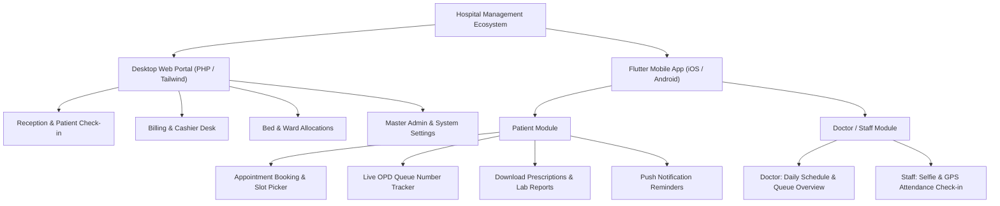
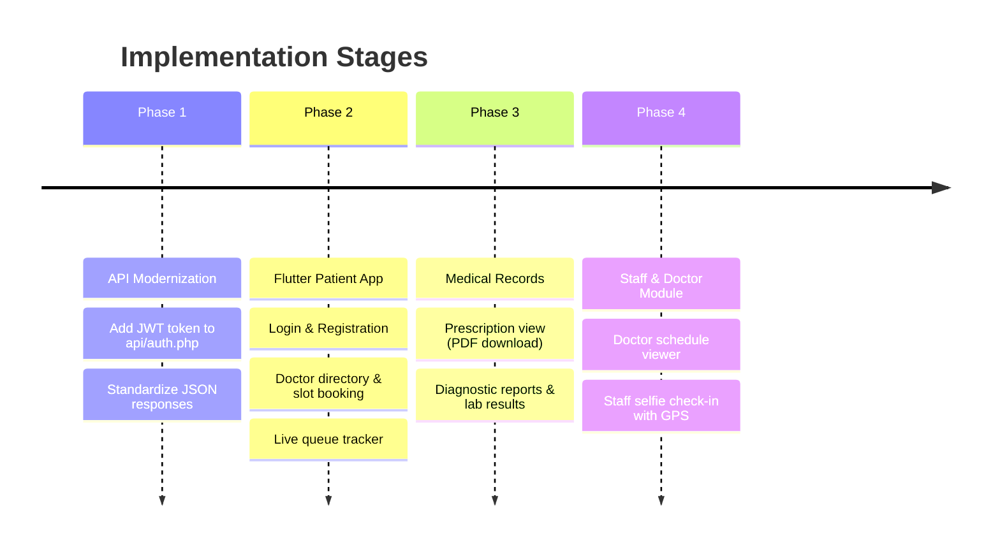

# 🏥 Hospital Management System — Flutter App Strategy, Feasibility & Cost Guide

> **A comprehensive evaluation, architecture plan, and cost breakdown for building a mobile companion app (Flutter) for our Hospital Management System.**

---

## 📌 Executive Summary (TL;DR)

* **Is building a Flutter app a good idea?**  
  **Yes, absolutely — but specifically for Patients and Doctors/Staff**, while keeping the desktop web application for hospital reception, billing desk, and admin.
* **Can we reuse our existing backend?**  
  **Yes!** We already have working PHP REST APIs in `/api/` (`booking.php`, `doctors.php`, `queue.php`, `patients.php`, `attendance_selfie.php`). We do **not** need to rewrite the backend.
* **What is the development cost?**  
  **$0 to start**. Flutter is free and open-source. We can test on physical phones using USB/Wi-Fi with our current local XAMPP setup.
* **What is the live hosting & server cost?**  
  **~$4 to $8 per month** on a reliable Linux Cloud VPS (Hetzner, DigitalOcean, or Hostinger) with free push notifications (Firebase) and 10GB free cloud file storage (Cloudflare R2).
* **One-time fees:**  
  Google Play Developer Account: **$25 (one-time)**. Apple App Store: **$99/year** (optional; can launch Android first).

---

## 🎯 1. The Strategy: Who is the App For?

A common mistake in hospital systems is trying to cram the entire hospital administration panel into a small phone screen. Hospital receptionists and billing operators need physical keyboards, large screens, barcode scanners, and thermal receipt printers.

The winning formula is a **hybrid system**:

---

## ⚖️ 2. Pros & Cons of Building the Flutter App

### Advantages (Pros) 👍
1. **Cross-Platform (Single Codebase):**  
   Flutter allows us to write one Dart codebase that runs natively on both **Android** and **iOS** with 60–120 FPS performance.
2. **Native Hardware Integration:**  
   - **Camera:** Instant prescription scanning and staff **Selfie Attendance** (`attendance_selfie.php`).
   - **QR Scanner:** Patients show their digital QR token at the reception desk for instant check-in.
   - **Biometrics:** Fingerprint / Face ID login for quick and secure access.
3. **Live Queue & Push Notifications (Huge Patient Experience Boost):**  
   Instead of sitting for 2 hours in a packed hospital waiting room, patients can monitor their queue token live from home and receive a push alert: *"You are 2nd in line. Please proceed to Doctor Cabin 3."*
4. **Offline Capability:**  
   Using lightweight local databases (Hive / SQLite), prescriptions and past medical records remain readable even if the patient loses mobile internet.
5. **Reuses Current Investment:**  
   All database tables (16 tables) and business logic already implemented in PHP can be connected directly via JSON REST APIs.

### Disadvantages & Challenges (Cons) ⚠️
1. **API Authentication Upgrade Needed:**  
   The current web system relies heavily on PHP browser sessions/cookies (`$_SESSION`). Mobile apps need stateless **Token Authentication (JWT / Bearer Token)**.
2. **Current MySQL BLOB File Storage:**  
   Storing large medical images and PDFs directly as `LONGBLOB` inside MySQL slows down mobile data transfer and drains server memory. We should shift file uploads to Cloud Object Storage (e.g., Cloudflare R2).
3. **App Store Approval & Maintenance:**  
   Publishing medical apps requires adherence to Google Play and Apple App Store privacy policies. Regular updates are needed when Android or iOS releases new OS versions.

---

## 🛠️ 3. Recommended Tech Stack ("What to Use")

| Layer | Recommended Technology | Why This Choice? |
| :--- | :--- | :--- |
| **Mobile App (Frontend)** | **Flutter (Dart 3.x)** | Fast native performance, beautiful modern widgets, cross-platform. |
| **State Management** | **Riverpod** or **Provider** | Clean architecture, easy testability, and standard in production Flutter apps. |
| **HTTP Networking** | **Dio** | Robust HTTP client for Flutter; handles token refresh, file upload progress, and interceptors. |
| **Local Offline Cache** | **Hive** or **SharedPreferences** | Fast key-value storage for authentication tokens and user profile caching. |
| **Backend API** | **Existing PHP 8+ REST API** | Located in `/api/`. No need to learn or build a new Node.js/Python backend. |
| **Database** | **MySQL / MariaDB** | Current indexed schema handles relational data (appointments, beds, doctors) reliably. |
| **Cloud Storage** | **Cloudflare R2** (S3-compatible) | 10 GB free forever, zero egress bandwidth costs for reports and photos. |
| **Push Notifications** | **Firebase Cloud Messaging (FCM)** | Industry standard, 100% free, works reliably on Android and iOS. |

---

## ⚡ 4. Speed & Performance Comparison: "Which is Fast?"

### A. Database Speed Comparison
* **MySQL 8.0 with Indexes (Current): ⭐⭐⭐⭐ (Fast & Recommended)**  
  *Average Query Time:* **5ms – 20ms**.  
  Because our schema is strictly relational (`hospital_id`, `doctor_id`, `patient_id`), adding indexes on foreign keys makes queries instantaneous. No need to migrate away.
* **Firebase Firestore (NoSQL): ⭐⭐⭐ (Moderate)**  
  *Average Read Time:* **30ms – 70ms**.  
  Firestore is great for simple key-value lookups, but healthcare data requires joins (Doctor + Schedule + Patient + Prescription + Bed). Doing multiple read calls in NoSQL increases latency and cost.
* **In-Memory Cache (Redis): ⭐⭐⭐⭐⭐ (Ultra Fast)**  
  *Average Read Time:* **< 1ms**.  
  Optional: If live queue tracking has thousands of patients refreshing every second, Redis can cache the queue numbers in RAM.

### B. File & Report Storage Speed
* **MySQL `LONGBLOB` (Current setup): ❌ Slowest**  
  Loading a 5MB scan directly from MySQL locks database memory and bloats SQL backup files.
* **Cloudflare R2 + CDN: ⚡ Fastest**  
  Files are cached on worldwide edge servers. The Flutter app downloads PDF reports and images directly via high-speed CDN without overloading the PHP server.

### C. Server Hosting Speed
* **Free / Shared Web Hosting (e.g., InfinityFree, cPanel shared): ❌ Slow**  
  Suffers from shared CPU limits, cold starts, and blocked API ports.
* **Cloud VPS (DigitalOcean / Hetzner / Hostinger KVM): ⚡ Fast & Stable**  
  Low latency (<30ms API response), full control over PHP and MySQL performance, and zero connection throttling.

---

## 💰 5. Complete Cost Breakdown

### A. Development Phase (Testing & Building)
| Item | Cost | Notes |
| :--- | :--- | :--- |
| Flutter SDK & Android Studio | **$0** | Completely free and open-source |
| Local Development Server | **$0** | Test using local XAMPP via Wi-Fi IP |
| Physical Android Device Testing | **$0** | Enable USB Debugging on your phone |
| **Total Dev Cost** | **$0** | **100% Free** |

---

### B. Production Launch & Monthly Running Cost
| Service / Resource | Free Tier Available? | Estimated Monthly Cost | Estimated Yearly Cost |
| :--- | :--- | :--- | :--- |
| **Cloud VPS Server** *(Ubuntu, PHP 8, MySQL, Nginx/Apache)* | Free trials only | **$4 – $7 / mo** (e.g. Hetzner, Hostinger VPS) | ~$48 – $84 / year |
| **Custom Domain Name** *(e.g., `hospitalapi.com`)* | No | — | ~$10 – $12 / year |
| **SSL Certificate (HTTPS)** | Yes (Let's Encrypt) | **$0** | **$0** |
| **Cloud Storage (Cloudflare R2)** *(Medical PDFs, X-Rays, Selfies)* | **10 GB Free forever** *(Zero egress bandwidth charges)* | **$0** (under 10GB) *(+$0.015/GB above 10GB)* | **$0** |
| **Push Notifications (Firebase FCM)** | **100% Free** | **$0** | **$0** |
| **Google Play Developer Account** | No | **$25** (One-time lifetime) | $25 once |
| **Apple Developer Account** *(Optional)* | No | — | $99 / year |

### 💵 Realistic Total Expenses:
* **One-Time Setup:** **$25** (Google Play Store registration) + **$10** (Domain) = **$35 total**.
* **Monthly Hosting Cost:** **~$5 to $7 / month** (₹400 – ₹600 INR/month).

---

## 🗺️ 6. Implementation Roadmap (Step-by-Step)

### Phase 1: Modernize API for Mobile (1–2 days)
1. Add a Bearer Token / JWT authentication endpoint in `api/auth.php`.
2. Ensure endpoints in `/api/` return clean, standardized JSON objects with error codes (`{ "status": "success", "data": [...] }`).

### Phase 2: Core Patient App (1–2 weeks)
1. **Authentication:** Login and Register with Hospital Code.
2. **Doctor Directory:** Fetch doctors and available days from `api/doctors.php`.
3. **Appointment Booking:** Select time slots via `api/booking.php`.
4. **Live OPD Queue:** Real-time queue position display consuming `api/queue.php`.

### Phase 3: Medical Records & File Handling (1 week)
1. Migrate file storage from `LONGBLOB` in MySQL to file paths or Cloudflare R2 URLs.
2. Allow patients to view, download, and share their prescriptions and lab reports in the Flutter app.

### Phase 4: Doctor & Staff Features (Optional / Secondary)
1. Quick consultation queue for doctors on mobile.
2. Staff selfie attendance using the device camera (`api/attendance_selfie.php`).

---

## 🏁 7. Final Verdict

Building a Flutter companion app for this Hospital Management System is a **high-value, low-cost move**:
1. **Keep Web for Admin/Desk:** Maintain the current web dashboard for administrative operations.
2. **Build Flutter for Patients & Staff:** Significantly improves patient satisfaction, reduces waiting room crowding, and offers mobile attendance for staff.
3. **Budget Friendly:** You can build and test everything for **$0**, and take it live for **~$5/month**.
