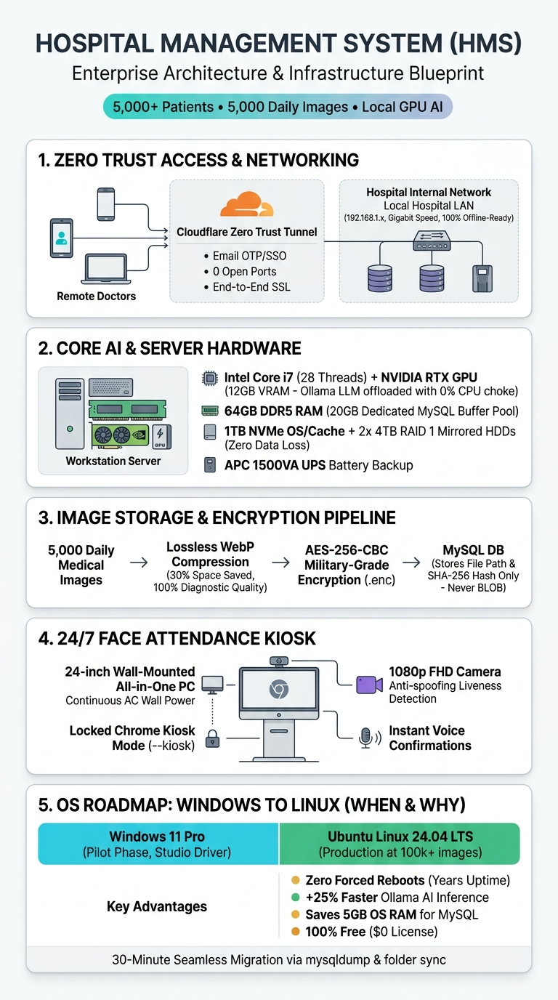
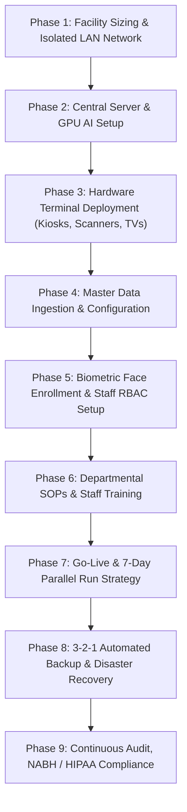
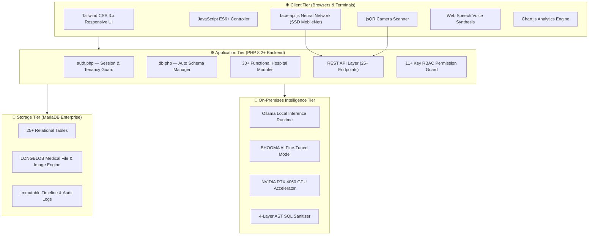
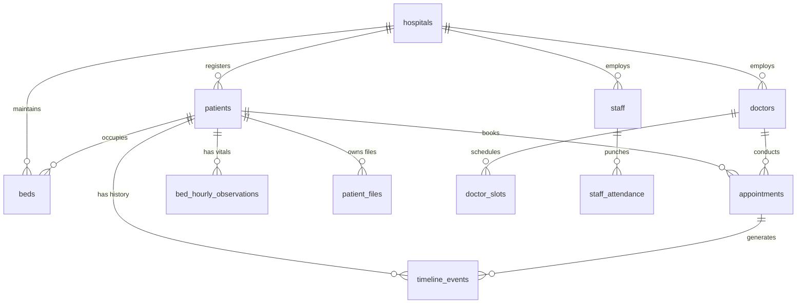

<p align="center">
  
</p>

<h1 align="center">🏥 Hospital Management System (HMS)</h1>
<h3 align="center">Version 3.0 Enterprise Release — AI-Powered, Paperless, Biometric Clinical Healthcare Ecosystem</h3>

<p align="center">
  <strong>A comprehensive, production-grade Hospital Management System engineered with PHP 8.2+, MariaDB 10.4+, Tailwind CSS 3.x, local neural face recognition (face-api.js), and an on-premises fine-tuned clinical LLM (BHOOMA AI on NVIDIA RTX 4060 GPU).</strong>
</p>

<p align="center">
  
  
  
  
  
  
  
  
</p>

<<<<<<< HEAD
=======
<p align="center">
  
</p>
>>>>>>> 95f8575 (feat(v3.0): Enterprise Release — Inpatient Bed Ward & Bedside Monitor Workstation, AI Face Attendance Kiosk, BHOOMA AI Clinical Dossier, 9-Phase Hospital Setup Master Plan & Comprehensive Docs Suite)

---

## 📑 Table of Contents

1. [Executive Overview & Vision](#-executive-overview--vision)
2. [What's New in Version 3.0 (Major Upgrades)](#-whats-new-in-version-30-major-upgrades)
3. [Hospital Setup & Implementation Master Plan (Phase-by-Phase)](#-hospital-setup--implementation-master-plan)
   - [Phase 1: Facility Sizing & Isolated LAN Network](#phase-1-facility-sizing--isolated-lan-network)
   - [Phase 2: Central Server & GPU AI Setup](#phase-2-central-server--gpu-ai-setup)
   - [Phase 3: Hardware Terminal Deployment (Kiosks, Scanners, TVs)](#phase-3-hardware-terminal-deployment)
   - [Phase 4: Master Data Ingestion & Configuration](#phase-4-master-data-ingestion--configuration)
   - [Phase 5: Biometric Face Enrollment & Staff RBAC Setup](#phase-5-biometric-face-enrollment--staff-rbac-setup)
   - [Phase 6: Departmental SOPs & Staff Training](#phase-6-departmental-sops--staff-training)
   - [Phase 7: Go-Live & 7-Day Parallel Run Strategy](#phase-7-go-live--7-day-parallel-run-strategy)
   - [Phase 8: 3-2-1 Automated Backup & Disaster Recovery](#phase-8-3-2-1-automated-backup--disaster-recovery)
   - [Phase 9: NABH / HIPAA & Data Sovereignty Compliance](#phase-9-nabh--hipaa--data-sovereignty-compliance)
4. [System Architecture & Data Flow](#-system-architecture--data-flow)
5. [In-Depth Feature Walkthrough (How Everything Works)](#-in-depth-feature-walkthrough)
   - [A. Inpatient Bed Ward & Bedside Monitor Workstation](#a-inpatient-bed-ward--bedside-monitor-workstation)
   - [B. Smart AI Face Attendance Kiosk](#b-smart-ai-face-attendance-kiosk)
   - [C. BHOOMA AI Clinical Chatbot & NL-to-SQL Engine](#c-bhooma-ai-clinical-chatbot--nl-to-sql-engine)
   - [D. Lifetime Patient QR Health Pass & Mobile LAN Auto-Resolve](#d-lifetime-patient-qr-health-pass--mobile-lan-auto-resolve)
   - [E. 4-Stage Real-Time Kanban Queue Pipeline](#e-4-stage-real-time-kanban-queue-pipeline)
   - [F. Doctor Consultation & Prescription Photo Capture](#f-doctor-consultation--prescription-photo-capture)
   - [G. Appointment Booking & Doctor Slots Overhaul](#g-appointment-booking--doctor-slots-overhaul)
   - [H. Staff Management & 11+ Granular Permission Keys](#h-staff-management--11-granular-permission-keys)
   - [I. Binary BLOB Medical File Storage Engine](#i-binary-blob-medical-file-storage-engine)
6. [Operational Posters & Visual Documentation](#-operational-posters--visual-documentation)
7. [Comprehensive Documentation Library (`docs/`)](#-comprehensive-documentation-library)
8. [Database Schema (25+ Tables)](#-database-schema-25-tables)
9. [REST API Quick Reference (25+ Endpoints)](#-rest-api-quick-reference)
10. [Quick Start & Installation Guide](#-quick-start--installation-guide)
11. [License & Credits](#-license--credits)

---

## 🌟 Executive Overview & Vision

The **Hospital Management System (HMS)** transforms paper-cluttered, fragmented hospital facilities into unified, real-time, digital healthcare ecosystems.

Designed for small clinics up to 500-bed multi-specialty hospitals, the platform connects **Reception**, **OPD Consulting Cabins**, **Inpatient Wards**, **ICUs**, **Diagnostic Labs**, **Pharmacies**, and **Administrative Boardrooms** into a single synchronized interface.

### The 5 Zero-Compromise Tenets:
1. **100% Data Sovereignty:** Patient records, clinical histories, and AI intelligence run entirely on-premises inside the hospital intranet. No medical data leaks to public commercial clouds.
2. **True Paperless Journey:** From walk-in check-in to doctor prescription, ICU hourly monitor snapshots, and discharge summaries—everything is digitized.
3. **Biological Infection Control:** Touchless facial recognition attendance replaces cross-contaminating fingerprint biometric scanners.
4. **Clinical Integrity Guarantee:** Medical files and ICU monitor photos are stored directly inside the relational database as binary BLOBs, immune to filesystem path breaks or disk file deletion.
5. **Human-Centric Design:** Built with Tailwind CSS 3.x and GSAP, the UI is fast, responsive, and easy to use for receptionists, nurses, doctors, and senior consultants alike.

---

## 🚀 What's New in Version 3.0 (Major Upgrades)

| Module | Major Enhancements in Version 3.0 |
|---|---|
| 🛏️ **Inpatient Bed Ward & Monitor Deck** | • **Fullscreen Bedside Workstation:** Dedicated clinical terminal for duty nurses.<br/>• **Bedside Machine Monitor Capture:** Photograph ventilator and patient monitor screens via camera directly into MySQL BLOB.<br/>• **Dual Views:** Kanban Ward Station View + Sortable Table Registry.<br/>• **Vital Telemetry:** Record BP, Pulse, SpO2, Temperature, and Respiration.<br/>• **Discharge Archiving:** All monitor images and vital histories are permanently preserved in the patient's dossier upon bed discharge. |
| 📸 **Smart AI Face Attendance Kiosk** | • **Standalone Kiosk Page (`face_attendance.php`):** Ultra-modern terminal for staff entrances.<br/>• **Touchless Biometric Punch:** Sub-500ms face recognition powered by `face-api.js` (SSD MobileNet V1).<br/>• **Voice Audio Greeting:** Web Speech API voice announcements (muted by default, 1-click toggle).<br/>• **Live Punch Feed:** Real-time ticker showing staff check-ins, shift status, and timestamps. |
| 🤖 **BHOOMA AI Chatbot Overhaul** | • **Complete Clinical Dossier Synthesis:** Automatically presents patient demographics, active bed admission, past appointments, diagnoses, prescriptions, vitals, and clickable file links.<br/>• **Natural Empathetic Tone:** Removed robotic headers; delivers warm, structured clinical summaries.<br/>• **Direct File Links:** Generates clickable `[View File](api/file.php?id=...)` links inside the chat.<br/>• **Live Training Pipeline:** Fine-tune models locally on NVIDIA RTX 4060 GPU with live loss curves. |
| 📅 **Appointment & Slots Overhaul** | • **Redesigned Booking (`book.php`):** 3-step intuitive pipeline (Doctor selection -> Slot Matrix -> Patient assignment).<br/>• **Doctor Slots Management (`doctor_slots.php`):** Weekly availability schedule with slot duration picker.<br/>• **Public Booking Link:** 1-click button to copy and share self-booking link with patients. |
| 📱 **Patient QR Health Pass** | • **Automatic LAN IP Resolution:** Resolves server LAN IP so mobile phones scanning QR on hospital Wi-Fi open records seamlessly.<br/>• **Dual-Mode View:** Privacy-safe masked view for public scans vs full EHR workstation for authenticated staff.<br/>• **WhatsApp / Telegram Rich Cards:** Open Graph meta tags generate preview cards when links are shared. |
| 👥 **Staff HR & Permissions** | • **11+ Granular Capability Keys:** Independent toggles for viewing patients, editing beds, billing, staff, and AI admin.<br/>• **Multi-View Roster:** Directory Cards, Table Registry, and Live Attendance Roster with status filters. |

---

## 🏥 Hospital Setup & Implementation Master Plan

Setting up an enterprise hospital management system requires meticulous planning across hardware, network, software, and human workflow dimensions. Below is the battle-tested, 10-week implementation plan.



---

### Phase 1: Facility Sizing & Isolated LAN Network

1. **Physical Site Survey:**
   - Map all physical zones: Reception, Waiting Lounges, OPD Doctor Cabins, Inpatient General Wards, ICU/CCU, Operation Theatres (OT), Diagnostic Lab, Radiology, Pharmacy, and Billing Counters.
   - Run structured **Cat6 Gigabit Ethernet cabling** to every doctor desk and nursing station.
2. **Network Architecture (Intranet-First):**
   - Configure a managed gigabit switch with **VLAN segmentation**:
     - `VLAN 10`: Administration & Billing
     - `VLAN 20`: OPD Consulting Cabins & Waiting Lounge Display
     - `VLAN 30`: Inpatient Wards, ICU Tablets & Mobile Nursing Carts
     - `VLAN 40`: Biometric Face Attendance Kiosks
3. **High-Density Wi-Fi Coverage:**
   - Install Enterprise Wi-Fi 6 Access Points (e.g., UniFi U6 Pro or Aruba AP) across inpatient corridors to ensure zero packet drop for roving bedside nursing tablets.
4. **Local Static IP & DNS:**
   - Assign central server static IP (e.g., `192.168.1.50`).
   - Configure local router DNS so hospital workstations can navigate to `http://hms.hospital.local`.

---

### Phase 2: Central Server & GPU AI Setup

1. **Server Sizing (50–150 Beds Standard):**
   - **CPU:** Intel Core i7-14700 / AMD Ryzen 9 7900X (12+ Cores).
   - **RAM:** 64 GB DDR5 ECC.
   - **Storage:** 2 x 1TB NVMe SSD in RAID 1 (Primary Database & App) + 4TB Enterprise HDD (Local Daily Backups).
   - **GPU (For BHOOMA AI):** NVIDIA GeForce RTX 4060 8GB / RTX 4070 12GB.
   - **Power:** Online Double-Conversion UPS (2 KVA) providing minimum 60 minutes battery run-time.
2. **Software Stack Installation:**
   - Install **XAMPP** or standalone **Apache 2.4+** with **PHP 8.2+** and **MariaDB 10.4+**.
   - Configure `php.ini`:
     ```ini
     max_execution_time = 300
     memory_limit = 512M
     post_max_size = 64M
     upload_max_filesize = 50M
     ```
   - Optimize MariaDB `my.ini` for high-concurrency BLOB storage:
     ```ini
     max_allowed_packet = 128M
     innodb_buffer_pool_size = 8G
     innodb_log_file_size = 512M
     max_connections = 500
     ```
3. **Automatic Database Deployment:**
   - Create database `hospital_db`.
   - Access `db.php` in a web browser—the built-in auto-migration manager automatically creates all 25+ relational tables, indexes, and seed records!
4. **Deploy Local AI Engine (Ollama):**
   - Install Ollama from [ollama.ai](https://ollama.ai).
   - Build custom BHOOMA AI model:
     ```powershell
     cd "d:\xampp\htdocs\Hospital Management System\ai\python"
     ollama create bhooma-hms-ai -f Modelfile
     ```

---

### Phase 3: Hardware Terminal Deployment

1. **Reception QR Desks:**
   - Install 2D Omnidirectional Presentation Scanners (Zebra DS9308 / Honeywell Genesis) configured in continuous auto-scan mode.
   - Install 80mm Thermal Receipt Printers (EPSON TM-T82) for printing walk-in token slips with QR codes.
2. **Waiting Lounge Live Pipeline TV:**
   - Mount 55" 4K Smart TV in the waiting lounge pointing to:
     `http://hms.hospital.local/queue.php?display=lounge`
   - Auto-refreshes every 5 seconds with audible chime alerts when new tokens are called.
3. **Doctor Consulting Rooms:**
   - Workstation PC with 1080p display and document webcam for photographing physical paper prescriptions.
4. **Staff Entrance AI Face Attendance Kiosks:**
   - Mount 15.6" or 21.5" All-in-One Touchscreen PC or iPad/Android tablet at 1.45m height at staff entry gates.
   - Equip with 1080p 60fps wide-angle camera with Wide Dynamic Range (WDR).
   - Open `http://hms.hospital.local/face_attendance.php` in fullscreen kiosk mode.
5. **Inpatient Ward & ICU Bedside Carts:**
   - Ruggedized 10.1" tablets with rear autofocus cameras on mobile medical carts for hourly vital logging and monitor capture.

---

### Phase 4: Master Data Ingestion & Configuration

Before enrolling patients, hospital leadership configures master data:
1. **Hospital Entity Profile (`hospitals`):** Hospital name, registration number, NABH accreditation level, emergency ambulance hotlines, official logo.
2. **Clinical Specializations:** General Medicine, Cardiology, Orthopaedics, Paediatrics, Neurology, Gynaecology, Dermatology, Pulmonology, General Surgery, ENT.
3. **Doctor Registry (`doctors`):** Full name, medical council registration number (MCI/NMC), qualifications, consultation fees, consulting cabin/room numbers.
4. **Doctor Timing & Slot Schedules (`doctor_slots.php`):** Define morning/evening shifts and consultation durations (15 min / 30 min slots).
5. **Bed & Ward Architecture (`beds`):**
   - ICU Beds (`ICU-01` to `ICU-20`)
   - General Ward Beds (`GEN-101` to `GEN-150`)
   - Private & Deluxe Suites (`PVT-201` to `PVT-220`)
6. **Billing Master (`charges`):** Standard fee schedules for OPD consultations, ICU bed per-diem rates, and diagnostic tests.

---

### Phase 5: Biometric Face Enrollment & Staff RBAC Setup

1. **Staff Account Creation:** Register all employees in `staff.php` with names, phone numbers, department roles, and shift timings.
2. **Facial Biometric Enrollment Drive:**
   - Administrator opens **Staff Management** -> **Enroll Face**.
   - The neural network locks onto the employee's face, extracts a 128-dimensional mathematical vector descriptor, and stores it in `staff.face_descriptor`.
   - Takes under 30 seconds per staff member.
3. **Granular RBAC Provisioning:**
   - Assign specific permissions using the 11+ capability keys:
     - Doctors: `can_consult_patients`, `can_view_patients`, `can_view_queue`
     - Nurses: `can_manage_beds`, `can_view_patients`, `can_view_queue`
     - Receptionists: `can_manage_queue`, `can_edit_patients`, `can_manage_billing`
     - Administrators: Full privileges across all 11 keys.

---

### Phase 6: Departmental SOPs & Staff Training

Deliver 4 tailored, hands-on training workshops:
- **Workshop 1 (Front Desk):** Fast QR scanning, walk-in registration, thermal slip printing, and online booking lookups.
- **Workshop 2 (Doctors):** Reviewing patient dossiers, writing electronic diagnoses, snapping prescription photos, and choosing clinical dispositions.
- **Workshop 3 (Nurses & ICU Staff):** Operating the Bedside Workstation (`beds.php`), recording hourly vitals, photographing patient monitors, and handling bed transfers.
- **Workshop 4 (IT & System Admins):** Server maintenance, automated backups, staff permissions, and local AI training.

---

### Phase 7: Go-Live & 7-Day Parallel Run Strategy

To eliminate clinical disruption risks:
- **Days 1–4 (Parallel Run):** Dual-entry protocol. Receptionists write on physical paper registers and simultaneously mirror entries into the HMS.
- **Days 5–6 (Digital Primary):** All transactions entered primarily into HMS. Paper register used only as secondary log. Nightly reconciliation audits.
- **Day 7 (Full Paperless Cutover):** Decommission paper registers. Official go-live across all hospital departments.

---

### Phase 8: 3-2-1 Automated Backup & Disaster Recovery

Hospital data must survive hardware crashes, power outages, and ransomware:
- **The 3-2-1 Rule:**
  - **3 Copies:** Live production database + local on-site secondary drive + encrypted offsite cold backup.
  - **2 Media Types:** High-speed NVMe SSD (Production) + Enterprise HDD / NAS (Backup).
  - **1 Off-Site Copy:** Automated nightly sync to encrypted external storage.
- **Recovery Time Objective (RTO):** < 30 minutes.
- **Recovery Point Objective (RPO):** < 15 minutes.
- Automated daily backup script included in [`docs/HOSPITAL_DEPLOYMENT_PLAN.md`](docs/HOSPITAL_DEPLOYMENT_PLAN.md).

---

### Phase 9: NABH / HIPAA & Data Sovereignty Compliance

- **Patient Privacy Shield:** Unauthenticated QR scans display masked phone numbers (`789•••••890`) and high-level health passes. Deep clinical notes require authenticated staff login.
- **Immutable Audit Trails:** Every vital reading, prescription upload, bed transfer, and patient discharge logs an irreversible entry into `timeline_events`.
- **Zero Third-Party Cloud Leaks:** 100% of data—including natural language AI queries—operates within the hospital's local intranet.

---

## 🏗️ System Architecture & Data Flow



---

## 🔍 In-Depth Feature Walkthrough

### A. Inpatient Bed Ward & Bedside Monitor Workstation
- **Live Ward Visualization (`beds.php`):** Visualizes ICU, HDU, General Wards, and Private Rooms with real-time occupancy percentages.
- **Fullscreen Bedside Workstation:** Tap any occupied bed to open a dedicated bedside monitoring deck.
- **Hourly Vitals Telemetry:** Log Blood Pressure, Pulse, SpO2, Temperature, and Respiration with automated clinical alert flags.
- **Machine Monitor Camera Snapshots:** Tap **Capture Monitor** to photograph the physical patient monitor or ventilator screen. The image is saved directly as a binary BLOB into MariaDB linked to the observation hour.
- **Discharge Record Preservation:** Discharging a bed frees the physical furniture while permanently preserving all monitor photographs and vital timelines in the patient's electronic medical file.

### B. Smart AI Face Attendance Kiosk
- **Touchless Biometric Terminal (`face_attendance.php`):** Ultra-modern kiosk designed for 24/7 continuous operation at hospital staff entrances.
- **Sub-500ms Recognition:** Real-time facial detection and 128-D vector matching using `face-api.js` (SSD MobileNet).
- **Voice Feedback:** Dynamic audio greeting (*"Welcome, Dr. Sharma. Attendance marked at 08:02 AM"*).
- **Anti-Spoofing & Cooldowns:** Multi-frame parallax validation and 60-second duplicate punch cooldown.

### C. BHOOMA AI Clinical Chatbot & NL-to-SQL Engine
- **Conversational Queries (`api/chatbot.php`):** Natural language questions (e.g., *"Show me all male patients with O+ blood in ICU"*) are converted to safe, parameterized MariaDB SQL.
- **Clinical Dossier Synthesis:** When querying a patient, the AI aggregates demographics, bed admissions, appointment history, diagnoses, prescriptions, and vitals into a structured medical report with clickable file links.
- **4-Layer Security Guard:** AST SQL sanitizer blocks `DROP`, `DELETE`, `UPDATE`, and `UNION`, guaranteeing read-only data safety.
- **Local GPU Fine-Tuning:** Dedicated dashboard (`ai_training_dashboard.php`) for training models on NVIDIA RTX 4060 GPUs with live loss curve visualization.

### D. Lifetime Patient QR Health Pass & Mobile LAN Auto-Resolve
- **Cryptographic UUIDv4 Identity:** Each patient receives a permanent lifetime QR code.
- **Intelligent LAN IP Auto-Resolver:** Translates `localhost` into the server's real local network IP address (`192.168.1.x`) so mobile devices on hospital Wi-Fi can scan and load records seamlessly.
- **Dual Security Modes:** Public scans display a privacy-masked emergency health pass; authenticated staff scans unlock the full EHR clinical workstation.
- **Social Sharing:** Rich Open Graph preview cards when shared via WhatsApp or Telegram.

### E. 4-Stage Real-Time Kanban Queue Pipeline
- **Stage 1 (Checked-In):** Walk-in or QR scanned patients.
- **Stage 2 (Arrived):** Triage nursing assessment and baseline vitals.
- **Stage 3 (Waiting Lounge):** Active waiting pool displayed on lounge TVs.
- **Stage 4 (Doctor Consultation):** In-cabin doctor examination.
- **Mobile Touch Swipe:** Kanban slider and stack views optimized for smartphones and tablets.

### F. Doctor Consultation & Prescription Photo Capture
- **4-Step Consultation Workflow:**
  1. Clinical Diagnosis (with ICD-10 suggestions).
  2. Prescription Photo Capture (via webcam for paper letterheads).
  3. Structured Digital Rx (dosage, frequency, duration).
  4. Clinical Disposition (Discharge / Send to Lab / Admit to Bed).
- **Automated Returning Queue:** Patients sent for laboratory tests automatically return to the doctor's active queue once test results are uploaded.

### G. Appointment Booking & Doctor Slots Overhaul
- **3-Step Booking Flow (`book.php`):** Doctor selection with specialization and fee preview -> Dynamic slot matrix -> Patient assignment.
- **Weekly Slots Management (`doctor_slots.php`):** Doctors configure daily working hours, break times, and slot durations.
- **Shareable Patient Link:** Instant button to copy public self-booking URL (`patient_book.php`).

### H. Staff Management & 11+ Granular Permission Keys
- **RBAC Matrix (`staff_permissions.php`):** 11 independent capability keys per employee.
- **Fast Role Presets:** 1-click presets for Doctors, Nurses, Receptionists, and Pharmacists.
- **Multi-View Directory:** Switch between Employee Cards, Detailed Table, and Live Attendance Roster.

### I. Binary BLOB Medical File Storage Engine
- **Immune to Filesystem Corruption:** Medical files, lab reports, X-rays, and monitor snapshots are stored as `LONGBLOB` binary data inside MariaDB.
- **Authenticated Streaming:** Files are streamed securely through `api/file.php` with session and tenancy verification.

---

## 🎨 Operational Posters & Visual Documentation

The repository includes high-resolution, print-ready posters:

| Poster File | Image Asset | Purpose & Display Location |
|---|---|---|
| `architecture_poster.html` | `hms_architecture_poster.jpg` | Enterprise Architecture Blueprint (Dark Mode) — Server Room & IT Office |
| `architecture_poster_white.html` | `hms_architecture_poster_white_updated.jpg` | Clean Architecture Blueprint (White Print Mode) — Executive Boardroom |
| `workflow_poster_white.html` | `hms_workflow_poster_vertical.jpg` | 24-Hour End-to-End Operational Lifecycle (Vertical) — Reception & Nursing Stations |

---

## 📚 Comprehensive Documentation Library

For deep technical and operational manuals, explore the [`docs/`](docs/) directory:

- [🏥 **Hospital Deployment & Implementation Plan**](docs/HOSPITAL_DEPLOYMENT_PLAN.md) — 10-week rollout master plan, networking, hardware, and backup scripts.
- [🛏️ **Bed Ward & Bedside Monitor Guide**](docs/BED_WARD_MONITOR_GUIDE.md) — Clinical manual for the Inpatient Bed Deck, monitor photo capture, and vitals.
- [📸 **Face Attendance Kiosk Guide**](docs/FACE_ATTENDANCE_KIOSK_GUIDE.md) — Deployment manual for touchless AI biometric attendance terminals.
- [🤖 **BHOOMA AI Engine & GPU Training Manual**](docs/AI_BHOOMA_TRAINING_MANUAL.md) — LLM fine-tuning on RTX 4060, ChatML dataset generation, and NL-to-SQL.
- [📱 **Patient QR & Consultation Workflow**](docs/PATIENT_QR_AND_CONSULTATION_WORKFLOW.md) — QR health pass, Kanban queue pipeline, and prescription capture.
- [🔒 **Staff Permissions & Security Guide**](docs/STAFF_PERMISSIONS_AND_SECURITY.md) — Zero-Trust RBAC matrix, 11+ capability keys, and audit logging.
- [🌐 **REST API Documentation**](docs/API_DOCUMENTATION.md) — Complete API reference covering 25+ endpoints with JSON schemas.

---

## 💾 Database Schema (25+ Tables)

The database engine (`hospital_db`) manages 25+ interconnected tables with strict foreign keys and automated migrations:



### Core Table Index:
- `hospitals`: Multi-hospital tenancy accounts, codes, and settings.
- `patients`: Master patient demographic registry with `qr_token` UUIDs.
- `doctors`: Doctor profiles, degrees, specializations, room numbers, and fees.
- `doctor_slots`: Granular daily slot schedules per doctor.
- `appointments`: Consultations with booking type, token number, status, and diagnosis.
- `beds`: Ward bed inventory with current occupancy pointers and wing locations.
- `bed_hourly_observations`: Bedside vital records (BP, Pulse, SpO2, Temp) and linked monitor images.
- `staff`: Hospital employee registry with `permissions` JSON and `face_descriptor` vectors.
- `staff_attendance`: Daily attendance punches, check-in/out timestamps, and status.
- `charges`: Invoices, procedure fees, and itemized billing ledger.
- `patient_files`: Binary BLOB storage for lab reports, prescriptions, and monitor photos.
- `timeline_events`: Immutable audit trail documenting every clinical action.
- `ai_training_logs`: Local GPU training step metrics and loss values.

---

## 🌐 REST API Quick Reference

| Endpoint | Method | Key Actions |
|---|:---:|---|
| `api/beds.php` | GET, POST | `get_all`, `admit`, `discharge`, `transfer`, `add_observation`, `get_observations` |
| `api/staff_face.php` | GET, POST | `get_descriptors`, `register`, `record_punch`, `today_roster` |
| `api/chatbot.php` | POST | Conversational NL-to-SQL query, clinical dossier synthesis, action cards |
| `api/ai_train_api.php` | GET, POST | `status`, `start_training`, `stop_training`, `generate_dataset`, `ollama_status` |
| `api/qr.php` | GET | `lookup`, `image`, `generate` |
| `api/dashboard.php` | GET | Real-time counters, revenue charts, bed occupancy percentages |
| `api/staff.php` | GET, POST | Staff CRUD, permissions update, password management |
| `api/file.php` | GET, POST | Binary BLOB image upload and secure authenticated stream download |

---

## ⚡ Quick Start & Installation Guide

### Prerequisites:
- **Web Server:** Apache 2.4+ (XAMPP recommended on Windows).
- **PHP:** Version 8.2 or higher (with `mysqli`, `curl`, `gd`, `mbstring`, `openssl`).
- **Database:** MariaDB 10.4+ or MySQL 8.0+.
- **AI Inference (Optional):** Ollama with NVIDIA GPU (RTX 4060 or higher).

### 3-Step Setup:
1. **Clone / Copy to Web Root:**
   ```bash
   git clone https://github.com/PoojanPatel7/hospital_management_system_Project.git
   # Move to: D:\xampp\htdocs\Hospital Management System
   ```
2. **Start Apache & MySQL:**
   - Launch XAMPP Control Panel and start **Apache** and **MySQL**.
3. **Open in Web Browser:**
   - Navigate to: `http://localhost/Hospital%20Management%20System/`
   - The system automatically detects the database, executes all auto-schema migrations, and presents the hospital login page!
   - **Default Admin Login:**
     - Hospital Code: `CARE01`
     - Username / Phone: `admin`
     - Password: `password123`

---

## 📄 License & Credits

- **Software License:** MIT License — Free for commercial and non-commercial hospital deployments.
- **Lead Developer:** [Poojan Patel](https://github.com/PoojanPatel7)
- **Built for:** BHOOMA Medicare Hospital & Modern Healthcare Facilities Worldwide.
