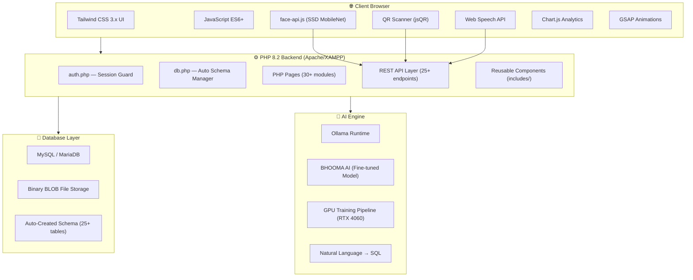
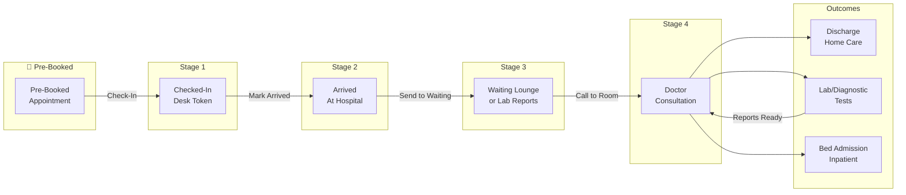
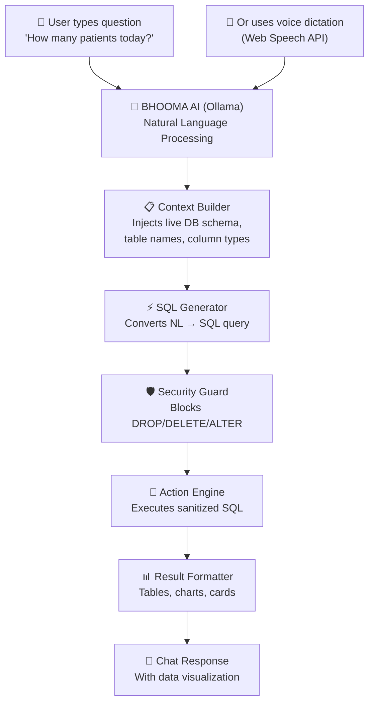
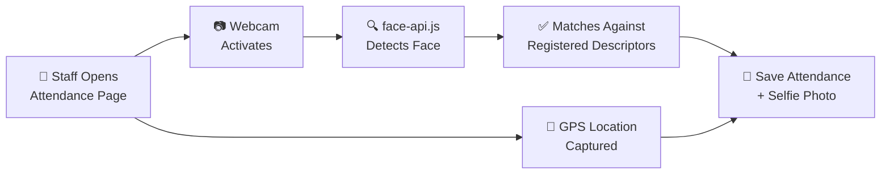
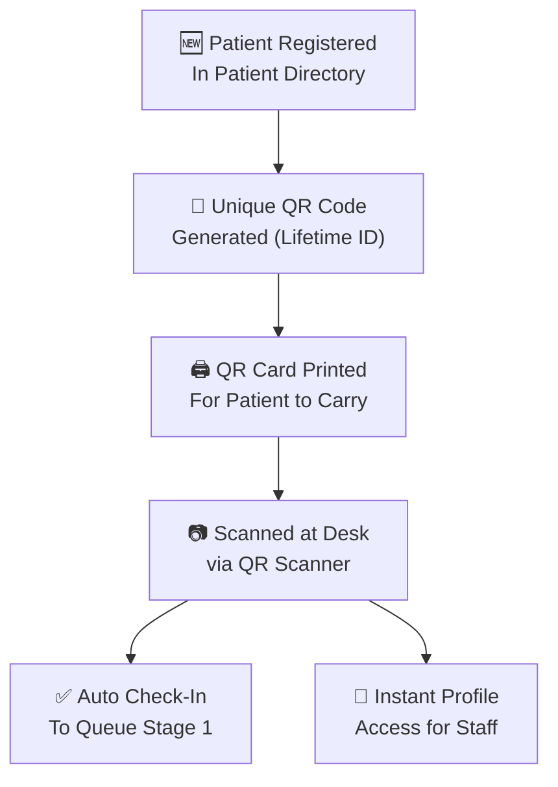
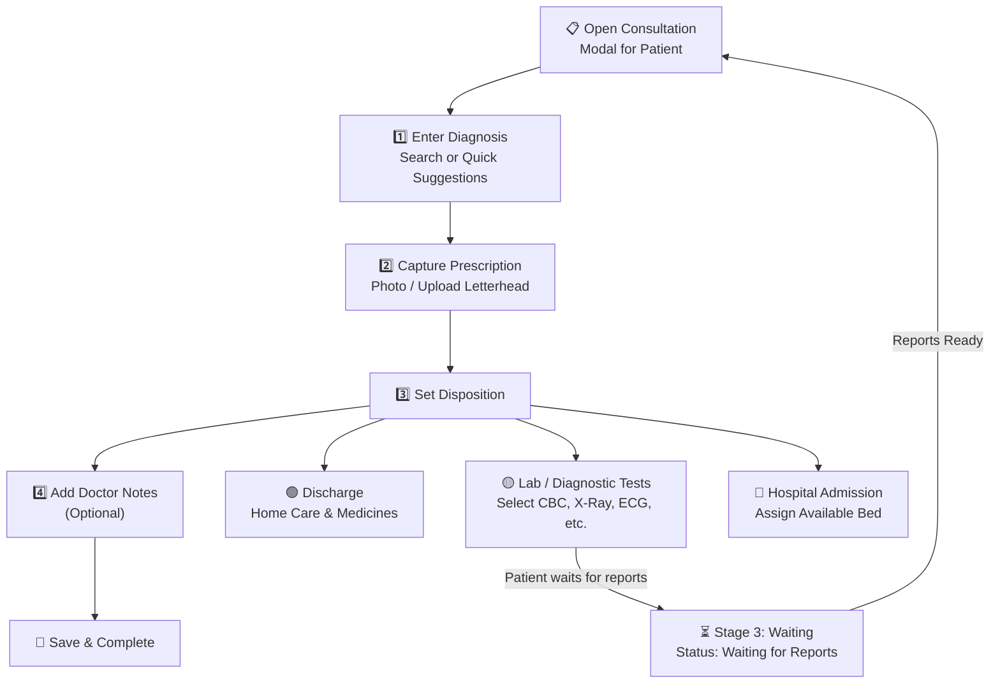
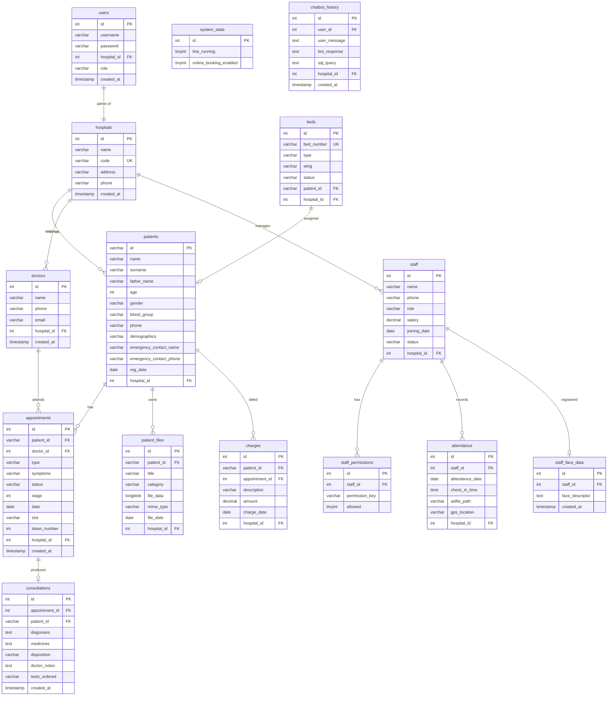

<p align="center">
  
</p>

<h1 align="center">🏥 Hospital Management System</h1>

<p align="center">
  <strong>A modern, AI-powered, full-featured web-based Hospital Management System built with PHP, MySQL, Tailwind CSS, and a locally fine-tuned LLM (BHOOMA AI)</strong>
</p>

<p align="center">
  
  
  
  
  
  
  
  
  
  
</p>


---

## 📋 Table of Contents

- [Project Overview](#-project-overview)
- [What Makes This Project Unique](#-what-makes-this-project-unique)
- [System Architecture](#-system-architecture)
- [Complete Feature List (30+ Modules)](#-complete-feature-list-30-modules)
- [Patient Queue Pipeline (Kanban System)](#-patient-queue-pipeline-kanban-system)
- [Dashboard & Analytics](#-dashboard--analytics)
- [AI Chatbot — BHOOMA AI](#-ai-chatbot--bhooma-ai)
- [Selfie Attendance & Face Recognition](#-selfie-attendance--face-recognition)
- [Patient QR Code Lifecycle](#-patient-qr-code-lifecycle)
- [Doctor Consultation Workflow](#-doctor-consultation-workflow)
- [Staff Permission System](#-staff-permission-system)
- [Database Schema (25+ Tables)](#-database-schema-25-tables)
- [Project File Structure](#-project-file-structure)
- [API Reference (25+ Endpoints)](#-api-reference-25-endpoints)
- [Installation & Setup](#%EF%B8%8F-installation--setup)
- [Security Features](#-security-features)
- [Technologies Used](#-technologies-used)
- [Recent Updates (October 2026)](#-recent-updates-october-2026)
- [Future Enhancements & Flutter App Plan](#-future-enhancements--flutter-app-plan)
- [Contributing](#-contributing)
- [License](#-license)
- [Author](#-author)

---

## 🌟 PROJECT OVERVIEW

This is a **comprehensive, production-ready Hospital Management System** designed to digitize every aspect of hospital operations — from patient registration and real-time queue tracking to AI-powered natural language database queries, from selfie-based staff attendance with face recognition to doctor consultation workflows with prescription photo uploads.

### Key Highlights

| Feature | Description |
|---------|-------------|
| 🤖 **AI Chatbot (BHOOMA AI)** | Locally fine-tuned LLM via Ollama that understands natural language queries about patients, doctors, beds, finances, and more. Executes live SQL, shows charts, handles voice input. |
| 📸 **Face Recognition Attendance** | Staff mark attendance via selfie with browser-based face-api.js recognition + GPS geofencing. Photo proof stored for audit. |
| 📱 **QR Code Patient System** | Each patient gets a unique lifetime QR code. Scan at desk for instant check-in to the live queue pipeline. |
| 🏥 **4-Stage Queue Pipeline** | Real-time Kanban board tracking patients from Desk Check-In → Arrived → Waiting Lounge → Doctor Consultation. |
| 💊 **Doctor Consultation Modal** | Diagnosis entry, prescription/letterhead photo upload, disposition (discharge / lab tests / bed admission), and doctor notes. |
| 🛏️ **Bed Management** | Real-time bed availability, assignments, transfers, discharge tracking across wards. |
| 💰 **Charges & Billing** | Track consultation fees, bed charges, procedure costs with itemized billing. |
| 🔒 **Granular Permissions** | 11+ permission keys per staff member — control access to every module individually. |
| 💾 **Binary BLOB Storage** | Medical files stored as binary BLOBs inside MySQL, immune to filesystem corruption. |
| 🧠 **GPU AI Training** | Fine-tune the hospital AI model on NVIDIA RTX 4060 GPU with live loss curve monitoring. |
| 🏨 **Multi-Hospital Support** | Each hospital gets isolated data with unique hospital codes. |
| 📊 **Analytics Dashboard** | Real-time stats with Chart.js — patient counts, revenue charts, bed occupancy, department distribution, weekly trends. |
| 🌐 **Online Booking** | Patients can book appointments online with doctor selection and time slot picking. |

---

## 🎯 WHAT MAKES THIS PROJECT UNIQUE

| Feature | Most HMS Projects | This Project |
|---------|------------------|--------------|
| AI Chatbot | ❌ None | ✅ Fine-tuned LLM with natural language → SQL, voice input, action engine |
| Staff Attendance | ❌ Basic checkbox | ✅ Selfie + face-api.js face recognition + GPS geofencing |
| Patient ID | ❌ Manual search | ✅ Lifetime QR code → instant scan-to-queue check-in |
| Queue Management | ❌ Simple list | ✅ 4-stage real-time Kanban board with slider/stack views, mobile swipe |
| Online Consultation | ❌ Not included | ✅ Full remote consultation with diagnosis, prescription photo, file upload |
| File Storage | ❌ Filesystem (unsafe) | ✅ Binary BLOB in MySQL (immune to disk corruption) |
| Permissions | ❌ Basic admin/user | ✅ 11+ granular per-staff permission keys |
| Staff Portal | ❌ Admin only | ✅ Dedicated staff login with personalized dashboard |
| AI Training | ❌ Cloud API dependency | ✅ Local GPU fine-tuning dashboard with real-time loss curves |
| Backup/Restore | ❌ phpMyAdmin | ✅ Built-in with schema validation, animated progress, one-click restore |
| Dashboard | ❌ Static counters | ✅ Animated GSAP cards, Chart.js graphs, live queue stats, revenue tracking |
| Navigation | ❌ Basic sidebar | ✅ Responsive header with desktop mega-menu, mobile bottom tab bar, QR fab button |

---

## 🏗️ SYSTEM ARCHITECTURE



---

## 🎯 COMPLETE FEATURE LIST (30+ MODULES)

### 🏠 Core Hospital Operations
| Module | File | Description |
|--------|------|-------------|
| **Login & Authentication** | `login.php`, `auth.php` | Secure session-based login with hospital code verification, auto-redirect for logged-in users |
| **Hospital Registration** | `register_hospital.php` | New hospital onboarding with unique code generation, admin account creation |
| **Dashboard** | `dashboard.php` | GSAP-animated statistics cards, Chart.js graphs (revenue, patients, beds), quick-action tiles, live queue mini-stats |
| **Reception Hub** | `includes/reception_hub.php` | Quick-access launchpad for desk staff — QR scan, queue view, patient registration |

### 👤 Patient Management
| Module | File | Description |
|--------|------|-------------|
| **Patient Directory** | `patients.php`, `api/patients.php` | Full CRUD for patient records — name, father, age, gender, blood group, phone, demographics, emergency contact |
| **Patient Profile** | `patient_profile.php` | Comprehensive single-patient view with medical history, files, appointment timeline |
| **Patient QR Card** | `patient_profile_qr.php` | Generate and print unique lifetime QR code cards for each patient |
| **Online Patient Booking** | `patient_book.php`, `patient_booking.php` | Public-facing appointment booking page — select doctor, pick time slot, enter symptoms |

### 🏥 Queue & Appointment Pipeline
| Module | File | Description |
|--------|------|-------------|
| **Hospital Queue (Kanban)** | `queue.php` | 4-stage pipeline: **Checked-In → Arrived → Waiting Lounge → Consultation**. Kanban and Table views, slider/stack card modes, mobile touch swipe, department & doctor filters, patient search with autocomplete |
| **Pre-Booked Appointments** | `queue.php` (advance section) | View, filter (Today / All Upcoming / Custom Date), check-in, undo, edit, and delete pre-booked appointments |
| **QR Scanner Check-In** | `js/qr-scanner.js` | Browser-based camera QR scanner for instant patient check-in to Stage 1 |
| **Booking Modal** | `includes/booking_modal.php` | Walk-in booking form — select patient, assign doctor, set priority, enter symptoms |
| **Direct Book Popup** | `includes/book_popup.php` | Quick appointment scheduling with doctor selection, date/time slot picker |

### 👨‍⚕️ Doctor & Consultation
| Module | File | Description |
|--------|------|-------------|
| **Doctor Management** | `doctors.php`, `api/doctors.php` | Add/edit doctors, assign specialization categories, manage availability |
| **Doctor Consultation** | `queue.php` (modal) | 4-step workflow: (1) Clinical Diagnosis with quick suggestions + search, (2) Prescription photo capture/upload, (3) Disposition — Discharge / Lab Tests / Bed Admission, (4) Doctor notes. Handles returning patients from lab. |
| **Online Consultation** | `online_consult.php` | Remote consultation page for telemedicine appointments |
| **Doctor Time Slots** | `api/doctor_slots.php` | Manage available time slots per doctor per day |
| **Patient Dossier** | `includes/dossier_modal.php` | Full clinical record popup — history, files, past consultations, test results |

### 🛏️ Bed & Ward Management
| Module | File | Description |
|--------|------|-------------|
| **Bed Management** | `beds.php`, `api/beds.php` | Real-time bed availability dashboard — add beds, assign patients, transfer, discharge, track ward occupancy |
| **Bed Types & Wings** | Managed via `beds.php` | Categorize beds by type (General, ICU, Private) and hospital wing |

### 👥 Staff & HR
| Module | File | Description |
|--------|------|-------------|
| **Staff Management** | `staff.php`, `api/staff.php` | Full CRUD for staff members — name, phone, role, salary, joining date, status |
| **Staff Permissions** | `staff_permissions.php` | 11+ granular permission keys per staff member — control module-level access |
| **Selfie Attendance** | `selfie_attendance.php`, `js/selfie-attendance.js` | Mark attendance via webcam selfie with GPS geofencing, photo proof, face-api.js recognition |
| **Face Registration** | `includes/face_register_modal.php`, `api/staff_face.php` | Register staff face descriptors for recognition-based attendance |
| **Staff Dashboard** | `includes/staff_dashboard_view.php` | Personalized dashboard for logged-in staff with permission-gated modules |

### 💰 Finance & Billing
| Module | File | Description |
|--------|------|-------------|
| **Charges & Billing** | `charges.php`, `api/charges.php` | Track consultation fees, bed charges, procedure costs, generate itemized bills |
| **Revenue Analytics** | `dashboard.php` | Chart.js revenue charts — daily, weekly, monthly trends, department breakdown |

### 🤖 AI & Chatbot
| Module | File | Description |
|--------|------|-------------|
| **BHOOMA AI Chatbot** | `includes/chatbot_widget.php`, `api/chatbot.php` | Natural language → SQL execution, voice dictation, chart generation, conversation history, workstation mode, export |
| **AI Training Dashboard** | `ai_training_dashboard.php`, `api/ai_train_api.php` | Fine-tune the BHOOMA model on local GPU (RTX 4060) with real-time loss curve visualization, training controls |
| **AI Logs** | `ai_logs.php` | View and debug AI query logs, SQL execution results, response analysis |
| **AI Context Engine** | `ai/context_builder.php`, `ai/schema_provider.php`, `ai/prompt_templates.php` | Dynamically builds SQL context from live schema, provides query templates, handles result formatting |
| **AI Action Engine** | `ai/action_engine.php` | Executes AI-generated SQL safely with parameterization and result formatting |
| **AI Security Guard** | `ai/security_guard.php`, `ai/sql_sanitizer.php` | Blocks dangerous SQL (DROP, DELETE, ALTER), sanitizes AI-generated queries before execution |

### 📁 Files & Documents
| Module | File | Description |
|--------|------|-------------|
| **File Management** | `api/files.php` | Upload, view, download medical documents — stored as Binary BLOBs in MySQL |
| **File Viewer Modal** | `includes/file_viewer_modal.php` | In-browser document/image viewer popup |
| **Upload Modal** | `includes/upload_modal.php` | Drag-and-drop file upload with category and date tagging |

### 🔧 System Administration
| Module | File | Description |
|--------|------|-------------|
| **Backup & Restore** | `backup.php`, `restore.php`, `api/backup.php` | One-click database backup with schema validation scanner, animated progress, download SQL dump, restore from file |
| **Database Auto-Setup** | `db.php`, `setup.php` | Auto-creates all 25+ tables, adds missing columns, seeds initial data on first run |
| **System Guide** | `guide.php` | Interactive help page explaining all features and workflows |
| **About Page** | `about.php` | Hospital and system information page |

---

## 🔄 PATIENT QUEUE PIPELINE (KANBAN SYSTEM)

The heart of daily hospital operations. Tracks every patient from desk arrival to doctor consultation in real-time.



### Queue Features
- **Kanban View** — 4 visual columns with patient cards showing token #, name, MRN, blood group, doctor, symptoms
- **Table View** — Traditional sortable data table with all patient info and inline actions
- **Slider / Stack Mode** — Toggle between showing one card at a time (slider with dots navigation) or all cards stacked
- **Mobile Touch Swipe** — Swipe left/right on patient cards to navigate in slider mode
- **Department & Doctor Filters** — Filter the entire pipeline by department or assigned doctor
- **Patient Search** — Real-time autocomplete search across all registered patients by name, MRN, phone, blood group
- **Pre-Booked Appointments** — Collapsible section showing upcoming appointments with Today / All Upcoming / Custom Date filters
- **Auto-Refresh** — Pipeline auto-refreshes every 10 seconds for real-time updates across multiple terminals
- **Undo Capabilities** — Every stage move can be reversed (undo check-in, move back to previous stage)

### Queue Modals
| Modal | Purpose |
|-------|---------|
| **Confirm Move** | Shows patient summary + current → target stage before confirming transfer |
| **Edit Appointment** | Change doctor, priority, date, time slot, or symptoms for any active appointment |
| **Delete Appointment** | Remove patient from the pipeline with confirmation |
| **Doctor Consultation** | 4-step diagnosis workflow — diagnosis, prescription photo, disposition, notes |

---

## 📊 DASHBOARD & ANALYTICS

The admin dashboard provides a real-time operational overview with animated GSAP card reveals and Chart.js graphs.

### Dashboard Sections
- **Greeting Banner** — Time-aware greeting with hospital name and admin name
- **Emergency Alert Bar** — Shows count of emergency patients in queue with direct link
- **Quick Stats Grid** — Total Patients, Today's Appointments, Active Queue, Available Beds, Total Revenue, Staff Count
- **Revenue Chart** — Weekly/monthly revenue trend line chart
- **Department Distribution** — Pie/doughnut chart of appointments by medical department
- **Bed Occupancy** — Visual gauge of current bed usage vs capacity
- **Quick Actions** — One-click tiles for common tasks (Add Patient, View Queue, Scan QR, Manage Beds)
- **Live Queue Mini-Stats** — Compact view of patients in each queue stage
- **Online Booking Toggle** — Enable/disable public patient appointment booking
- **AI Dashboard Controls** — Toggle AI chatbot visibility and features

---

## 🤖 AI CHATBOT — BHOOMA AI

A locally fine-tuned Large Language Model that runs on Ollama (no cloud dependency) and can query the live hospital database using natural language.



### Chatbot Features
- **Natural Language Queries** — "Show me all patients with blood group B+", "How many beds are free?", "Revenue this week?"
- **Voice Dictation** — Click microphone icon to speak queries using Web Speech API
- **Live SQL Execution** — Converts questions to SQL, executes against live database, returns formatted results
- **Chart Generation** — Automatically generates Chart.js visualizations for aggregate queries
- **Conversation History** — Sidebar drawer with past conversations, searchable
- **Workstation Mode** — Expandable full-screen mode for complex data exploration
- **Export** — Export chat responses and query results
- **Sound Effects** — Web Audio API notification sounds for messages
- **Security** — SQL sanitizer blocks destructive operations, parameterized queries prevent injection

### AI Training Pipeline
- **Local GPU Training** — Fine-tune the model on NVIDIA RTX 4060 with 3M+ hospital-specific training examples
- **Live Loss Curves** — Real-time Chart.js visualization of training loss during fine-tuning
- **Training Controls** — Start, pause, resume training from the dashboard
- **Training Logs** — Full audit trail of training runs, parameters, and results

---

## 📸 SELFIE ATTENDANCE & FACE RECOGNITION

Modern attendance system using browser-based facial recognition — no external hardware required.



### How It Works
1. **Face Registration** — Admin registers staff faces via webcam, storing 128-dimension face descriptor vectors in the database
2. **Attendance Marking** — Staff opens selfie attendance page, webcam captures their face
3. **Face Recognition** — face-api.js (SSD MobileNet V1) detects the face, extracts descriptor, matches against registered staff
4. **GPS Geofencing** — Browser captures GPS coordinates to verify staff is within hospital premises
5. **Photo Proof** — Selfie image is stored as attendance proof for audit purposes
6. **Models Used** — SSD MobileNet V1, Face Landmark 68, Face Recognition Model, Age/Gender Model, Expression Model (all loaded from `/models/` directory)

---

## 📱 PATIENT QR CODE LIFECYCLE



- Each patient gets a **unique, permanent QR code** tied to their MRN (Medical Record Number)
- QR codes are generated using the `qrcode.js` library
- Staff can scan QR codes using the built-in browser camera scanner (`jsQR`)
- Scanning instantly checks the patient into Stage 1 of the queue pipeline
- QR cards can be printed as physical cards for patients to carry

---

## 👨‍⚕️ DOCTOR CONSULTATION WORKFLOW

When a patient reaches Stage 4 (Consulting Room), the doctor uses the Consultation Modal:



### Consultation Features
- **Clinical Diagnosis** — Autocomplete search with common diagnosis datalist + quick-add buttons (Viral Fever, Hypertension, Diabetes, etc.)
- **Multiple Diagnoses** — Add multiple diagnoses as tags, remove individually
- **Prescription Photo** — Camera capture or file upload of handwritten prescription / doctor letterhead pad
- **Disposition Options:**
  - **Discharge** — Patient sent home with medicines
  - **Lab / Diagnostic Tests** — Select from 8 common tests (CBC, X-Ray, ECG, USG, etc.) + custom entry. Patient moved to Waiting Lounge.
  - **Hospital Admission** — Assign an available bed from the beds module
- **Doctor Notes** — Free-text advice and instructions
- **Returning Patients** — When a patient returns from lab with reports, their previous diagnosis is auto-loaded and the doctor can finalize

---

## 🔐 STAFF PERMISSION SYSTEM

Fine-grained, per-staff permission control with 11+ configurable permission keys.

| Permission Key | Controls Access To |
|----------------|-------------------|
| `can_view_patients` | Patient directory and profiles |
| `can_add_patients` | Adding new patient records |
| `can_view_doctors` | Doctor list and details |
| `can_manage_doctors` | Add/edit/delete doctors |
| `can_view_queue` | Live queue pipeline |
| `can_manage_queue` | Move patients between stages, check-in, consult |
| `can_view_beds` | Bed availability dashboard |
| `can_manage_beds` | Assign, transfer, discharge beds |
| `can_view_charges` | View billing and charges |
| `can_manage_charges` | Create/edit charges and bills |
| `can_view_staff` | Staff directory |
| `can_manage_staff` | Add/edit staff, modify permissions |
| `can_view_reports` | Analytics and reports |
| `can_access_ai` | BHOOMA AI chatbot |
| `can_backup` | Database backup and restore |

---

## 💾 DATABASE SCHEMA (25+ TABLES)

The database auto-creates all tables on first run via `db.php`. Missing columns are automatically added during upgrades.



---

## 📁 PROJECT FILE STRUCTURE

```
Hospital Management System/
│
├── 📄 index.php                    # Home / Reception Hub (full-page zero-scroll design)
├── 📄 login.php                    # Login page with hospital code
├── 📄 register_hospital.php        # Hospital registration & onboarding
├── 📄 dashboard.php                # Admin dashboard with GSAP + Chart.js
├── 📄 queue.php                    # 4-stage Kanban queue pipeline (core operational page)
├── 📄 patients.php                 # Patient directory (search, add, edit, delete)
├── 📄 patient_profile.php          # Single patient full profile view
├── 📄 patient_profile_qr.php       # Patient QR code generation & printing
├── 📄 patient_book.php             # Public patient appointment booking
├── 📄 doctors.php                  # Doctor management
├── 📄 beds.php                     # Bed management dashboard
├── 📄 staff.php                    # Staff management
├── 📄 staff_permissions.php        # Staff permission editor
├── 📄 selfie_attendance.php        # Selfie + face recognition attendance
├── 📄 charges.php                  # Billing & charges
├── 📄 online_consult.php           # Online / remote consultation
├── 📄 ai_training_dashboard.php    # AI model training interface
├── 📄 ai_logs.php                  # AI query execution logs
├── 📄 backup.php                   # Database backup tool
├── 📄 restore.php                  # Database restore tool
├── 📄 guide.php                    # System user guide
├── 📄 about.php                    # About page
├── 📄 auth.php                     # Session authentication guard
├── 📄 db.php                       # Database connection + auto schema creator
├── 📄 setup.php                    # First-run setup & data seeding
│
├── 📁 api/                         # REST API endpoints
│   ├── patients.php                # Patient CRUD API
│   ├── doctors.php                 # Doctor CRUD API
│   ├── queue.php                   # Queue pipeline API (13 actions)
│   ├── booking.php                 # Appointment booking API
│   ├── beds.php                    # Bed management API
│   ├── staff.php                   # Staff CRUD API
│   ├── staff_face.php              # Face descriptor registration API
│   ├── charges.php                 # Charges / billing API
│   ├── consultation.php            # Consultation save/load API
│   ├── dashboard.php               # Dashboard statistics API
│   ├── chatbot.php                 # AI chatbot query API
│   ├── ai_train_api.php            # AI training controls API
│   ├── files.php                   # File upload/download (BLOB) API
│   ├── backup.php                  # Backup/restore API
│   ├── doctor_slots.php            # Doctor time slot API
│   ├── permissions.php             # Staff permissions API
│   ├── history.php                 # Appointment history API
│   ├── attendance_selfie.php       # Selfie attendance API
│   ├── qr.php                      # QR code data API
│   └── online_consultation.php     # Online consultation API
│
├── 📁 includes/                    # Reusable PHP components
│   ├── header.php                  # Responsive header with mega-menu + mobile bottom tab bar
│   ├── footer.php                  # Footer with chatbot widget inclusion
│   ├── chatbot_widget.php          # BHOOMA AI chatbot floating widget
│   ├── booking_modal.php           # Walk-in booking modal
│   ├── book_popup.php              # Direct appointment booking popup
│   ├── dossier_modal.php           # Patient clinical dossier popup
│   ├── confirm_modal.php           # Reusable confirmation dialog
│   ├── upload_modal.php            # File upload modal
│   ├── file_viewer_modal.php       # Document/image viewer modal
│   ├── face_register_modal.php     # Staff face registration modal
│   ├── reception_hub.php           # Reception quick-access dashboard
│   ├── staff_dashboard_view.php    # Staff-specific dashboard view
│   ├── ai_dashboard_control.php    # AI chatbot toggle controls
│   ├── logout_modal.php            # Logout confirmation
│   ├── patient_qr_card_modal.php   # QR card print modal
│   └── permissions_modal.php       # Permission editor modal
│
├── 📁 ai/                          # AI engine modules
│   ├── ollama_client.php           # Ollama API client
│   ├── context_builder.php         # Dynamic schema context builder
│   ├── schema_provider.php         # Database schema introspection
│   ├── prompt_templates.php        # AI prompt engineering templates
│   ├── action_engine.php           # SQL execution engine
│   ├── security_guard.php          # Dangerous SQL blocker
│   ├── sql_sanitizer.php           # SQL injection prevention
│   └── system_knowledge.php        # Hospital-specific knowledge base
│
├── 📁 js/                          # JavaScript files
│   ├── qr-scanner.js               # QR code camera scanner (jsQR)
│   ├── selfie-attendance.js        # Selfie attendance logic + face-api.js integration
│   └── face-api.min.js             # face-api.js library (SSD MobileNet)
│
├── 📁 models/                      # Face recognition ML models
│   ├── ssd_mobilenetv1_model.*     # Face detection model
│   ├── face_landmark_68_model.*    # 68-point facial landmark model
│   ├── face_recognition_model.*    # 128-dimension face descriptor model
│   ├── age_gender_model.*          # Age and gender prediction model
│   ├── face_expression_model.*     # Expression detection model
│   └── tiny_face_detector_model.*  # Lightweight face detector
│
├── 📁 images/                      # Static images and icons
│   ├── Logo.png                    # Hospital logo
│   └── ...                         # Stage images, avatars
│
├── 📁 UI images/                   # Screenshots for documentation
│   └── Daskboard.jpg               # Dashboard screenshot
│
├── 📄 README.md                    # This file
├── 📄 FLUTTER_APP_PLAN_AND_COST_ANALYSIS.md  # Flutter mobile app roadmap
└── 📄 .gitignore                   # Git ignore rules
```

---

## 🔌 API REFERENCE (25+ ENDPOINTS)

### Queue Pipeline API (`api/queue.php`)
| Action | Method | Description |
|--------|--------|-------------|
| `get_queue` | GET | Get all active pipeline patients (stages 1–4) with full details |
| `get_advance_appointments` | GET | Get pre-booked appointments (filter by date optional) |
| `update_status` | POST | Move patient to a new stage/status |
| `check_in_advance` | POST | Check-in a pre-booked patient to Stage 1 |
| `undo_check_in` | POST | Revert a checked-in patient back to Pre-Booked |
| `toggle_line` | POST | Start/pause the hospital queue line |
| `register_walkin` | POST | Register a new walk-in patient + appointment |
| `book_existing` | POST | Book appointment for an existing registered patient |
| `book_advance` | POST | Create an advance/future appointment |
| `edit_appointment` | POST | Edit appointment details (doctor, date, symptoms, etc.) |
| `delete_appointment` | POST | Remove an appointment from the pipeline |

### Consultation API (`api/consultation.php`)
| Action | Method | Description |
|--------|--------|-------------|
| `get_consultation` | GET | Load existing consultation data for an appointment |
| `save_with_files` | POST | Save diagnosis, disposition, notes, and prescription photo |
| `save` | POST | Save consultation without file attachments |

### Patient API (`api/patients.php`)
| Action | Method | Description |
|--------|--------|-------------|
| `get_all` | GET | Get all patients for the hospital |
| `get_one` | GET | Get single patient by ID |
| `add` | POST | Register a new patient |
| `update` | POST | Update patient details |
| `delete` | POST | Delete a patient record |

### Other Key APIs
| Endpoint | Key Actions |
|----------|-------------|
| `api/doctors.php` | `get_hospital_doctors`, `add`, `update`, `delete` |
| `api/beds.php` | `get_all`, `add`, `assign`, `discharge`, `transfer` |
| `api/staff.php` | `get_all`, `add`, `update`, `delete` |
| `api/staff_face.php` | `register_face`, `get_descriptors` |
| `api/charges.php` | `get_all`, `add`, `update`, `delete` |
| `api/chatbot.php` | `query` — Send natural language question to BHOOMA AI |
| `api/dashboard.php` | `get_stats` — Dashboard counters and chart data |
| `api/files.php` | `upload`, `download`, `list`, `delete` |
| `api/backup.php` | `create_backup`, `restore` |
| `api/booking.php` | `get_categories`, `get_doctors_by_category`, `get_slots` |

---

## ⚙️ INSTALLATION & SETUP

### Prerequisites
- **XAMPP** (or any Apache + PHP 8.0+ + MySQL/MariaDB stack)
- **Node.js** (optional, for development tools)
- **Ollama** (optional, for AI chatbot — install from [ollama.ai](https://ollama.ai))

### Steps

1. **Clone the Repository**
   ```bash
   git clone https://github.com/PoojanPatel7/hospital_management_system_Project.git
   ```

2. **Move to XAMPP htdocs**
   ```bash
   # Copy or move to your web server directory
   cp -r hospital_management_system_Project "C:/xampp/htdocs/Hospital Management System"
   ```

3. **Start Apache & MySQL**
   - Open XAMPP Control Panel
   - Start **Apache** and **MySQL** services

4. **Access the Application**
   ```
   http://localhost/Hospital Management System/
   ```

5. **Auto Setup**
   - On first visit, the system auto-creates the database `hospital_db` and all 25+ tables
   - `db.php` handles all schema creation and migrations automatically
   - Register a new hospital with admin credentials

6. **Optional: AI Chatbot Setup**
   ```bash
   # Install Ollama
   # Download and run your preferred model
   ollama pull llama3.1
   # Or use a custom fine-tuned BHOOMA model
   ```

### Default Configuration
- Database: `hospital_db` (auto-created)
- PHP Session-based authentication
- Hospital code required for multi-hospital isolation
- All tables auto-migrate on schema changes

---

## 🔒 SECURITY FEATURES

| Feature | Implementation |
|---------|---------------|
| **Session Authentication** | PHP session-based login with hospital code verification (`auth.php`) |
| **Permission Guard** | Every page checks staff permissions via `permission_check.php` before rendering |
| **SQL Injection Prevention** | Prepared statements with parameterized queries throughout all APIs |
| **AI SQL Sanitizer** | Blocks DROP, DELETE, ALTER, TRUNCATE in AI-generated queries (`security_guard.php`) |
| **XSS Protection** | HTML entity encoding for all user-displayed data |
| **CSRF Prevention** | Session-bound forms with server-side validation |
| **File Security** | Medical files stored as Binary BLOBs inside MySQL, not on filesystem |
| **Hospital Isolation** | All queries filtered by `hospital_id` — hospitals cannot see each other's data |
| **Password Hashing** | `password_hash()` with bcrypt for all user passwords |
| **Input Validation** | Server-side validation on all form submissions |
| **Auto Schema Guard** | `db.php` checks and creates missing columns/tables without data loss |

---

## 🛠️ TECHNOLOGIES USED

### Backend
| Technology | Purpose |
|-----------|---------|
| **PHP 8.2+** | Server-side logic, API endpoints, session management |
| **MySQL / MariaDB** | Relational database with BLOB storage |
| **Apache (XAMPP)** | Web server |
| **Ollama** | Local LLM runtime for AI chatbot |

### Frontend
| Technology | Purpose |
|-----------|---------|
| **Tailwind CSS 3.x** | Utility-first CSS framework for responsive UI |
| **JavaScript ES6+** | Client-side interactivity, AJAX, DOM manipulation |
| **GSAP 3.12** | Animation engine for dashboard card reveals and transitions |
| **Chart.js** | Data visualization — line charts, doughnut charts, bar charts |
| **face-api.js** | Browser-based face detection & recognition (SSD MobileNet V1) |
| **jsQR** | QR code scanning from webcam feed |
| **qrcode.js** | QR code generation for patient cards |
| **Web Speech API** | Voice dictation for AI chatbot |
| **Web Audio API** | Sound effects for chatbot notifications |
| **Font Awesome 6** | Icon library |

### ML Models (for Face Recognition)
| Model | Purpose |
|-------|---------|
| **SSD MobileNet V1** | Face detection (bounding box) |
| **Face Landmark 68** | 68-point facial landmark detection |
| **Face Recognition** | 128-dimension face descriptor extraction |
| **Age/Gender Model** | Age and gender prediction |
| **Expression Model** | Facial expression classification |

---

## 🆕 RECENT UPDATES (OCTOBER 2026)

### 🔄 October 17, 2026 — Major UI & Feature Update

#### 1. Queue Page Complete Redesign (`queue.php`)
- **Removed cluttered multi-color design** — Replaced rainbow backgrounds (teal, amber, purple, neon borders) with unified clean slate/white palette
- **Removed 144px hero banner images** from each stage column — patient cards now visible immediately
- **Simplified all 4 modals** (Confirm Move, Edit Appointment, Delete, Doctor Consultation) — reduced visual noise, minimal colors, clear typography
- **Consultation modal streamlined** — Clean numbered steps (1. Diagnosis, 2. Prescription Photo, 3. Disposition, 4. Notes) with monochrome design
- **Patient cards cleaned up** — Show essential info only: token, appointment code, name, MRN, blood group, doctor, symptoms
- **Action buttons unified** — All buttons use slate-900 (dark) for primary actions, white/slate for secondary
- **All functionality preserved** — Zero features removed, only visual simplification

#### 2. Dashboard Overhaul (`dashboard.php`)
- **GSAP-animated stat cards** with staggered entrance animations
- **Chart.js integration** — Revenue trend line chart, department distribution doughnut chart
- **Emergency patient alert bar** with live count and direct queue link
- **Quick-action tiles grid** — Visual shortcuts to every major module
- **Online booking toggle** — Enable/disable public appointment booking from dashboard
- **Live queue mini-stats** — Shows patients in each pipeline stage without leaving dashboard
- **AI dashboard controls** — Toggle chatbot visibility

#### 3. Header Navigation Revamp (`includes/header.php`)
- **Desktop:** Clean horizontal navigation with dropdown mega-menus, QR scan button in nav bar, queue link with live badge
- **Mobile:** Full-screen slide-out navigation + bottom tab bar with floating QR scan FAB button
- **Responsive breakpoints** properly handled for all screen sizes

#### 4. Login Page Redesign (`index.php`)
- **Full-page zero-scroll design** on desktop (fits within viewport)
- **Split layout** with hospital branding on left, login form on right
- **Smooth entrance animations**

#### 5. Face Recognition Attendance System (NEW)
- **`js/face-api.min.js`** — Browser-based face recognition library
- **`models/`** directory — Pre-trained face detection and recognition models (SSD MobileNet V1, Face Landmark, Face Recognition, Age/Gender, Expression)
- **`api/staff_face.php`** — API for registering face descriptors
- **`includes/face_register_modal.php`** — UI for registering staff faces
- **`js/selfie-attendance.js`** — Selfie capture + face matching + GPS geofencing

#### 6. AI Training Dashboard Enhancements (`ai_training_dashboard.php`)
- **Expanded training controls** and real-time loss curve monitoring
- **Enhanced API** (`api/ai_train_api.php`) with additional training management actions

#### 7. Dashboard Statistics API (NEW) (`api/dashboard.php`)
- New dedicated API endpoint for fetching real-time dashboard statistics
- Patient counts, revenue data, bed occupancy, queue stats

#### 8. Chatbot Widget Updates (`includes/chatbot_widget.php`)
- UI refinements and bug fixes
- Better mobile responsiveness

---

## 🚀 FUTURE ENHANCEMENTS & FLUTTER APP PLAN

A detailed Flutter mobile app plan with cost analysis is available in [`FLUTTER_APP_PLAN_AND_COST_ANALYSIS.md`](FLUTTER_APP_PLAN_AND_COST_ANALYSIS.md).

### Planned Features
- 📱 **Flutter Mobile App** — Native Android/iOS app for doctors, staff, and patients
- 🔔 **Push Notifications** — Real-time alerts for queue updates, lab reports, appointments
- 📈 **Advanced Analytics** — Predictive AI for patient flow, resource optimization
- 🧾 **PDF Report Generation** — Automated medical reports, discharge summaries, bills
- 💳 **Payment Gateway** — Online payment integration for consultation fees
- 🌍 **Multi-Language Support** — Hindi, Gujarati, and other regional language support
- 📧 **Email/SMS Notifications** — Appointment reminders, lab report availability
- 🏥 **Pharmacy Module** — Medicine inventory, prescription fulfillment tracking
- 🔬 **Lab Module** — Full laboratory information system with test tracking and results

---

## 🤝 CONTRIBUTING

Contributions are welcome! To contribute:

1. Fork the repository
2. Create a feature branch: `git checkout -b feature/your-feature`
3. Commit your changes: `git commit -m "Add your feature"`
4. Push to the branch: `git push origin feature/your-feature`
5. Open a Pull Request

### Development Guidelines
- Follow existing code style (Tailwind CSS utility classes, PHP PSR conventions)
- Test all changes with XAMPP locally before submitting
- Update this README if adding new modules or features
- Ensure all new API endpoints include proper error handling and validation

---

## 📄 LICENSE

This project is licensed under the **MIT License** — see the [LICENSE](LICENSE) file for details.

---

## 👨‍💻 AUTHOR

**Poojan Patel**

- GitHub: [@PoojanPatel7](https://github.com/PoojanPatel7)
- Project: [hospital_management_system_Project](https://github.com/PoojanPatel7/hospital_management_system_Project)

---

<p align="center">
  <strong>Built with ❤️ for modern healthcare management</strong><br/>
  <sub>© 2026 Poojan Patel — Hospital Management System</sub>
</p>
