<p align="center">
  
</p>

<h1 align="center">🏥 Hospital Management System</h1>
<h3 align="center">Version 3.0 Enterprise — AI-Powered · Paperless · Biometric · On-Premises Clinical Healthcare Platform</h3>

<p align="center">
  <strong>A production-grade, full-stack Hospital Management System built with PHP 8.2+, MariaDB 10.4+, Tailwind CSS 3.x, face-api.js neural face recognition, and BHOOMA AI — a locally fine-tuned clinical LLM running on NVIDIA RTX 4060 GPU via Ollama.</strong>
</p>

<p align="center">
  
  
  
  
  
  
  
  
  
  
  
</p>


---

## 📑 Table of Contents

| # | Section | Description |
|---|---|---|
| 1 | [Executive Overview](#1--executive-overview) | Project vision, core tenets, and transformation goals |
| 2 | [What Makes This Unique](#2--what-makes-this-project-unique) | Side-by-side comparison with typical HMS projects |
| 3 | [What's New in V3.0](#3--whats-new-in-version-30-october-2026) | Full changelog of every major upgrade |
| 4 | [System Architecture](#4--system-architecture--data-flow) | Full-stack architecture diagram, tech stack breakdown |
| 5 | [Complete Feature List (30+ Modules)](#5--complete-feature-list-30-modules) | Every page, modal, and module with file references |
| 6 | [Inpatient Bed Ward & Bedside Monitor Workstation](#6--inpatient-bed-ward--bedside-monitor-workstation) | ICU/ward management, hourly vitals, camera monitor capture |
| 7 | [Smart AI Face Attendance Kiosk](#7--smart-ai-face-attendance-kiosk) | Touchless biometric terminal, neural network pipeline |
| 8 | [BHOOMA AI Chatbot & NL-to-SQL Engine](#8--bhooma-ai-chatbot--nl-to-sql-engine) | On-premises LLM, clinical dossier synthesis, GPU training |
| 9 | [Lifetime Patient QR Health Pass](#9--lifetime-patient-qr-health-pass) | UUID QR identity, LAN IP auto-resolve, dual security views |
| 10 | [4-Stage Hospital Queue Pipeline](#10--4-stage-hospital-queue-pipeline-kanban) | Real-time Kanban board, mobile swipe, priority tokens |
| 11 | [Doctor Consultation & Prescription Capture](#11--doctor-consultation--prescription-capture) | 4-step clinical workflow, diagnosis, disposition |
| 12 | [Appointment Booking & Doctor Slots](#12--appointment-booking--doctor-slots) | 3-step booking, weekly slot deck, public self-booking |
| 13 | [Staff Management & 11+ Permission Keys](#13--staff-management--11-granular-permission-keys) | RBAC matrix, role presets, multi-view directory |
| 14 | [Security Architecture & Data Protection](#14--security-architecture--data-protection) | Zero-Trust, SQL injection defense, BLOB security, audit trails |
| 15 | [Database Schema (25+ Tables)](#15--database-schema-25-tables) | Full ER diagram and table index |
| 16 | [REST API Reference (25+ Endpoints)](#16--rest-api-reference-25-endpoints) | Complete endpoint specs with JSON schemas |
| 17 | [Hospital Deployment Master Plan (9 Phases)](#17--hospital-deployment--implementation-master-plan-9-phases) | Full setup roadmap from site survey to go-live |
| 18 | [Hardware & Network Infrastructure](#18--hardware--network-infrastructure) | VLAN topology, server specs, kiosk cameras, printers |
| 19 | [Hardware Terminal Setup (Kiosks, Scanners, TVs)](#19--hospital-hardware-terminal-setup) | Detailed per-location hardware deployment guide |
| 20 | [Departmental SOPs & Workflows](#20--departmental-standard-operating-procedures-sops) | Sequence diagrams for walk-in, consultation, ICU monitoring |
| 21 | [Biometric Face Enrollment & RBAC Provisioning](#21--biometric-face-enrollment--rbac-provisioning) | Enrollment protocol, descriptor storage, permission matrix |
| 22 | [Staff Training & Change Management](#22--staff-training--change-management) | 4 targeted training workshops |
| 23 | [Go-Live & Parallel Run Strategy](#23--go-live--7-day-parallel-run-strategy) | 7-day dual-entry protocol, cutover checklist |
| 24 | [Disaster Recovery & 3-2-1 Backup Plan](#24--disaster-recovery--3-2-1-automated-backup-plan) | Backup script, RTO/RPO targets |
| 25 | [NABH / HIPAA & Data Sovereignty Compliance](#25--nabh--hipaa--data-sovereignty-compliance) | Regulatory compliance matrix |
| 26 | [Project File Structure](#26--project-file-structure) | Complete directory tree |
| 27 | [Quick Start Installation](#27--quick-start-installation-guide) | 3-step setup guide |
| 28 | [Future Roadmap & Flutter App Plan](#28--future-roadmap--flutter-app-plan) | Upcoming features and mobile app |
| 29 | [License & Author](#29--license--author) | Credits and licensing |

---

## 1 · Executive Overview

This system transforms paper-heavy, fragmented hospital operations into a unified, real-time, digital healthcare ecosystem — connecting **Reception**, **OPD Consulting Cabins**, **Inpatient Wards & ICUs**, **Diagnostic Labs**, **Pharmacies**, and **Administrative Boardrooms** into one synchronized platform.

### The 5 Zero-Compromise Tenets

| # | Tenet | How We Deliver |
|---|---|---|
| 1 | **100% Data Sovereignty** | Patient records, clinical histories, and AI queries run entirely on-premises inside the hospital intranet. Zero data leaks to external clouds. |
| 2 | **True Paperless Journey** | Walk-in check-in → doctor prescription → ICU hourly monitor snapshots → discharge summaries — everything digitized. |
| 3 | **Biological Infection Control** | Touchless AI face recognition replaces cross-contaminating fingerprint biometric scanners. |
| 4 | **Clinical Integrity Guarantee** | Medical files and ICU monitor photos stored as binary BLOBs inside MariaDB, immune to filesystem corruption. |
| 5 | **Human-Centric Design** | Tailwind CSS 3.x + GSAP animations = fast, responsive, and easy for receptionists, nurses, and senior doctors alike. |

### End-to-End Patient Journey

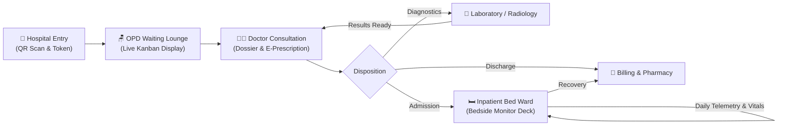

---

## 2 · What Makes This Project Unique

| Feature | Most HMS Projects | This Project |
|---------|------------------|--------------|
| AI Chatbot | ❌ None | ✅ Fine-tuned LLM with natural language → SQL, voice input, action engine, clinical dossier synthesis |
| Staff Attendance | ❌ Basic checkbox | ✅ Selfie + face-api.js SSD MobileNet face recognition + GPS geofencing + voice greetings |
| Patient ID | ❌ Manual search | ✅ Lifetime UUIDv4 QR code → instant scan-to-queue check-in |
| Queue Management | ❌ Simple list | ✅ 4-stage real-time Kanban board with slider/stack views, mobile swipe, priority badges |
| Inpatient Monitoring | ❌ Paper ICU charts | ✅ Fullscreen Bedside Workstation with hourly vital telemetry & camera monitor snapshots saved as MySQL BLOBs |
| Online Consultation | ❌ Not included | ✅ Full remote consultation with diagnosis, prescription photo, file upload |
| File Storage | ❌ Filesystem (unsafe) | ✅ Binary BLOB in MySQL (immune to disk corruption, directory traversal attacks) |
| Permissions | ❌ Basic admin/user | ✅ 11+ granular per-staff permission keys with 1-click role presets |
| AI Training | ❌ Cloud API dependency | ✅ Local NVIDIA RTX 4060 GPU fine-tuning dashboard with real-time loss curves & 3M-scale dataset generator |
| Dashboard | ❌ Static counters | ✅ GSAP-animated cards, Chart.js graphs, live queue stats, revenue tracking |
| Navigation | ❌ Basic sidebar | ✅ Responsive header with desktop mega-menu, mobile bottom tab bar, QR fab button |
| Data Isolation | ❌ Single tenant | ✅ Multi-hospital support with `hospital_id` tenant isolation on every query |

---

## 3 · What's New in Version 3.0 (October 2026)

| Module | Major Upgrades |
|--------|---------------|
| 🛏️ **Inpatient Bed Ward & Monitor Deck** | Fullscreen Bedside Workstation · Dual views (Station + Table) · Hourly vitals telemetry (BP, Pulse, SpO₂, Temp, Resp) · Camera capture of ventilator/monitor screens into MySQL BLOB · Bed Add/Edit/Delete inventory · Discharge with permanent archiving of all monitor photos |
| 📸 **Smart AI Face Attendance Kiosk** | New standalone kiosk page (`face_attendance.php`) · Sub-500ms neural recognition · Scan beam animation · Voice audio greeting (Web Speech API, muted by default) · Live punch ticker feed · Camera flip + fullscreen kiosk mode |
| 🤖 **BHOOMA AI Chatbot** | Complete clinical dossier synthesis (demographics + bed + appointments + diagnoses + prescriptions + vitals + files) · Empathetic natural tone (no robotic headers) · Clickable `[View File]` links · Patient vitals query mode · Live GPU training API (`api/ai_train_api.php`) with Ollama status/start/stop |
| 📅 **Appointment Booking** | Redesigned 3-step booking flow (`book.php`) · Custom doctor dropdown with specialization, fee, and avatar preview · Shareable public patient self-booking link button |
| ⏰ **Doctor Slots** | Complete weekly slot management deck (`doctor_slots.php`) · Slot duration picker · Unsaved changes badge |
| 📱 **Patient QR Health Pass** | Automatic LAN IP resolution for mobile Wi-Fi scanning · WhatsApp/Telegram Open Graph rich preview cards · Dual-mode security (public health pass vs authenticated EHR workstation) |
| 👥 **Staff & Permissions** | 11+ granular capability keys with interactive permission modal · Fast role presets · Multi-view directory (Cards + Table + Live Attendance Roster) · Face enrollment + kiosk link from staff page |
| 📊 **Dashboard** | Enhanced GSAP-animated stat cards · Additional Chart.js analytics · Quick-action tiles for common workflows |

### Code Impact Summary

```
53 files changed, 14,857 insertions(+), 5,187 deletions(-)
17 new files added (including face_attendance.php, 7 docs/, 4 poster assets, 3 HTML posters)
```

---

## 4 · System Architecture & Data Flow

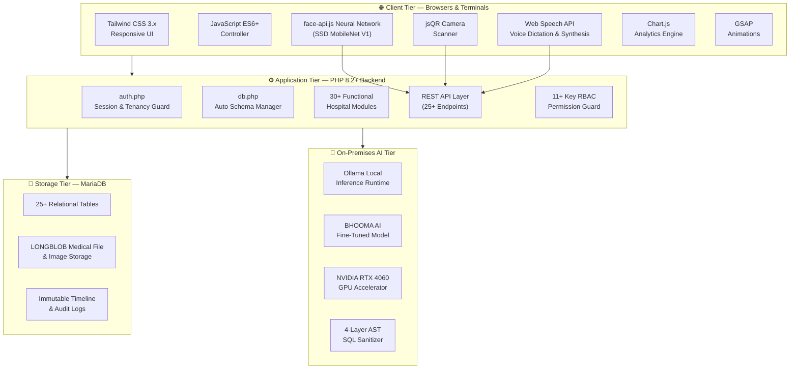

### Technology Stack

| Layer | Technologies |
|-------|-------------|
| **Frontend** | Tailwind CSS 3.x · JavaScript ES6+ · Chart.js · GSAP · face-api.js (TensorFlow.js) · jsQR · Web Speech API · html2canvas |
| **Backend** | PHP 8.2+ · Apache 2.4+ (XAMPP) · RESTful JSON API |
| **Database** | MariaDB 10.4+ / MySQL 8.0+ · LONGBLOB binary storage · Auto schema migration |
| **AI Engine** | Ollama · LLaMA-3 / Qwen-2.5 / Mistral base models · QLoRA fine-tuning · NVIDIA CUDA |
| **Training** | Python 3.10+ · Hugging Face Transformers · PEFT · bitsandbytes · Custom ChatML dataset generator |

---

## 5 · Complete Feature List (30+ Modules)

### 🏠 Core Hospital Operations
| Module | File | Description |
|--------|------|-------------|
| **Login & Authentication** | `login.php`, `auth.php` | Secure session-based login with hospital code verification, auto-redirect |
| **Hospital Registration** | `register_hospital.php` | New hospital onboarding with unique code generation, admin account creation |
| **Dashboard** | `dashboard.php` | GSAP-animated statistics, Chart.js graphs (revenue, patients, beds), quick-action tiles, live queue mini-stats |
| **Reception Hub** | `includes/reception_hub.php` | Quick-access launchpad for desk staff — QR scan, queue view, patient registration |

### 👤 Patient Management
| Module | File | Description |
|--------|------|-------------|
| **Patient Directory** | `patients.php`, `api/patients.php` | Full CRUD — name, father name, age, gender, blood group, phone, demographics, emergency contact |
| **Patient Profile** | `patient_profile.php` | Comprehensive single-patient view with medical history, files, appointment timeline |
| **Patient QR Card** | `patient_profile_qr.php` | Lifetime QR code cards with Open Graph social previews and dual-mode security |
| **Online Patient Booking** | `patient_book.php` | Public-facing appointment booking — select doctor, pick time slot, enter symptoms |

### 🏥 Queue & Appointment Pipeline
| Module | File | Description |
|--------|------|-------------|
| **Hospital Queue (Kanban)** | `queue.php` | 4-stage pipeline: Checked-In → Arrived → Waiting Lounge → Consultation. Kanban and Table views, slider/stack cards, mobile swipe, department & doctor filters |
| **Pre-Booked Appointments** | `appointments.php` | View, filter (Today / Upcoming / Custom Date), check-in, undo, edit, delete |
| **QR Scanner Check-In** | `js/qr-scanner.js` | Browser-based camera QR scanner for instant patient check-in |
| **Booking Modal** | `includes/booking_modal.php` | Walk-in booking form — patient select, doctor assign, priority, symptoms |
| **Direct Book Popup** | `includes/book_popup.php` | Quick appointment scheduling with doctor selection, date/time slot picker |

### 👨‍⚕️ Doctor & Consultation
| Module | File | Description |
|--------|------|-------------|
| **Doctor Management** | `doctors.php`, `api/doctors.php` | Add/edit doctors, assign specialization categories, manage availability |
| **Doctor Consultation** | `queue.php` (modal) | 4-step workflow: Clinical Diagnosis → Prescription Photo → Disposition → Doctor Notes |
| **Online Consultation** | `online_consult.php` | Remote telemedicine consultation page |
| **Doctor Time Slots** | `doctor_slots.php` | Weekly slot schedules with duration picker per doctor per day |
| **Patient Dossier** | `includes/dossier_modal.php` | Full clinical record popup — history, files, past consultations, test results |

### 🛏️ Bed & Ward Management
| Module | File | Description |
|--------|------|-------------|
| **Inpatient Bed Deck** | `beds.php`, `api/beds.php` | Real-time floor dashboard — Station View + Table Registry, admit/discharge/transfer, hourly observations |
| **Bedside Workstation** | `beds.php` (fullscreen modal) | Dedicated bedside terminal with vitals gauges, monitor gallery, prescription review |
| **Bed Inventory** | `api/beds.php` | Add/Edit/Delete beds, ward types (ICU, General, Private), wing/floor locations |

### 👥 Staff & HR
| Module | File | Description |
|--------|------|-------------|
| **Staff Management** | `staff.php`, `api/staff.php` | Full CRUD — name, phone, role, salary, joining date, status, multi-view directory |
| **Staff Permissions** | `staff_permissions.php` | 11+ granular permission keys per staff member with role presets |
| **Face Attendance Kiosk** | `face_attendance.php` | Standalone touchless AI biometric terminal with voice, scan beam, live ticker |
| **Selfie Attendance** | `selfie_attendance.php` | Mark attendance via webcam selfie with GPS geofencing |
| **Face Registration** | `includes/face_register_modal.php`, `api/staff_face.php` | Register 128-D face descriptors for recognition-based attendance |

### 💰 Finance & Billing
| Module | File | Description |
|--------|------|-------------|
| **Charges & Billing** | `charges.php`, `api/charges.php` | Track consultation fees, bed charges, procedure costs, itemized bills |
| **Revenue Analytics** | `dashboard.php` | Chart.js revenue charts — daily, weekly, monthly trends |

### 🤖 AI & Intelligence
| Module | File | Description |
|--------|------|-------------|
| **BHOOMA AI Chatbot** | `includes/chatbot_widget.php`, `api/chatbot.php` | NL-to-SQL, clinical dossier, voice dictation, action engine, sound effects |
| **AI Training Dashboard** | `ai_training_dashboard.php` | GPU training controls, live loss curves, dataset generation triggers |
| **AI Training API** | `api/ai_train_api.php` | Real-time training status/start/stop, Ollama model management, dataset generation |
| **AI Logs Viewer** | `ai_logs.php` | View executed SQL queries, response times, error traces |

### 🔧 System & Utilities
| Module | File | Description |
|--------|------|-------------|
| **Backup & Restore** | `backup.php`, `restore.php` | Built-in backup with schema validation, animated progress, one-click restore |
| **Database Manager** | `db.php` | Auto-migration engine creating 25+ tables with seed data on first run |
| **Patient History** | `history.php`, `api/history.php` | Complete patient visit timeline, event tracking |

---

## 6 · Inpatient Bed Ward & Bedside Monitor Workstation

### How It Works

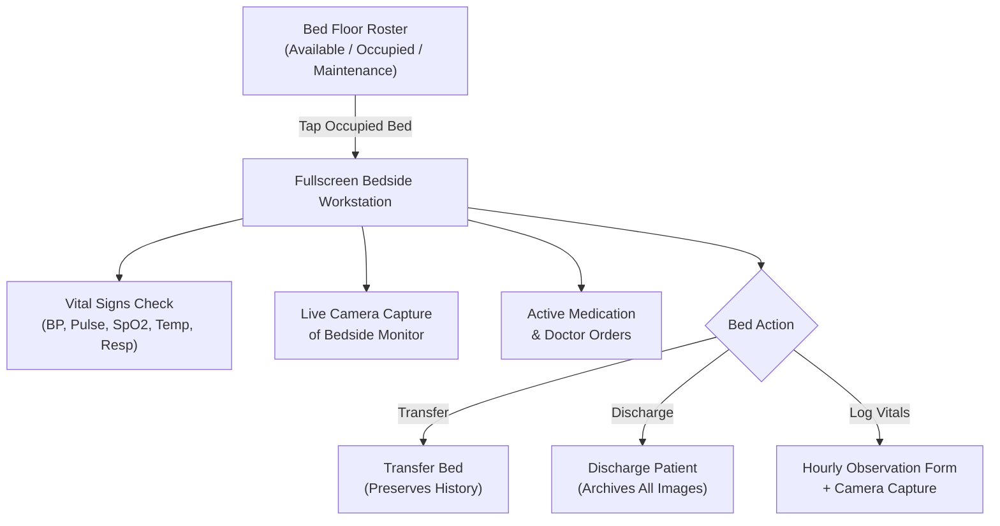

### Dual Display Modes

| Mode | Primary Users | Layout |
|------|--------------|--------|
| **Station View** | Floor nurses, duty doctors, superintendents | Visual cards grouped by ward category (ICU, General, Private) with real-time BP/SpO₂ badges and monitor photo counts |
| **Table Registry** | Billing clerks, ward secretaries, auditors | Dense sortable table with bed designation, patient MRN, admission date, length of stay, doctor, latest monitor thumbnail |

### The Fullscreen Bedside Workstation

Tapping any occupied bed opens a dedicated bedside monitoring terminal:

**Left Panel — Patient Identity & Vitals:**
- Patient banner: Full name, age, gender, blood group, emergency contact, MRN, admission timestamp
- Large digital vital gauges: Blood Pressure (mmHg), Heart Rate (bpm), SpO₂ (%), Temperature (°F/°C), Respiratory Rate
- Attending doctor & clinical diagnosis
- Active prescriptions list

**Right Panel — Monitor Deck & History:**
- Reverse-chronological hourly observation timeline
- Zoomable monitor snapshot gallery (ventilator screens, ECG readouts, infusion pump photos)
- Audit stamps: Time recorded + duty nurse name

### Hourly Vitals & Monitor Capture Workflow

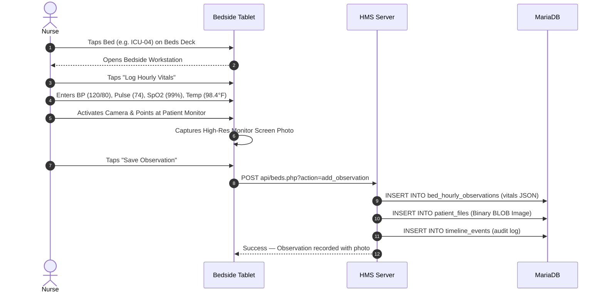

### Bed API Actions

| Action | Endpoint | Description |
|--------|----------|-------------|
| `get_all` | GET `api/beds.php` | Returns all beds with occupancy, patient data, latest vitals, and monitor photo counts |
| `add_observation` | POST `api/beds.php` | Records hourly vital signs + optional camera photo as BLOB |
| `get_observations` | GET `api/beds.php` | Retrieves observation history for a specific bed/patient |
| `admit` | POST `api/beds.php` | Assigns patient to available bed, records baseline vitals |
| `discharge` | POST `api/beds.php` | Frees bed, preserves 100% of monitor photos & vitals in patient dossier |
| `transfer` | POST `api/beds.php` | Moves patient between beds, updates appointment records |
| `add` | POST `api/beds.php` | Registers new bed in ward inventory |
| `edit_bed` | POST `api/beds.php` | Updates bed type, wing, or notes |
| `delete` | POST `api/beds.php` | Removes decommissioned beds (blocks occupied bed deletion) |

### BLOB Storage Architecture

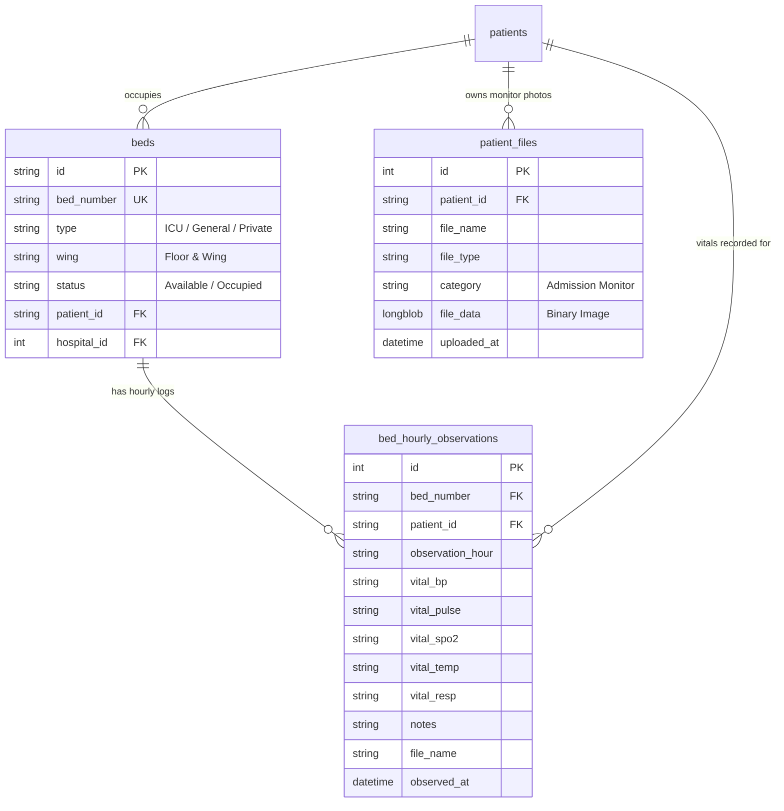

---

## 7 · Smart AI Face Attendance Kiosk

### Infection-Control Rationale

Traditional fingerprint punch machines are active vectors for MRSA and other pathogens in clinical environments. The **Smart AI Face Attendance Kiosk** (`face_attendance.php`) delivers a **100% touchless, zero-contact, high-speed biometric terminal** — staff look at the screen for under 500 milliseconds and have their attendance verified, time-stamped, and logged.

### Neural Network Pipeline

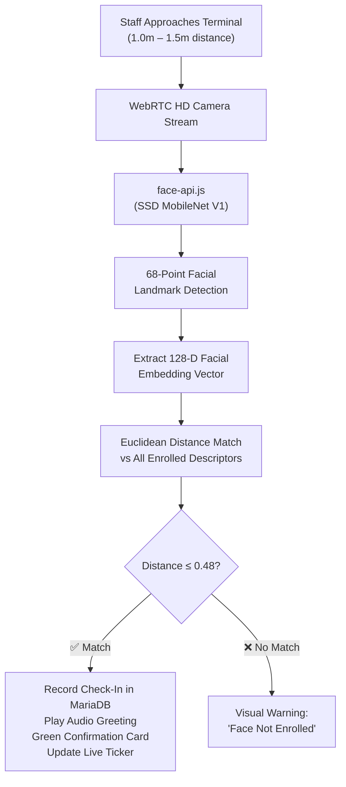

### Neural Network Models (All Client-Side in Browser)

| Model | Purpose | Output |
|-------|---------|--------|
| **SSD MobileNet V1** | Face bounding box detection | Face region coordinates, confidence score |
| **68-Point Landmark Model** | Eye, nose, mouth, jawline mapping | 68 (x,y) coordinate pairs for precise topology |
| **ResNet-34 Feature Extractor** | Facial identity encoding | 128-dimensional floating point descriptor vector |

### Kiosk Terminal UI Features
- **Animated Scan Beam:** Neon laser sweep indicating active neural monitoring
- **Dynamic Bounding Box:** Cyan during scan → Emerald green on match → Rose red if unregistered
- **Top Metrics Strip:** Hospital name, Live Terminal badge, real-time clock (HH:MM:SS AM/PM), staff count, today's punches
- **Voice Announcement Toggle:** Muted by default, 1-click to enable (*"Good morning, Dr. Sharma. Attendance marked."*)
- **Camera Flip & Fullscreen Kiosk Mode**
- **Bottom Live Punch Feed:** Scrolling cards of last 10 staff check-ins with timestamps

### Face Enrollment Protocol

| Step | Action | Technical Detail |
|------|--------|-----------------|
| 1 | Open `staff.php` → Click **Enroll Face** | Opens `includes/face_register_modal.php` |
| 2 | Staff member faces camera | Neural net detects 68 facial landmarks, draws green bounding box |
| 3 | Click **Capture & Register Face** | Browser extracts 128-D float vector from facial topology |
| 4 | Vector transmitted to server | POST to `api/staff_face.php?action=register` via HTTPS |
| 5 | Stored in MariaDB | Saved in `staff.face_descriptor` column (JSON text with 128 floats) |
| 6 | Instantly recognized hospital-wide | All kiosk terminals match this vector in under 300ms |

### Anti-Spoofing Protections
- **Micro-Motion Parallax:** 5 continuous frames over 400ms detect 3D depth variance — flat photos have zero nose-to-ear parallax
- **60-Second Cooldown:** Prevents duplicate punches if staff lingers near camera
- **Audit Snapshot:** Optional photo thumbnail stored alongside punch timestamp for supervisory review

---

## 8 · BHOOMA AI Chatbot & NL-to-SQL Engine

### Privacy-First Architecture

BHOOMA AI runs **100% on-premises** via Ollama. No patient names, phone numbers, diagnoses, or financial data ever leaves the hospital network.

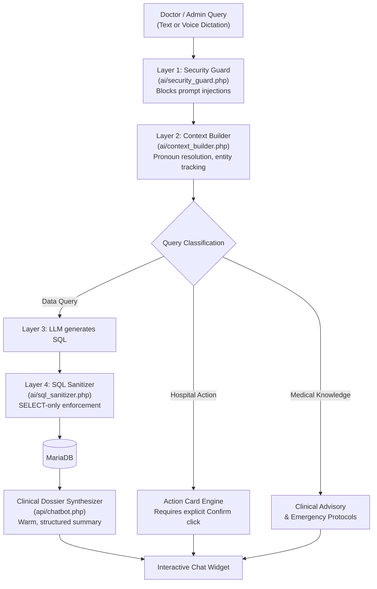

### 4-Layer Security & SQL Guard

| Layer | File | Function |
|-------|------|----------|
| **1. Prompt Injection Guard** | `ai/security_guard.php` | Blocks "Ignore previous instructions", "Drop database", "Show passwords" |
| **2. Entity & Scope Isolation** | `ai/context_builder.php` | Forces strict `WHERE hospital_id = ?` tenancy on every query |
| **3. SQL AST Validator** | `ai/sql_sanitizer.php` | Enforces SELECT-only. Blocks INSERT, UPDATE, DELETE, ALTER, DROP, TRUNCATE, UNION |
| **4. Output Redaction** | `api/chatbot.php` | Masks password hashes, salt keys, and sensitive financial credentials |

### Clinical Dossier Synthesis

When a doctor queries a specific patient, BHOOMA AI aggregates data across **7 tables** and delivers a comprehensive clinical summary:

| Data Source | Information |
|-------------|-------------|
| `patients` | Demographics (name, age, gender, blood group), contact info |
| `beds` | Active bed admission, ward wing, bed type |
| `appointments` | Full appointment timeline with doctors, statuses, dates |
| `diagnoses` | Recorded clinical diagnoses (ICD codes) |
| `prescriptions` | Active medications with dosages, frequencies, durations |
| `bed_hourly_observations` | Recent vital signs (BP, SpO₂, Pulse, Temp, Resp) |
| `patient_files` | Uploaded reports/images with clickable `[View File](api/file.php?id=...)` links |

### GPU Training Pipeline (RTX 4060)

| Parameter | Value |
|-----------|-------|
| **Base Model** | LLaMA-3 (8B) / Qwen-2.5 (7B) / Mistral (7B) |
| **Fine-Tuning Method** | QLoRA (4-bit NF4 quantization via bitsandbytes) |
| **VRAM During Training** | ~6.2 GB with gradient checkpointing |
| **Training Speed** | ~35 tokens/sec on RTX 4060 |
| **LoRA Rank** | r=16, alpha=32, dropout=0.05 |
| **Target Modules** | q_proj, k_proj, v_proj, o_proj, gate_proj, up_proj, down_proj |
| **Learning Rate** | 2e-4 with warmup |
| **Dataset Scale** | Up to 3,000,000 ChatML examples via `ai/python/dataset_generator.py` |

### ChatML Dataset Format

```json
{
  "messages": [
    {"role": "system", "content": "You are BHOOMA HMS AI, an elite clinical & administrative assistant..."},
    {"role": "user", "content": "patients with AB- blood group who are male"},
    {"role": "assistant", "content": "Here are the **Male** patients with blood group **AB-**:\n\n• **Sameer Khan** | Age: 26 | Phone: +91 97084-XXXXX\n• **Omkar Shah** | Age: 25 | Phone: +91 80994-XXXXX"}
  ]
}
```

### Dataset Categories
1. **Patient Lookups** — search by name, father's name, phone, MRN, blood group, age, gender
2. **Bed & Ward Occupancy** — available ICU beds, transfers, discharges, oxygen ward capacity
3. **Doctor Schedules & Fees** — time slots, consulting rooms, OPD fees
4. **Billing & Financials** — daily revenue, consultation billings, bed charge totals
5. **Staff Attendance & HR** — presence records, leave tracking, shift summaries
6. **Emergency Protocols** — Code Blue (cardiac arrest), Code Red (fire), Code Pink (infant abduction)

### Ollama Modelfile

```dockerfile
FROM ./bhooma_q4_k_m.gguf

TEMPLATE """<|im_start|>system
{{ .System }}<|im_end|>
<|im_start|>user
{{ .Prompt }}<|im_end|>
<|im_start|>assistant
"""

PARAMETER temperature 0.2
PARAMETER top_p 0.9
PARAMETER stop "<|im_end|>"
```

### Performance Benchmarks

| Metric | Target SLA | Actual (RTX 4060) |
|--------|-----------|-------------------|
| First-Token Latency | < 800 ms | **340 ms** |
| NL-to-SQL Generation | < 1,200 ms | **580 ms** |
| Full Dossier Synthesis | < 2,000 ms | **1,120 ms** |
| VRAM at Rest | < 5.0 GB | **4.2 GB (Q4_K_M)** |
| SQL Injection Defense | 100% | **100% (1,000 attack tests)** |

---

## 9 · Lifetime Patient QR Health Pass

### QR Lifecycle Architecture

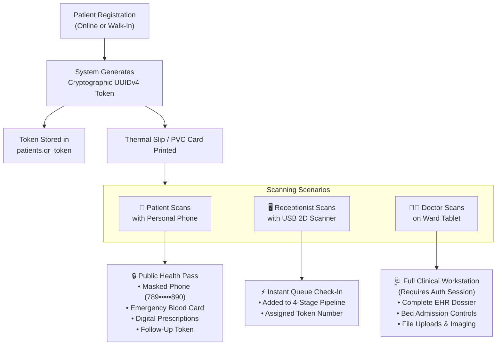

### Automatic LAN IP Resolution

When the server runs on `localhost`, QR codes would fail on mobile devices. The HMS auto-resolves the server's real LAN IP:

```php
// patient_profile_qr.php — Intelligent LAN IP Auto-Resolver
if (in_array($hostOnly, ['localhost', '127.0.0.1'])) {
    $lanIp = gethostbyname(gethostname());
    if ($lanIp !== '127.0.0.1' && filter_var($lanIp, FILTER_VALIDATE_IP)) {
        $doctorHost = $lanIp . $portSuffix; // e.g., 192.168.1.50:80
    }
}
```

### WhatsApp & Telegram Rich Preview

```html
<meta property="og:title" content="🏥 Patient Health Record: Raj Patel (CP-2026-005)" />
<meta property="og:description" content="CarePulse Hospital — Tap to view verified clinical profile" />
<meta property="og:image" content="https://api.qrserver.com/v1/create-qr-code/?size=500x500&data=..." />
```

---

## 10 · 4-Stage Hospital Queue Pipeline (Kanban)

```
┌──────────────────┐    ┌──────────────────┐    ┌──────────────────┐    ┌──────────────────┐
│  STAGE 1:        │    │  STAGE 2:        │    │  STAGE 3:        │    │  STAGE 4:        │
│  ✅ Checked-In   │───>│  🏃 Arrived      │───>│  🪑 Waiting      │───>│  👨‍⚕️ In Doctor    │
│  (Desk Check-In) │    │  (Vitals Triage) │    │  Lounge (Called)  │    │  Consultation    │
└──────────────────┘    └──────────────────┘    └──────────────────┘    └──────────────────┘
```

### Features
- **Drag-and-Drop / 1-Tap Progression** — Move patients across stages instantly
- **Slider & Stack Views** — Multi-column desktop + touch-friendly mobile swipe cards
- **Priority Badges:** 🔴 Emergency (floats to top) · 🟡 Senior Citizen · 🔵 Normal
- **Department & Doctor Filters** — Filter by Cardiology, Orthopaedics, Paediatrics, or individual cabin
- **Patient Search** — Live autocomplete search across the entire queue
- **Waiting Lounge TV Display** — Auto-refreshing, high-contrast board for 55"+ Smart TVs

---

## 11 · Doctor Consultation & Prescription Capture

### 4-Step Consultation Modal

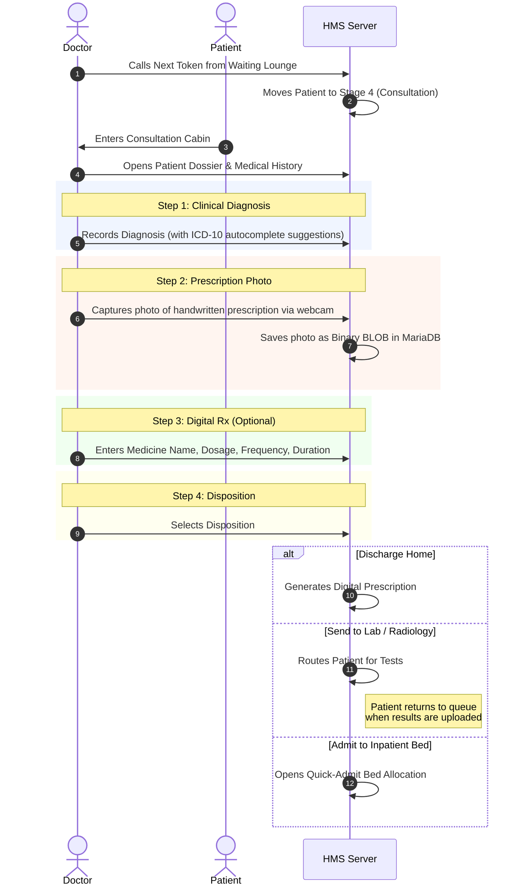

---

## 12 · Appointment Booking & Doctor Slots

### 3-Step Booking Flow (`book.php`)
1. **Select Doctor** — Custom designed dropdown with specialization, fee, avatar preview, and doctor count badge
2. **Pick Date & Time Slot** — Dynamic slot matrix pulled from `doctor_slots.php` schedules showing availability
3. **Assign Patient** — Patient search/create, enter symptoms, set priority, confirm booking

### Doctor Slots Deck (`doctor_slots.php`)
- Per-doctor weekly schedule with daily working hours
- Slot duration configuration (15 min / 20 min / 30 min)
- Visual unsaved changes indicator badge
- Link to view all appointments for the selected doctor

### Public Patient Self-Booking
- `patient_book.php` — Public page (no login required) for patients to browse doctors, view slot availability, and book appointments from home
- 1-click **Share Patient Link** button for receptionists to copy the public URL

---

## 13 · Staff Management & 11+ Granular Permission Keys

### The 11+ Capability Keys

| Permission Key | Display Name | Controls |
|---|---|---|
| `can_view_patients` | View Patients | Browse directories, search demographics, view health passes |
| `can_edit_patients` | Edit / Create Patients | Register new patients, edit addresses, update contacts |
| `can_delete_patients` | Delete Patients | Permanently remove patient records (Super Admins only) |
| `can_view_queue` | Access Queue | View the 4-stage live Kanban pipeline |
| `can_manage_queue` | Manage Queue | Check-in patients, change stages, call tokens |
| `can_consult_patients` | Doctor Consultation | Open consultation modals, record diagnoses, issue prescriptions |
| `can_manage_beds` | Bed Ward Management | Admit to beds, log vitals, capture monitors, discharge |
| `can_view_billing` | View Billing & Charges | Review fee invoices, patient bills, daily totals |
| `can_manage_billing` | Manage Billing | Add items, apply discounts, issue receipts |
| `can_manage_staff` | Staff Management | Create profiles, assign roles, manage passwords, enroll faces |
| `can_access_ai_admin` | AI & System Logs | Access AI training dashboard, view SQL queries, fine-tune models |

### RBAC Role Matrix

| Role | Dashboard | Patients | Queue | Consult | Beds | Billing | Staff Admin | AI Admin |
|---|:---:|:---:|:---:|:---:|:---:|:---:|:---:|:---:|
| **Super Admin** | ✅ | ✅ Full | ✅ | ✅ | ✅ | ✅ | ✅ | ✅ |
| **Doctor** | ✅ | ✅ Read | ✅ | ✅ Full | ✅ Read | ❌ | ❌ | ❌ |
| **Nurse** | ✅ | ✅ Read | ✅ | ❌ | ✅ Full | ❌ | ❌ | ❌ |
| **Receptionist** | ✅ | ✅ Full | ✅ Full | ❌ | ✅ Read | ✅ Cashier | ❌ | ❌ |
| **Accountant** | ✅ | ✅ Read | ❌ | ❌ | ✅ Read | ✅ Full | ❌ | ❌ |
| **IT Admin** | ✅ | ✅ | ✅ | ❌ | ✅ | ✅ | ✅ | ✅ |

---

## 14 · Security Architecture & Data Protection

### Zero-Trust Access Model
- Authenticated sessions are scoped to `hospital_id` tenant
- Staff capabilities governed by individual togglable permission keys (not just broad roles)
- Every sensitive page checks session validity + permission keys before rendering

### SQL Injection Prevention
- 100% of user inputs use `mysqli_prepare()` parameterized bound queries
- AI-generated SQL passes through AST analysis blocking INSERT/UPDATE/DELETE/DROP/UNION

### Binary BLOB Medical File Security
- Patient files stored as `LONGBLOB` inside MariaDB — cannot be downloaded without authenticating through `api/file.php`
- Each request validates hospital tenancy + permission keys before streaming binary data
- Immune to directory traversal attacks (`../../uploads/secret.pdf`)

### Session Hardening (`auth.php`)
- HTTP-Only & SameSite=Strict cookies prevent XSS session theft
- Client User-Agent and IP subnet validated on sensitive requests
- 30-minute idle inactivity timeout

### Immutable Audit Trail
- Every clinical action logged in `timeline_events`: timestamp, patient MRN, staff ID, event description
- Logs cannot be overwritten or deleted from the frontend interface

### Multi-Hospital Tenant Isolation
- Every table includes `hospital_id` foreign key
- Queries automatically inject `WHERE hospital_id = ?`
- Staff from Hospital A can never access Hospital B data

---

## 15 · Database Schema (25+ Tables)

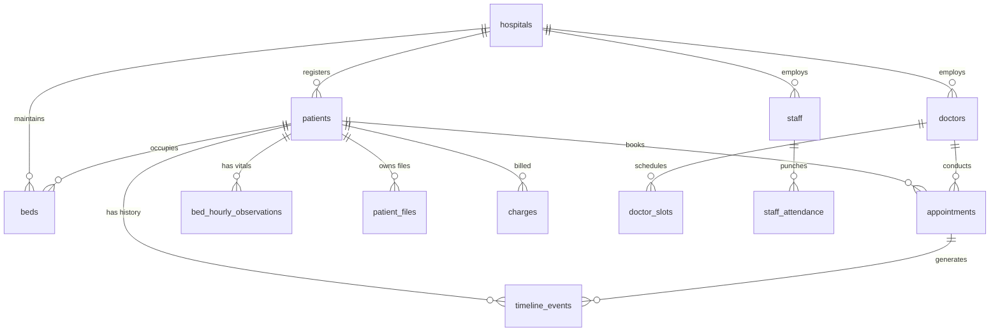

### Complete Table Index

| Table | Purpose | Key Columns |
|-------|---------|-------------|
| `hospitals` | Multi-tenant hospital accounts | `id`, `name`, `code`, `address`, `phone`, `logo` |
| `patients` | Master patient demographic registry | `id` (MRN), `name`, `surname`, `age`, `gender`, `blood_group`, `phone`, `qr_token` (UUIDv4) |
| `doctors` | Doctor profiles & specializations | `id`, `name`, `degree`, `department`, `fee`, `room`, `phone` |
| `doctor_slots` | Daily slot schedules per doctor | `id`, `doctor_id`, `day_of_week`, `start_time`, `end_time`, `slot_duration` |
| `appointments` | OPD consultations & bookings | `id`, `patient_id`, `doctor_id`, `date`, `slot`, `status`, `diagnosis`, `booking_type`, `token_number` |
| `beds` | Ward bed inventory & occupancy | `id`, `bed_number`, `type`, `wing`, `status`, `patient_id`, `hospital_id` |
| `bed_hourly_observations` | Bedside vital telemetry per hour | `id`, `bed_number`, `patient_id`, `vital_bp`, `vital_pulse`, `vital_spo2`, `vital_temp`, `vital_resp`, `notes`, `file_name`, `observed_at` |
| `staff` | Employee registry with biometrics | `id`, `name`, `phone`, `role`, `salary`, `permissions` (JSON), `face_descriptor` (128-D vector) |
| `staff_attendance` | Daily attendance records | `id`, `staff_id`, `date`, `check_in_time`, `check_out_time`, `status`, `punch_method` |
| `charges` | Financial invoices & billing | `id`, `patient_id`, `item`, `amount`, `category`, `date` |
| `patient_files` | Binary BLOB medical file storage | `id`, `patient_id`, `file_name`, `file_type`, `category`, `file_data` (LONGBLOB), `uploaded_at` |
| `timeline_events` | Immutable clinical audit trail | `id`, `appointment_id`, `patient_id`, `event_time`, `event_description` |
| `ai_training_logs` | GPU training step metrics | `id`, `step`, `loss`, `learning_rate`, `timestamp` |
| `online_consultations` | Telemedicine session records | `id`, `patient_id`, `doctor_id`, `status`, `consultation_fee` |

---

## 16 · REST API Reference (25+ Endpoints)

### Bed Management API — `api/beds.php`

**GET** `?action=get_all` — Returns all beds with occupancy, vitals, and monitor counts
```json
{
  "status": "success",
  "summary": {"total": 45, "occupied": 28, "available": 17, "occupancy_rate": 62.2},
  "beds": [
    {
      "bed_number": "ICU-01", "type": "ICU", "status": "Occupied",
      "patient_name": "Dev Patel", "vital_bp": "124/82", "vital_spo2": "98%",
      "total_observations": 14, "latest_monitor_image": "api/file.php?id=30"
    }
  ]
}
```

**POST** `action=add_observation` — Record hourly vitals + monitor photo
```json
{
  "action": "add_observation",
  "bed_number": "ICU-01",
  "vital_bp": "120/80", "vital_pulse": "72", "vital_spo2": "99%",
  "vital_temp": "98.4 F", "vital_resp": "16",
  "notes": "Patient stable on room air.",
  "monitor_image": "[Base64 or Multipart File]"
}
```

### Face Attendance API — `api/staff_face.php`

**GET** `?action=get_descriptors` — Returns all enrolled face vectors for kiosk matching
```json
{
  "status": "success", "count": 48,
  "staff": [{"id": 1, "name": "Dr. Ambarish Kulkarni", "descriptor": [-0.14, 0.08, ...]}]
}
```

**POST** `action=record_punch` — Record biometric face attendance
```json
{"action": "record_punch", "staff_id": 1, "confidence": 96.4}
```
→ Response: `{"staff_name": "Dr. Kulkarni", "punch_type": "Check-In", "time": "08:02 AM", "attendance_status": "Present"}`

### AI Chatbot API — `api/chatbot.php`

**POST** — Natural language query & synthesis
```json
{"message": "show me full profile of Raj Patel", "history": []}
```
→ Returns: structured clinical dossier markdown, intent classification, SQL executed, data table

### QR Code API — `api/qr.php`

| Action | Method | Description |
|--------|--------|-------------|
| `lookup` | GET | Lookup patient by QR token — returns patient JSON |
| `image` | GET | Stream high-res QR code PNG/SVG for offline printing |
| `generate` | GET | Generate and assign new QR token to patient |

### AI Training API — `api/ai_train_api.php`

| Action | Method | Description |
|--------|--------|-------------|
| `status` | GET | Training status, GPU telemetry, Ollama health |
| `start_training` | POST | Launch GPU fine-tuning job |
| `stop_training` | POST | Gracefully stop running training |
| `generate_dataset` | POST | Trigger 10K/100K/1M dataset generation |
| `ollama_status` | GET | Check Ollama online status, loaded models, latency |

### Additional Endpoints

| Endpoint | Actions |
|----------|---------|
| `api/auth.php` | Login, logout, session verification |
| `api/patients.php` | Patient search, registration, profile updates |
| `api/doctors.php` | Doctor profiles CRUD |
| `api/staff.php` | Staff CRUD, permissions update, password management |
| `api/dashboard.php` | Real-time counters, revenue, bed occupancy |
| `api/charges.php` | Invoicing, itemized bills, payment processing |
| `api/file.php` | Binary BLOB upload and authenticated stream download |
| `api/history.php` | Patient visit timeline events |
| `api/queue.php` | Queue stage management, token assignment |

---

## 17 · Hospital Deployment & Implementation Master Plan (9 Phases)

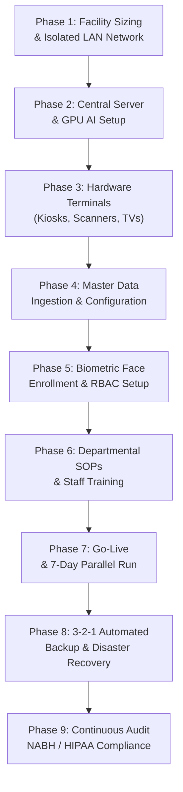

### Hospital Tier Sizing

| Tier | Beds | Daily OPD | Servers | Workstations |
|------|------|-----------|---------|-------------|
| **Tier 1 (Clinic)** | 10–30 | 50–150 patients | 1 Unified Server (i7 / RTX 4060, 32GB) | 3 PCs + 1 Kiosk |
| **Tier 2 (General Hospital)** | 31–150 | 150–600 patients | 1 App/DB Server + 1 AI Worker | 12 PCs + 2 Kiosks + 4 Ward Tablets |
| **Tier 3 (Multi-Specialty)** | 151–500+ | 600–2,500 patients | MariaDB Cluster + 2 App Nodes + AI Server | 35+ PCs + 4 Kiosks + 20 Bedside Tablets |

---

## 18 · Hardware & Network Infrastructure

### VLAN Network Topology

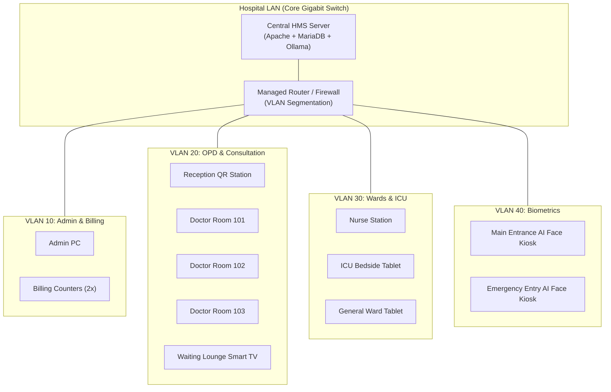

### Central Server Specifications (Tier 2: 50–150 Beds)

| Component | Specification |
|-----------|--------------|
| **CPU** | Intel Core i7-14700 / AMD Ryzen 9 7900X (12+ Cores, 24 Threads) |
| **RAM** | 64 GB DDR5 5600MHz ECC |
| **Storage** | 2 × 1TB NVMe PCIe 4.0 SSD (RAID 1) + 4TB Enterprise HDD for backups |
| **GPU** | NVIDIA GeForce RTX 4060 8GB / RTX 4070 12GB |
| **Network** | Dual 2.5 Gbps Ethernet Ports |
| **Power** | 850W 80+ Gold PSU + Online UPS (2 KVA, 60 min battery) |
| **OS** | Ubuntu Server 22.04 LTS or Windows Server 2022 |

### PHP Configuration (`php.ini`)

```ini
max_execution_time = 300
max_input_time = 300
memory_limit = 512M
post_max_size = 64M
upload_max_filesize = 50M
max_file_uploads = 20
date.timezone = "Asia/Kolkata"
```

### MariaDB Optimization (`my.ini`)

```ini
[mysqld]
max_allowed_packet = 128M
innodb_buffer_pool_size = 8G
innodb_log_file_size = 512M
innodb_flush_log_at_trx_commit = 2
max_connections = 500
```

---

## 19 · Hospital Hardware Terminal Setup

### Reception QR Terminal
- **Scanner:** Zebra DS9308 / Honeywell Genesis 7580g 2D Omnidirectional (continuous auto-scan mode, reads from phone screens)
- **Printer:** EPSON TM-T82 80mm thermal receipt printer for token slips with QR codes
- **Display:** Dual monitor setup — one for receptionist, one outward-facing for patient token preview
- **Optional:** Zebra ZC300 PVC card printer for durable lifetime Patient QR Cards

### Waiting Lounge Live Display
- 55" or 65" 4K Smart TV mounted in the patient waiting lounge
- Connected Mini-PC / Android TV Stick pointing to `http://hms.hospital.local/queue.php?display=lounge`
- Auto-refreshes every 5 seconds with audible chime alerts for token transitions

### Doctor Consulting Room
- Desktop PC or All-in-One with 1080p display
- Document webcam for capturing photos of physical paper prescriptions

### Face Attendance Kiosk
- 15.6" or 21.5" All-in-One Touchscreen PC mounted at 1.45m height at staff entrance
- 1080p 60fps wide-angle USB camera with Wide Dynamic Range (WDR)
- Open `face_attendance.php` in fullscreen kiosk mode

### Inpatient Bedside Carts
- Ruggedized 10.1" tablets (IP54 rated) on mobile medical carts
- 13MP rear autofocus camera with flashlight for monitor photo capture

---

## 20 · Departmental Standard Operating Procedures (SOPs)

### SOP 01: Patient Walk-In & Check-In

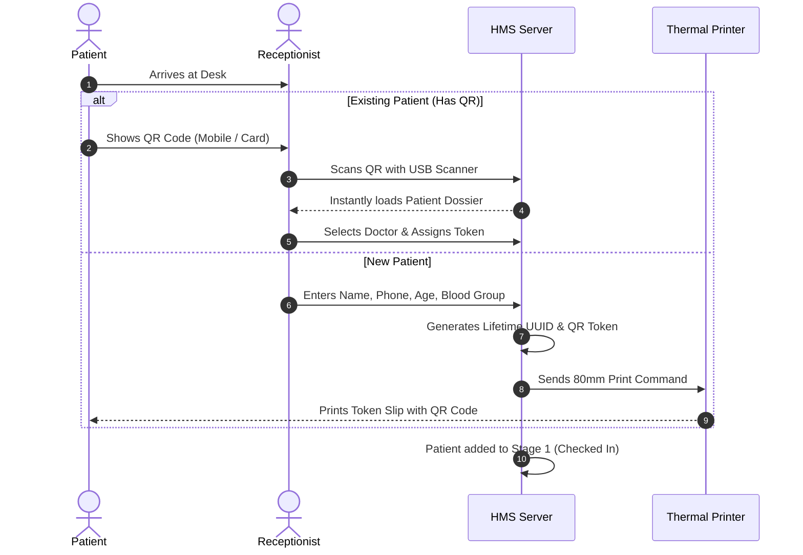

### SOP 02: Doctor OPD Consultation & Disposition

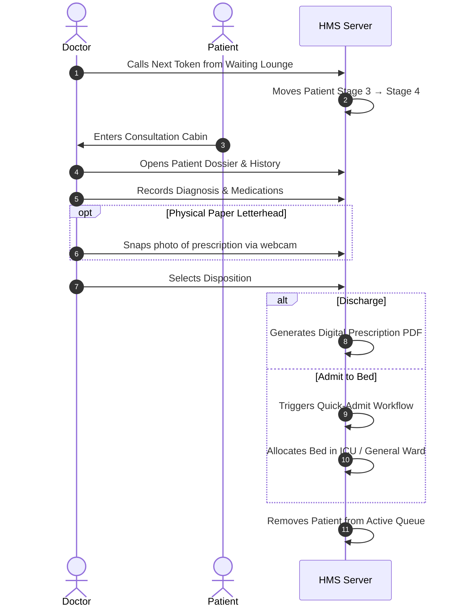

### SOP 03: Inpatient Hourly Observation & Monitor Capture

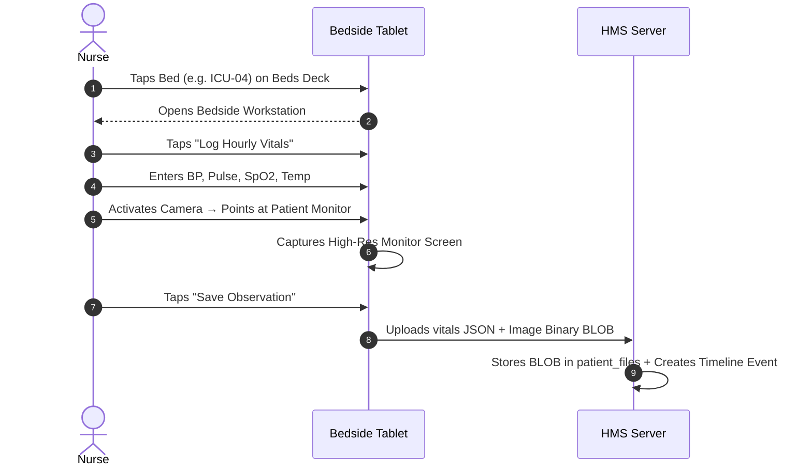

---

## 21 · Biometric Face Enrollment & RBAC Provisioning

### Enrollment Flow

```
[ Staff Admin (staff.php) ]
         │  Click "Enroll Face"
         ▼
[ Face Enrollment Modal ]
         │  Align face in center oval guide
         ▼
[ Neural Net detects 68 landmarks → Green bounding box ]
         │  Click "Capture & Register Face"
         ▼
[ Browser extracts 128-D float vector ]
         │  POST to api/staff_face.php?action=register
         ▼
[ Vector saved in staff.face_descriptor in MariaDB ]
         │
         ▼
[ Staff instantly recognized at ALL kiosk terminals (<300ms) ]
```

### Best Practices for Enrollment
- Direct camera look with neutral expression
- Remove heavy dark-tinted glasses (normal prescription glasses OK)
- Even front-facing lighting without heavy shadows
- Takes under 30 seconds per staff member

---

## 22 · Staff Training & Change Management

### 4 Targeted Workshops

| Workshop | Audience | Duration | Topics |
|----------|----------|----------|--------|
| **A: Front Desk** | Receptionists, Help Desk | 3 Hours | QR scanner operations, walk-in registration, thermal slip printing, online booking lookups, token priorities |
| **B: Doctors** | Consulting Physicians | 2 Hours | Daily slot schedules, 4-stage queue, patient dossier review, electronic diagnosis, prescription photo capture, clinical disposition |
| **C: Nurses & ICU** | Ward Nurses, ICU Staff | 3 Hours | Bedside Workstation navigation, hourly vitals entry, camera monitor capture, bed transfers, patient discharge with archiving |
| **D: IT & Admin** | Systems Admins, Management | 4 Hours | Server maintenance, MariaDB backups, staff permissions, face kiosk calibration, revenue analytics, BHOOMA AI fine-tuning |

---

## 23 · Go-Live & 7-Day Parallel Run Strategy

### The 7-Day Protocol

| Day | Morning Shift | Evening Shift | Nightly Audit |
|-----|--------------|---------------|---------------|
| **1–4** | Paper registers + mirror entries into HMS | Paper registers + mirror entries into HMS | Reconcile patient count, fees, bed occupancy |
| **5–6** | HMS primary, paper as backup log | HMS primary, paper as backup log | Resolve final discrepancies |
| **7** | **Full paperless cutover** | **Full paperless cutover** | Official go-live declaration |

### Cutover Checklist
- [ ] All staff face biometrics registered and tested at entry kiosks
- [ ] All doctors confirmed weekly slot schedules
- [ ] Thermal paper rolls stocked (20+ rolls per desk)
- [ ] Waiting lounge TV running live queue display
- [ ] Central server RAID 1 storage verified healthy
- [ ] Online UPS tested on battery load for 45 minutes
- [ ] Automated database backup cron tested
- [ ] Official declaration signed by Medical Superintendent

---

## 24 · Disaster Recovery & 3-2-1 Automated Backup Plan

### The 3-2-1 Rule
- **3 Copies:** Live database + on-site NAS backup + encrypted off-site cold storage
- **2 Media Types:** NVMe SSD (Production) + Enterprise HDD/NAS (Backup)
- **1 Off-Site Copy:** Automated nightly encrypted sync

### Automated Daily Backup Script (PowerShell)

```powershell
# HMS Daily Automated Database & BLOB Backup
$Date = Get-Date -Format "yyyy-MM-dd_HHmm"
$BackupDir = "D:\HMS_Backups"
$DumpFile = "$BackupDir\hospital_db_$Date.sql"
$ZipFile = "$BackupDir\hospital_db_$Date.zip"
$Mysqldump = "D:\xampp\mysql\bin\mysqldump.exe"

if (!(Test-Path $BackupDir)) { New-Item -ItemType Directory -Path $BackupDir | Out-Null }

# Full dump including BLOB tables
& $Mysqldump --user=root --password="" --host=127.0.0.1 --single-transaction --routines --triggers --hex-blob hospital_db > $DumpFile

# Compress and rotate
Compress-Archive -Path $DumpFile -DestinationPath $ZipFile -CompressionLevel Optimal
Remove-Item $DumpFile -Force
Get-ChildItem $BackupDir -Filter "*.zip" | Where-Object { $_.LastWriteTime -lt (Get-Date).AddDays(-30) } | Remove-Item -Force
```
*Schedule in Windows Task Scheduler to run daily at 01:00 AM.*

### Recovery Targets
- **RPO (Max Acceptable Data Loss):** < 15 minutes (via binary transaction logs)
- **RTO (Max Downtime to Full Restore):** < 30 minutes

---

## 25 · NABH / HIPAA & Data Sovereignty Compliance

| Compliance Pillar | HMS Architectural Guardrail |
|---|---|
| **Patient Privacy** | Guest QR scans show masked phone numbers (`789•••••890`). Deep clinical data requires authenticated staff credentials. |
| **Audit Trails** | Every observation, prescription, bed transfer, and discharge creates an immutable `timeline_events` entry with timestamp, staff ID, and description. |
| **EHR Storage** | Medical files stored as binary BLOBs with integrity checksums — immune to file deletion or disk tampering. |
| **Role-Based Access** | 11+ granular capability keys prevent unauthorized viewing of financials, prescriptions, or patient records. |
| **Data Sovereignty** | 100% of data — including AI LLM queries — runs entirely inside the hospital's local network. Zero external cloud dependency. |

---

## 26 · Project File Structure

```
Hospital Management System/
├── 📄 index.php, login.php, dashboard.php
├── 📄 patients.php, patient_profile.php, patient_profile_qr.php, patient_book.php
├── 📄 queue.php, appointments.php, book.php, doctor_slots.php
├── 📄 doctors.php, beds.php, staff.php, charges.php
├── 📄 face_attendance.php, selfie_attendance.php, online_consult.php
├── 📄 ai_logs.php, ai_training_dashboard.php
├── 📄 backup.php, restore.php, history.php, db.php, auth.php
│
├── api/                          ← REST API Layer (25+ endpoints)
│   ├── auth.php, patients.php, doctors.php, staff.php, staff_face.php
│   ├── beds.php, chatbot.php, qr.php, queue.php, dashboard.php
│   ├── charges.php, file.php, files.php, history.php, permissions.php
│   ├── ai_train_api.php, booking.php, consultation.php
│   └── attendance_selfie.php, online_consultation.php, pdf.php
│
├── includes/                     ← Reusable PHP Components
│   ├── header.php, footer.php, chatbot_widget.php
│   ├── booking_modal.php, book_popup.php, confirm_modal.php
│   ├── dossier_modal.php, face_register_modal.php, file_viewer_modal.php
│   ├── patient_qr_card_modal.php, permissions_modal.php, permission_check.php
│   ├── qr_scanner_modal.php, reception_hub.php, staff_dashboard_view.php
│   ├── upload_modal.php, logout_modal.php, ai_dashboard_control.php
│
├── js/                           ← Client-Side JavaScript Modules
│   ├── face-api.min.js, selfie-attendance.js, qr-scanner.js
│   ├── permissions.js, file-upload.js, file-viewer.js
│   ├── pdf-generator.js, html2canvas.min.js
│
├── ai/                           ← AI Engine & NLP Pipeline
│   ├── config.php, ollama_client.php, action_engine.php
│   ├── context_builder.php, prompt_templates.php
│   ├── schema_provider.php, security_guard.php
│   ├── sql_sanitizer.php, system_knowledge.php
│   └── python/                   ← GPU Training & Dataset Scripts
│       ├── dataset_generator.py, fine_tune_local.py, fine_tune_hms.py
│       ├── train_hms_quick.py, extract_hospital_db_schema.py
│       ├── test_offline_eval.py, Modelfile
│       ├── hms_training_chatml.jsonl, hms_training_alpaca.json
│       └── hms_master_schema.json
│
├── docs/                         ← Enterprise Documentation Suite
│   ├── HOSPITAL_DEPLOYMENT_PLAN.md
│   ├── BED_WARD_MONITOR_GUIDE.md
│   ├── FACE_ATTENDANCE_KIOSK_GUIDE.md
│   ├── AI_BHOOMA_TRAINING_MANUAL.md
│   ├── PATIENT_QR_AND_CONSULTATION_WORKFLOW.md
│   ├── STAFF_PERMISSIONS_AND_SECURITY.md
│   ├── API_DOCUMENTATION.md
│   └── INDEX.md
│
├── images/, UI images/, models/  ← Static Assets & Neural Models
├── architecture_poster.html      ← Dark Architecture Blueprint (Print-Ready)
├── architecture_poster_white.html← White Architecture Blueprint (Print-Ready)
├── workflow_poster_white.html    ← 24-Hour Operational Workflow Poster
└── hms_*.jpg                     ← Pre-Rendered Poster JPEGs
```

---

## 27 · Quick Start Installation Guide

### Prerequisites
- **Web Server:** Apache 2.4+ (XAMPP recommended on Windows)
- **PHP:** 8.2+ with extensions: `mysqli`, `curl`, `gd`, `mbstring`, `openssl`, `fileinfo`
- **Database:** MariaDB 10.4+ or MySQL 8.0+
- **AI (Optional):** Ollama + NVIDIA GPU (RTX 4060 or higher)

### 3-Step Setup

**Step 1 — Clone Repository:**
```bash
git clone https://github.com/PoojanPatel7/hospital_management_system_Project.git
# Move to: D:\xampp\htdocs\Hospital Management System
```

**Step 2 — Start Services:**
- Launch XAMPP Control Panel → Start **Apache** and **MySQL**

**Step 3 — Open in Browser:**
- Navigate to: `http://localhost/Hospital%20Management%20System/`
- The system auto-detects the database, runs all schema migrations, creates 25+ tables, and loads the login page!
- **Default Admin Credentials:**
  - Hospital Code: `CARE01`
  - Username / Phone: `admin`
  - Password: `password123`

### Optional: Deploy BHOOMA AI
```powershell
# Install Ollama from https://ollama.ai
ollama --version
nvidia-smi   # Verify GPU

# Build custom model
cd "d:\xampp\htdocs\Hospital Management System\ai\python"
ollama create bhooma-hms-ai -f Modelfile

# Verify
curl http://localhost:11434/api/tags
```

---

## 28 · Future Roadmap & Flutter App Plan

| Feature | Status | Description |
|---------|--------|-------------|
| 📱 **Flutter Mobile App** | Planned | Cross-platform mobile app for doctors, nurses, and patients with push notifications |
| 🔬 **Lab & Radiology Module** | Planned | Complete laboratory test ordering, result entry, and DICOM imaging viewer |
| 💊 **Pharmacy Dispensation** | Planned | Automated prescription → pharmacy queue with inventory tracking |
| 📋 **Discharge Summary PDF** | Planned | Auto-generated clinical discharge summaries with doctor signature |
| 🌍 **Multi-Language Support** | Planned | Hindi, Gujarati, Tamil, and Telugu UI localization |
| 🔄 **Real-Time WebSocket Queue** | Planned | WebSocket-based live queue updates replacing AJAX polling |
| 📊 **Department-Level Analytics** | Planned | Per-department revenue, patient volume, and efficiency dashboards |

---

## 29 · License & Author

- **Software License:** MIT License — Free for commercial and non-commercial hospital deployments.
- **Lead Developer:** [Poojan Patel](https://github.com/PoojanPatel7)
- **Built for:** BHOOMA Medicare Hospital & Modern Healthcare Facilities Worldwide.

---

<p align="center">
  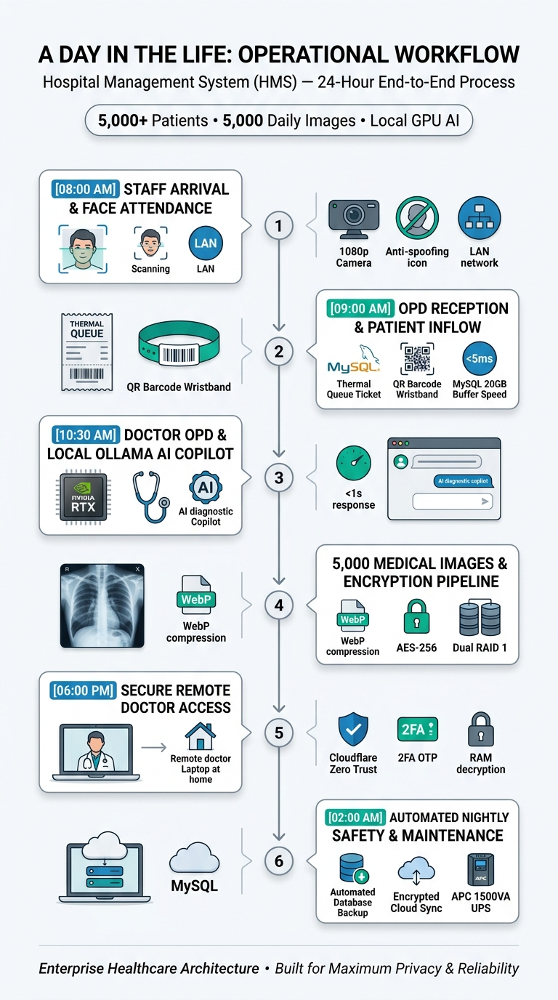
</p>

<p align="center">
  <strong>🏥 Hospital Management System v3.0 Enterprise — Designed to Save Lives, Not Just Data.</strong>
</p>
