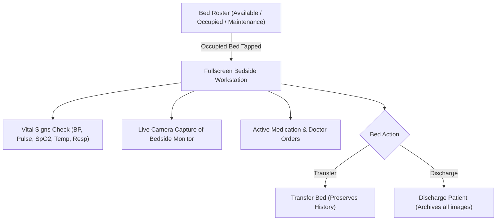
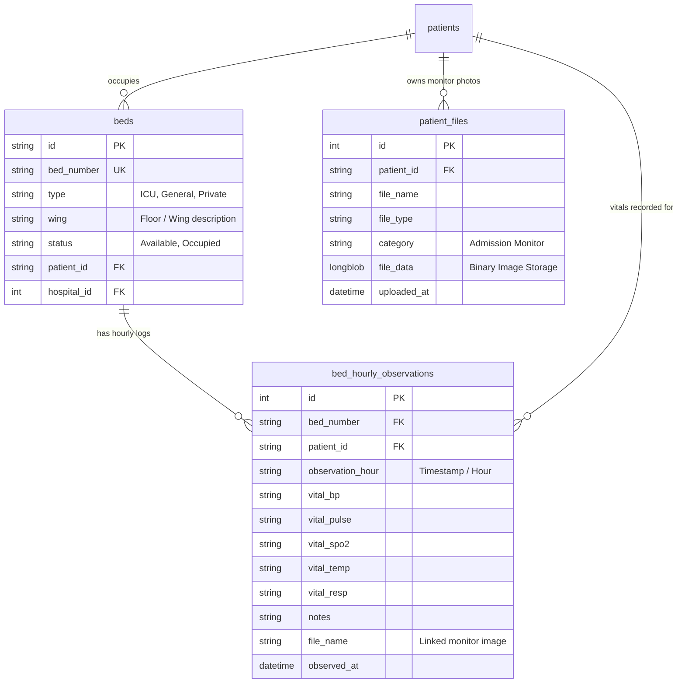

# 🛏️ Hospital Inpatient Bed Ward & Monitor Workstation Guide

> **Module Documentation:** Inpatient Bed Management, ICU Monitoring & Clinical Workstation  
> **Source Files:** `beds.php`, `api/beds.php`, `api/file.php`  
> **Target Audience:** Head Nurses, Ward Sisters, ICU In-Charge, Resident Medical Officers (RMO), Hospital Administrators

---

## 📋 Table of Contents
1. [Overview & Clinical Objectives](#1-overview--clinical-objectives)
2. [Dual Display Modes: Station View vs Detailed Table](#2-dual-display-modes-station-view-vs-detailed-table)
3. [The Dedicated Fullscreen Bedside Workstation](#3-the-dedicated-fullscreen-bedside-workstation)
4. [Hourly Clinical Observations & Vitals Telemetry](#4-hourly-clinical-observations--vitals-telemetry)
5. [ICU Machine Monitor & Camera Snapshot Capture](#5-icu-machine-monitor--camera-snapshot-capture)
6. [Patient Bed Admission Workflow (Quick-Admit)](#6-patient-bed-admission-workflow-quick-admit)
7. [Patient Bed Transfer Workflow](#7-patient-bed-transfer-workflow)
8. [Patient Discharge & Permanent Archiving](#8-patient-discharge--permanent-archiving)
9. [Bed Inventory Management (Add, Edit, Delete Beds)](#9-bed-inventory-management-add-edit-delete-beds)
10. [Database Architecture & BLOB File Preservation](#10-database-architecture--blob-file-preservation)

---

## 1. Overview & Clinical Objectives

The **Inpatient Bed Ward & Monitor Deck** (`beds.php`) is designed to replace chaotic whiteboard ward tracking and paper ICU charts with an interactive, real-time clinical workstation.



### Key Clinical Capabilities:
- **Instant Floor Visibility:** Live color-coded indicators (Emerald for Available, Rose for Occupied, Amber for Critical/Cleaning).
- **Comprehensive Bedside Telemetry:** Track systolic/diastolic Blood Pressure, Heart Rate / Pulse, Blood Oxygen Saturation (SpO2), Body Temperature, and Respiratory Rate.
- **Direct Visual Proof:** Photograph patient monitors, ventilator screens, infusion pump rates, or clinical wound dressings with a single tap of the tablet's camera.
- **Zero Loss on Discharge:** When a patient is discharged, their bed returns to Available status, but 100% of their hourly observation photos, vital charts, and timeline notes remain permanently archived in the patient's electronic medical file.

---

## 2. Dual Display Modes: Station View vs Detailed Table

`beds.php` provides two purpose-built views catering to different operational roles:

### 2.1 Station View (Visual Ward Kanban)
- **Primary Users:** Floor nurses, duty doctors, and hospital superintendents.
- **Layout:** High-density visual cards grouped by ward categories:
  - **Critical Care & ICU Beds:** Highlighting patient acuity, active oxygen support, and latest vitals.
  - **General Inpatient Wards:** Grouped by floor and wing (e.g., *North Wing 2nd Floor*).
  - **Private & Deluxe Suites:** Individual room status with guest amenities.
- **Quick Actions on Card:**
  - One-click access to the Bedside Workstation.
  - Direct badge display of the most recent Blood Pressure and SpO2 readings.
  - Count of total recorded machine monitor photographs.

### 2.2 Detailed Table Registry View
- **Primary Users:** Hospital billing clerks, ward secretaries, and audit officers.
- **Layout:** Dense, sortable data table detailing:
  - Bed Designation & Ward Wing
  - Bed Classification (ICU / General / Semi-Private / Private)
  - Occupying Patient Name & MRN ID
  - Admission Date & Length of Stay (Days / Hours)
  - Attending Consultant Doctor
  - Thumbnail of the Latest Machine Monitor Snapshot
  - Administrative Action Menu (Transfer, Discharge, History)

---

## 3. The Dedicated Fullscreen Bedside Workstation

Tapping any occupied bed opens the **Dedicated Fullscreen Bedside Workstation** (`modal-fullscreen-bedstation`), transforming the tablet or PC into an immersive bedside monitor:

### Left Panel: Patient Identity & Vital Telemetry
- **Patient Banner:** Full name, age, gender, blood group, emergency contact, MRN ID, and admission timestamp.
- **Current Vitals Dashboard:** Large, high-visibility digital gauges:
  - **Blood Pressure (BP):** Displayed in mmHg (e.g., `120/80`).
  - **Heart Rate / Pulse:** Displayed in bpm with color-coded safety bands (emerald for 60–100, amber for tachycardia/bradycardia).
  - **Oxygen Saturation (SpO2):** Displayed in % (alerts triggered if < 94%).
  - **Body Temperature:** Displayed in °F or °C.
  - **Respiratory Rate:** Breaths per minute.
- **Attending Doctor & Clinical Diagnosis:** Primary admitting diagnosis with quick-link to doctor notes.
- **Active Prescriptions:** Current medications prescribed by the consulting physician.

### Right Panel: Machine Monitor Deck & Hourly History
- **Hourly Observation Feed:** Reverse-chronological timeline of every observation recorded since admission.
- **Monitor Snapshot Gallery:** High-resolution zoomable photographs of the patient's bedside monitor, ventilator curve, or infusion pump.
- **Audit Stamp:** Time recorded and name of the duty nurse who performed the observation.

---

## 4. Hourly Clinical Observations & Vitals Telemetry

### Recording an Hourly Observation:
1. Inside the Bedside Workstation, tap **Log Hourly Vitals & Observation**.
2. Enter the current physiological parameters:
   - Systolic / Diastolic BP
   - Pulse (bpm)
   - SpO2 (%)
   - Temperature (°F)
   - Respiration (breaths/min)
3. Enter clinical nursing notes (e.g., *"Patient resting comfortably on 2L nasal cannula oxygen. IV fluids running at 75ml/hr."*).
4. (Optional) Capture monitor photograph (see [Section 5](#5-icu-machine-monitor--camera-snapshot-capture)).
5. Tap **Save Observation Record**.
6. The system sends an AJAX POST request to `api/beds.php?action=add_observation`.
7. The observation is stored in `bed_hourly_observations`, the parent bed's latest vitals are updated, and a timeline entry is posted to `timeline_events`.

---

## 5. ICU Machine Monitor & Camera Snapshot Capture

In critical care settings, transcribed numbers can be prone to human typing error. The HMS solves this by capturing actual photographic evidence of medical hardware:

```
[ Bedside Tablet Camera ]
         │
         ▼ (Live WebRTC Stream / File Input)
[ Photo Snapshot: Philips / GE Healthcare Patient Monitor ]
         │
         ▼ (Base64 / Multipart Form Data)
[ api/beds.php -> action: add_observation ]
         │
         ▼
[ Binary BLOB Storage in patient_files (Category: 'Admission Monitor') ]
         │
         ▼
[ Instant thumbnail in Bedside Deck + Linked in Patient Dossier ]
```

### Supported Capture Sources:
- **Tablet / Smartphone Integrated Camera:** Direct capture without leaving the web browser.
- **USB Medical Webcam:** Mounted on the bedside cart pointing directly at the monitor screen.
- **File Upload:** Uploading saved DICOM snapshots or digital ECG machine JPG/PNG exports.

---

## 6. Patient Bed Admission Workflow (Quick-Admit)

### Admission from OPD or Emergency:
1. On `beds.php`, tap **Admit Patient** or click **Quick Admit** on any Available bed card.
2. The **Quick Admit Modal** displays:
   - **Search Patient:** Live autocomplete search by Patient Name, Phone Number, or MRN ID.
   - **Select Target Bed:** Dropdown showing only currently Available beds categorized by ward type.
   - **Attending Doctor:** Assign primary physician.
   - **Admission Reason / Initial Diagnosis:** Enter presenting complaint.
   - **Initial Vital Signs:** Enter baseline BP, Pulse, SpO2, and Temp.
3. Tap **Confirm Admission**.
4. The system executes:
   - Updates `beds.status = 'Occupied'` and sets `beds.patient_id`.
   - Links the bed number to the patient's active appointment.
   - Creates an admission event in `timeline_events`.
   - Alerts the nursing station.

---

## 7. Patient Bed Transfer Workflow

When a patient improves and steps down from ICU to General Ward (or deteriorates and requires ICU escalation):

1. Inside the Bedside Workstation or on the bed card, tap **Transfer Bed**.
2. Select the **Destination Bed** from the list of available beds.
3. Enter the **Clinical Reason for Transfer** (e.g., *"Step down to General Ward following hemodynamic stabilization"*).
4. Tap **Execute Transfer**.
5. The backend (`api/beds.php?action=transfer`) safely:
   - Verifies the destination bed is still Available.
   - Moves the `patient_id` pointer to the destination bed.
   - Resets the previous bed to `Available` (ready for housekeeping sanitation).
   - Updates the patient's appointment record to reflect the new bed.
   - Creates an immutable audit trail entry documenting the transfer time and reason.

---

## 8. Patient Discharge & Permanent Archiving

When the treating doctor approves discharge:

1. Inside the Bedside Workstation, tap **Discharge Patient**.
2. Enter **Discharge Summary & Home Care Instructions** (e.g., *"Patient afebrile for 48 hours. Wound healthy. Follow up in OPD after 7 days."*).
3. Tap **Confirm Discharge**.
4. The backend (`api/beds.php?action=discharge`) executes the discharge protocol:
   - Sets the bed status to `Available` and clears `patient_id`.
   - Updates the appointment status to `Discharged from Bed`.
   - **Permanent Archiving Guarantee:** All hourly vital records in `bed_hourly_observations` and all monitor photographs in `patient_files` remain permanently attached to the patient's ID.
   - Posts a discharge event to `timeline_events`.
5. The bed is immediately flagged as Available for sanitization and new admissions.

---

## 9. Bed Inventory Management (Add, Edit, Delete Beds)

Administrators can dynamically manage physical bed capacity without touching database code:

- **Add New Bed:** Specify Bed Designation (e.g. `ICU-21`), Ward Type (ICU, General, Private), and Hospital Wing/Floor.
- **Edit Bed:** Update bed notes, ward relocation, or equipment specifications.
- **Delete Bed:** Delete decommissioned beds (the system strictly forbids deleting occupied beds to prevent data corruption).

---

## 10. Database Architecture & BLOB File Preservation

The bed management subsystem operates across three core tables in MariaDB:



*All medical monitor photos are stored directly in `patient_files.file_data` as binary `LONGBLOB` data, guaranteeing that no file path breakage, filesystem corruption, or OS-level file deletion can ever compromise clinical evidence.*
