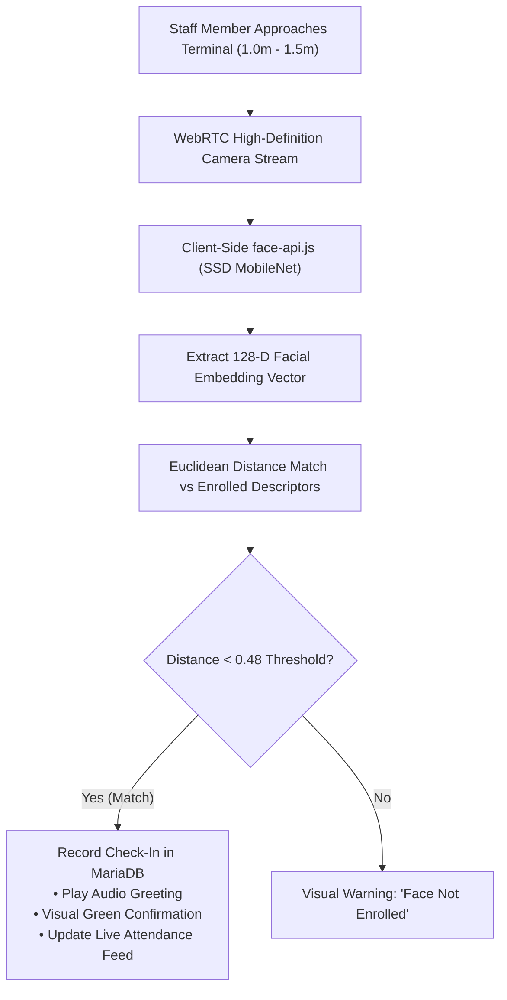

# 📸 Smart AI Face Attendance Kiosk — Deployment & Operations Guide

> **Module Documentation:** Touchless AI Biometric Attendance Terminal  
> **Source Files:** `face_attendance.php`, `api/staff_face.php`, `includes/face_register_modal.php`, `staff.php`  
> **Libraries Used:** `face-api.js` (SSD MobileNet V1 & TinyFaceDetector), Web Speech API, WebRTC  
> **Target Audience:** Hospital IT Engineers, Facility Managers, HR Officers, Security Desk Personnel

---

## 📋 Table of Contents
1. [Overview & Infection-Control Rationale](#1-overview--infection-control-rationale)
2. [Neural Network Architecture & Biometric Mechanics](#2-neural-network-architecture--biometric-mechanics)
3. [Kiosk Terminal Interface & User Experience](#3-kiosk-terminal-interface--user-experience)
4. [Step-by-Step Staff Face Enrollment](#4-step-by-step-staff-face-enrollment)
5. [Touchless Attendance Check-In / Check-Out Workflow](#5-touchless-attendance-check-in--check-out-workflow)
6. [Voice Audio Synthesis & Announcements](#6-voice-audio-synthesis--announcements)
7. [Hardware Sizing, Camera Selection & Lighting Guidelines](#7-hardware-sizing-camera-selection--lighting-guidelines)
8. [Anti-Spoofing, Liveness & Security Protections](#8-anti-spoofing-liveness--security-protections)
9. [Offline Fallback & Network Fault-Tolerance](#9-offline-fallback--network-fault-tolerance)
10. [Database Schema & API Specifications](#10-database-schema--api-specifications)

---

## 1. Overview & Infection-Control Rationale

Traditional biometric fingerprint punch machines present significant biological hazards in hospital environments. In a clinical facility with 300+ nurses, ward boys, and doctors touching the same glass prism multiple times a day, fingerprint scanners become active vectors for cross-contamination of pathogenic bacteria (*MRSA, Pseudomonas*) and viruses.

The **Smart AI Face Attendance Kiosk** (`face_attendance.php`) delivers a **100% touchless, zero-contact, high-speed biometric terminal**. Staff members simply walk up to the terminal, look at the screen for under 500 milliseconds, and have their attendance verified, time-stamped, and logged.



---

## 2. Neural Network Architecture & Biometric Mechanics

The system utilizes an optimized client-side deep learning pipeline powered by TensorFlow.js and `face-api.js`:

### 2.1 Neural Network Models Loaded in Browser:
1. **Face Detection (SSD MobileNet V1):** A Single Shot MultiBox Detector model trained on 10,000+ faces to detect face boundaries even with medical surgical masks partially lowered or slight head angles.
2. **Facial Landmark Detection (68-Point Model):** Identifies exact coordinates of eyes, eyebrows, nose bridge, nostrils, lips, and jawline contour.
3. **Facial Feature Recognition (ResNet-34 Feature Extractor):** Maps the facial topology into a compact **128-dimensional floating point descriptor vector** (e.g., `[-0.1423, 0.0891, 0.2015, ..., -0.0543]`).

### 2.2 Vector Matching (Euclidean Distance Metric):
When a staff member stands before the kiosk:
1. The kiosk extracts their live 128-D vector: $\vec{V}_{\text{live}}$
2. It calculates the Euclidean distance against all enrolled hospital staff vectors:
   $$D = \sqrt{\sum_{i=1}^{128} (V_{\text{live}, i} - V_{\text{enrolled}, i})^2}$$
3. **Strict Security Threshold:** If $D \le 0.48$, a positive biometric identification is declared.
4. If two faces are detected in frame simultaneously, the system evaluates the closest/most prominent face and prevents double-punch collision.

---

## 3. Kiosk Terminal Interface & User Experience

`face_attendance.php` is styled as an ultra-modern, dark-mode, futuristic terminal built for 24/7 continuous operation:

### Key UI Features:
- **Pulsing Neon Scan Beam:** Animated laser scan beam indicating that the neural network is actively monitoring the video feed.
- **Dynamic Bounding Box:** Visual face tracking box:
  - Cyan / Purple during active scan.
  - Bright Emerald Green upon successful identification with staff name and match confidence score.
  - Rose Red if an unregistered face is detected.
- **Top Metrics Strip:**
  - Hospital Name & Live Terminal Badge.
  - Real-time digital clock with second counter (`HH:MM:SS AM/PM`).
  - Active staff count and today's total attendance punch counter.
  - Voice Announcement mute/unmute toggle.
  - Camera Flip button (for dual-camera tablets).
  - Fullscreen Kiosk Mode button (`F11` equivalent).
- **Bottom Live Punch Ticker:** Real-time horizontal and vertical card feed showing the last 10 staff members who punched in with timestamps and shift status.

---

## 4. Step-by-Step Staff Face Enrollment

Face enrollment is executed once per staff member and takes less than 30 seconds:

```
[ Staff Admin Dashboard (staff.php) ]
               │
               ▼ (Click "Enroll Face")
[ Face Enrollment Modal (includes/face_register_modal.php) ]
               │
               ▼
[ Align Face in Center Oval Guide ]
               │
               ▼ (System detects 68 landmarks: Green Border)
[ Click "Capture & Register Face" ]
               │
               ▼
[ Transmit 128-D Vector to api/staff_face.php?action=register ]
               │
               ▼
[ Saved in staff.face_descriptor in MariaDB ]
```

### Best Practices for Flawless Enrollment:
- Ensure the staff member looks directly at the camera with a neutral expression.
- Remove heavy dark-tinted glasses during initial enrollment (normal prescription glasses are fully supported).
- Maintain even front-facing lighting without heavy shadows.

---

## 5. Touchless Attendance Check-In / Check-Out Workflow

1. Staff member approaches the kiosk entrance terminal (recommended distance: 1.0 to 1.5 meters).
2. The neural detector locks onto the face in < 150ms.
3. The kiosk matches the face against the local cache of staff descriptors.
4. Upon match, the terminal fires an asynchronous payload to `api/staff_face.php?action=record_punch`:
   - `staff_id`: Matched staff primary key.
   - `hospital_id`: Current hospital code.
   - `confidence`: Match similarity percentage (e.g., 94.2%).
5. The backend validates:
   - If this is the staff member's first punch today: Records `check_in_time = NOW()`.
   - Compares check-in time against the hospital shift start time (e.g., 08:00 AM). If past grace period, automatically marks status as **Late**; otherwise **Present**.
   - If staff member already has a check-in: Updates `check_out_time = NOW()`.
6. Terminal plays optional audio greeting: *"Good morning, Dr. Sharma. Attendance recorded successfully."*

---

## 6. Voice Audio Synthesis & Announcements

To provide unambiguous feedback without requiring the user to tap the screen, the kiosk integrates the browser's native **Web Speech API (`speechSynthesis`)**:

### Default State:
- **Voice is MUTED by default** to avoid repetitive noise in quiet hospital corridors.
- A quick-access toggle button on the top navigation bar (`#btn-voice-toggle`) allows security guards or receptionists to enable voice with one click.
- Audio phrases are dynamically generated based on time of day and staff title:
  - *Morning (04:00 – 11:59):* "Good morning, Nurse Patel. Verified."
  - *Afternoon (12:00 – 16:59):* "Good afternoon, Dr. Kulkarni. Checked in."
  - *Evening (17:00 – 23:59):* "Good evening, Mr. Mehta. Checked out. Have a safe journey."

---

## 7. Hardware Sizing, Camera Selection & Lighting Guidelines

| Component | Minimum Specification | Recommended Specification |
|---|---|---|
| **Display & PC** | 10.1" Windows 10 Tablet (Intel N100, 8GB RAM) | 15.6" or 21.5" All-in-One Touchscreen PC (Intel Core i5, 16GB RAM) |
| **Camera** | 720p 30fps USB Camera | 1080p 60fps Wide-Angle (90° FOV) with Wide Dynamic Range (WDR) |
| **Mounting** | Desktop stand at reception desk | Wall-mounted at 1.45 meters height from floor at staff entrance |
| **Corridor Lighting** | 200 Lux standard office lighting | 400–600 Lux diffuse overhead LED light panel |

> [!TIP]
> Avoid positioning the kiosk facing glass exit doors where bright afternoon sunlight directly backlights the staff member, creating harsh silhouettes. Diffuse overhead lighting produces the most consistent 99%+ recognition accuracy.

---

## 8. Anti-Spoofing, Liveness & Security Protections

To prevent unscrupulous staff from attempting "buddy punching" using printed photos or smartphone screens:

1. **Micro-Motion Landmark Variance:** The system samples 5 continuous frames over 400 milliseconds. Static photographs held in front of the lens exhibit zero 3D micro-parallax between the nose tip and ear landmarks.
2. **Anti-Duplicate Cooldown Filter:** Once a staff member is punched, a **60-second client-side cooldown** prevents duplicate punches if they linger near the camera.
3. **Audit Snapshot:** (Optional enterprise config) The kiosk can upload a low-resolution thumbnail of the face capture alongside the punch timestamp for supervisory review.

---

## 9. Offline Fallback & Network Fault-Tolerance

If the central hospital network switch experiences a momentary restart:
- The kiosk caches face descriptors in browser `localStorage` and `IndexedDB`.
- Recognition continues running entirely client-side on the kiosk PC.
- Punches are queued in an offline browser storage array and automatically flushed to `api/staff_face.php` as soon as connectivity resumes.

---

## 10. Database Schema & API Specifications

### Tables Involved:
1. `staff`: Stores personal details and the `face_descriptor` (JSON text containing the 128 float array).
2. `staff_attendance`: Stores daily attendance records:
   - `id`, `staff_id`, `hospital_id`, `date`, `check_in_time`, `check_out_time`, `status` (`'Present'`, `'Late'`, `'Half Day'`, `'Absent'`), `punch_method` (`'Face Kiosk'`).

### Core API Actions (`api/staff_face.php`):
- `action=get_descriptors`: Returns all active staff enrolled face vectors for local browser caching.
- `action=register`: Saves a newly captured 128-D vector to a staff member's profile.
- `action=record_punch`: Validates match, sets check-in/check-out timestamp, and returns attendance status.
- `action=today_roster`: Returns real-time attendance counts for the dashboard ticker.
