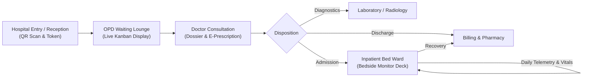
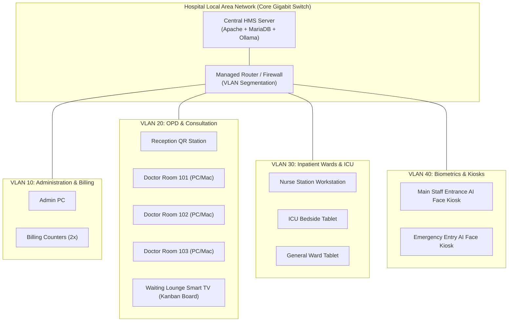
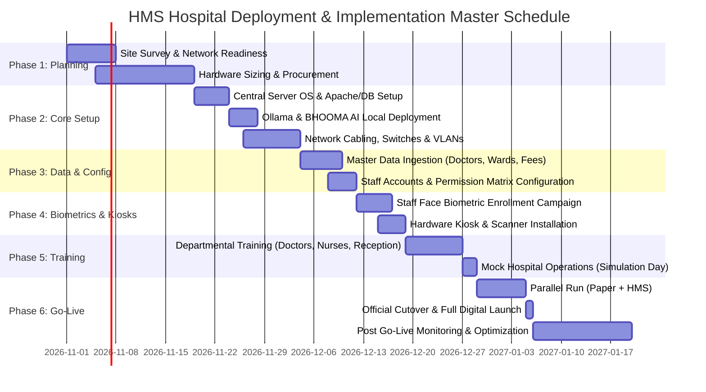
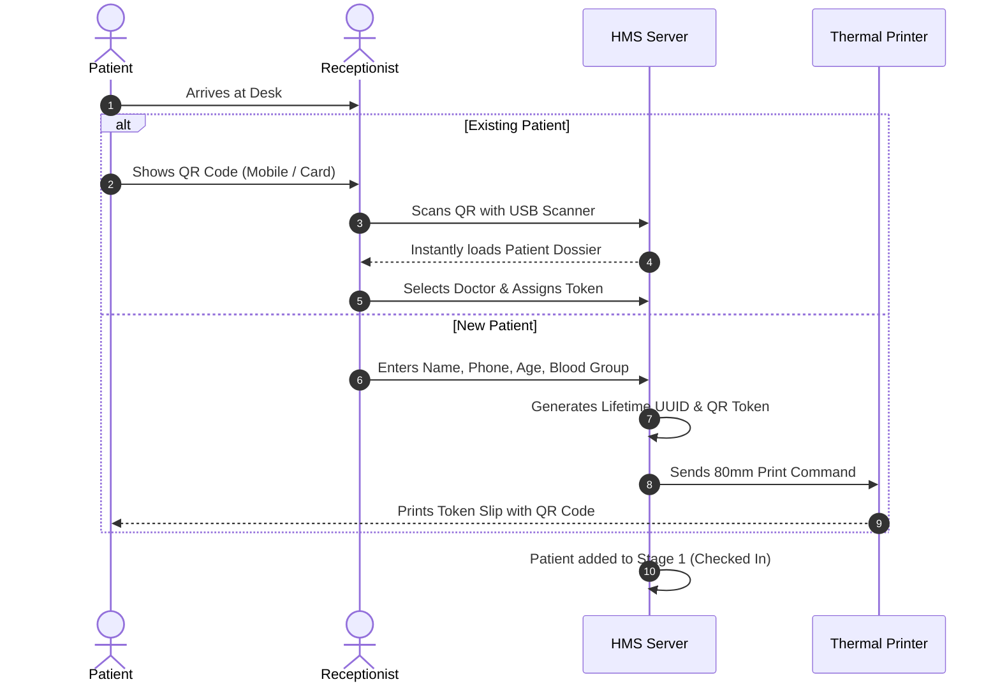
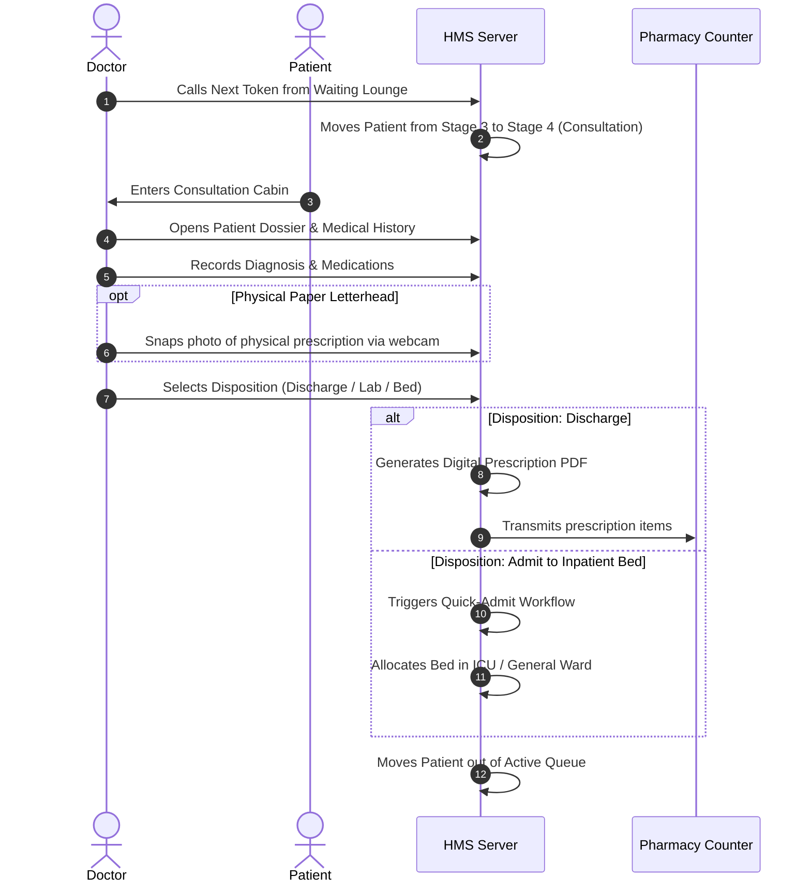
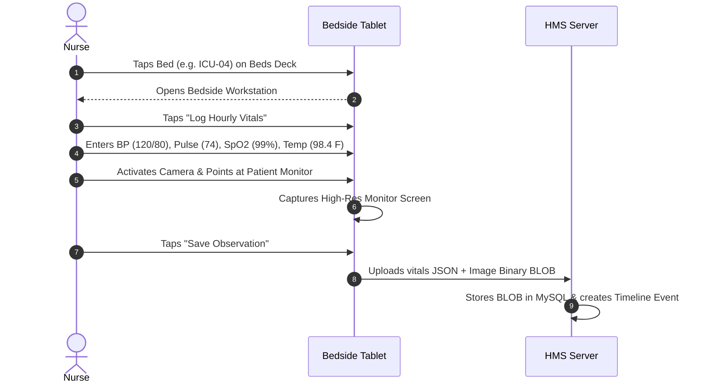

# 🏥 Hospital Management System — Enterprise Deployment & Implementation Master Plan

> **Document Version:** 3.0 Enterprise  
> **Target Audience:** Hospital Board of Directors, Medical Superintendents, Chief Technology Officers (CTO), Hospital IT Administrators, Department Heads, and Operations Managers  
> **Scope:** Complete turn-key roadmap for deploying, configuring, and operating the Hospital Management System (HMS) in small, medium, and multi-specialty hospitals.

---

## 📋 Table of Contents
1. [Executive Summary & Vision](#1-executive-summary--vision)
2. [Hospital Facility & Departmental Sizing](#2-hospital-facility--departmental-sizing)
3. [Hardware & Network Infrastructure Architecture](#3-hardware--network-infrastructure-architecture)
4. [Phase-by-Phase Deployment Roadmap (10-Week Plan)](#4-phase-by-phase-deployment-roadmap-10-week-plan)
5. [Server & Local AI Engine Installation Guide](#5-server--local-ai-engine-installation-guide)
6. [Hospital Hardware Terminals & Workstation Setup](#6-hospital-hardware-terminals--workstation-setup)
7. [Master Data Ingestion & Configuration](#7-master-data-ingestion--configuration)
8. [Departmental Operating Procedures (SOPs)](#8-departmental-operating-procedures-sops)
9. [Biometric Face Enrollment & Staff Role Provisioning](#9-biometric-face-enrollment--staff-role-provisioning)
10. [Staff Training & Change Management Curriculum](#10-staff-training--change-management-curriculum)
11. [Go-Live Execution & Parallel Run Strategy](#11-go-live-execution--parallel-run-strategy)
12. [Disaster Recovery, High Availability & Automated Backup Plan](#12-disaster-recovery-high-availability--automated-backup-plan)
13. [Regulatory Compliance, NABH/HIPAA & Data Privacy Matrix](#13-regulatory-compliance-nabhhipaa--data-privacy-matrix)

---

## 1. Executive Summary & Vision

The objective of this deployment plan is to transform paper-heavy, fragmented hospital operations into an integrated, real-time, digital healthcare ecosystem. 

### Core Transformation Goals:
1. **Zero-Paper Patient Journey:** Eliminate paper files through lifetime QR identification, digital clinical dossiers, and automated prescription generation.
2. **Transparent Queue & Reduced Waiting Times:** Transition from chaotic hallway queues to a structured 4-stage visual Kanban pipeline (Checked-In → Arrived → Waiting Lounge → Doctor Consultation).
3. **Bedside Inpatient Telemetry:** Equip ward nurses and ICU teams with the Inpatient Bed Ward Deck to record vital signs (BP, Pulse, SpO2, Temp, Respiration) and capture live machine monitor/ECG snapshots directly into MySQL BLOB storage.
4. **Touchless Staff Attendance:** Deploy the AI Face Attendance Kiosk at hospital staff entrances to ensure audit-proof biometric verification without physical touch or fingerprint smudges.
5. **Private On-Premises Clinical AI:** Host BHOOMA AI on a dedicated local GPU server (NVIDIA RTX 4060 or higher) via Ollama, giving doctors and administrators instant natural-language access to patient records, bed occupancy, and revenue analytics without leaking patient data to public cloud APIs.



---

## 2. Hospital Facility & Departmental Sizing

The system scales seamlessly from a 20-bed single-specialty nursing home up to a 500-bed multi-specialty hospital. Sizing recommendations:

| Hospital Tier | Bed Capacity | Daily OPD Footfall | Recommended Servers | Kiosks & Workstations |
|---|---|---|---|---|
| **Tier 1 (Clinic / Daycare)** | 10 – 30 Beds | 50 – 150 Patients | 1 Unified Server (Core i7 / RTX 4060, 32GB RAM) | 3 Workstations + 1 Attendance Kiosk |
| **Tier 2 (General Hospital)** | 31 – 150 Beds | 150 – 600 Patients | 1 Primary App/DB Server + 1 AI Worker Server | 12 Workstations + 2 Attendance Kiosks + 4 Ward Tablets |
| **Tier 3 (Multi-Specialty)** | 151 – 500+ Beds | 600 – 2,500 Patients | High-Availability MariaDB Cluster + 2 App Nodes + Dedicated AI Inference Server | 35+ Workstations + 4 Entry Kiosks + 20 Bedside Tablets |

---

## 3. Hardware & Network Infrastructure Architecture

### 3.1 Network Topology (Isolated Hospital LAN / VLANs)
To guarantee 99.99% uptime, low latency, and zero dependency on public internet outages, the HMS is designed as an **Intranet-First Architecture**:



### 3.2 Recommended Hardware Specifications

#### A. Central Server (Tier 2 Standard: 50–150 Beds)
- **Processor:** Intel Core i7-14700 / AMD Ryzen 9 7900X (12+ Cores, 24 Threads)
- **RAM:** 64 GB DDR5 5600MHz ECC
- **Storage:** 2 x 1TB NVMe PCIe 4.0 M.2 SSDs (Configured in RAID 1 for real-time mirroring) + 4TB Enterprise HDD for weekly cold backups
- **GPU (For BHOOMA AI):** NVIDIA GeForce RTX 4060 8GB / RTX 4070 12GB (VRAM dedicated to Ollama FP16/Q4 quantization)
- **Network:** Dual 2.5 Gbps Ethernet Ports
- **Power:** 850W 80+ Gold PSU backed by an Online Double-Conversion UPS (minimum 2 KVA, 60 minutes battery run-time)
- **Operating System:** Ubuntu Server 22.04 LTS or Windows Server 2022 / Windows 11 Pro Enterprise

#### B. Entrance Face Attendance Kiosks
- **Form Factor:** 15.6" or 21.5" All-In-One Touchscreen PC or iPad/Android Tablet mounted on a floor stand or wall-bracket at staff entryways.
- **Camera:** 1080p 60fps Wide-Angle USB Web Camera with auto-exposure and wide dynamic range (WDR) to handle varying daylight conditions.
- **Audio:** External 10W speaker or integrated stereo speakers for voice greeting confirmations (*"Welcome, Dr. Sharma. Attendance marked at 08:02 AM"*).

#### C. Reception & Patient Registration Desks
- **PC:** Intel Core i5, 16GB RAM, Dual Displays (One for receptionist, one outward-facing for patient token preview).
- **QR / Barcode Scanner:** 2D Omnidirectional Presentation Scanner (e.g., Zebra DS9308 or Honeywell Genesis 7580g) capable of scanning off mobile phone screens instantly.
- **ID Card Printer:** Zebra ZC300 or PVC Card Printer (Optional, for printing durable lifetime PVC Patient QR Cards).
- **Slip Printer:** 80mm Thermal Receipt Printer (EPSON TM-T82 or TVS RP3150) for printing instant walk-in token receipts with QR codes.

#### D. Doctor OPD Consulting Rooms
- **Hardware:** Desktop PC / All-in-One PC / Medical-grade tablet with minimum 1080p display.
- **Webcam:** Document camera or webcam for capturing high-resolution photos of external physical paper prescriptions or laboratory test letterheads.

#### E. Bedside Tablets & Inpatient Ward Carts
- **Hardware:** Ruggedized 10.1" Android or Windows Tablets (IP54 rated against hospital fluid splashes) on mobile medical carts.
- **Camera:** 13MP rear autofocus camera with flashlight for capturing crisp bedside machine monitor displays, syringe pump readings, and wound progress photos.

---

## 4. Phase-by-Phase Deployment Roadmap (10-Week Plan)



### Detailed Milestone Breakdown:

#### Week 1: Site Survey & Physical Infrastructure Inspection
- Audit hospital physical floor plans: Reception, OPD blocks, Emergency, ICU, General Wards, Radiology, Pathology, Pharmacy, and Server Room.
- Test LAN cabling (Cat6) drops at each doctor room, nursing station, and reception desk.
- Conduct Wi-Fi heatmapping in inpatient wards to eliminate dead spots for mobile bedside tablets.
- Finalize hardware acquisition contracts for server, kiosks, scanners, and thermal printers.

#### Week 2–3: Server Staging, Environment Hardening & Local AI Pipeline
- Assemble and burn-in central server hardware in a temperature-controlled server rack.
- Install Ubuntu Server or Windows Server with Apache/Nginx, PHP 8.2+, and MariaDB 10.4+.
- Configure `db.php` connection parameters and run the auto-migration engine to create all 25+ relational tables.
- Install Ollama runtime, configure GPU acceleration (`CUDA`), pull/load BHOOMA AI weights, and test the Python training pipeline.
- Create automated SSL certificates (`https://hms.hospital.local`) for secure WebRTC camera access.

#### Week 4: Master Data Ingestion & Configuration
- Populate departments: Cardiology, Orthopaedics, Paediatrics, Neurology, General Medicine, Obstetrics, etc.
- Ingest doctor profiles: Names, qualifications, specializations, room numbers, consultation fees, and emergency contacts.
- Configure doctor time slots and daily availability matrices (`doctor_slots.php`).
- Build inpatient ward and bed registries (`beds.php`): ICU beds, General Ward beds, Deluxe rooms, Semi-private cubicles.

#### Week 5: Staff Onboarding, Permission Setup & Face Enrollment
- Create user accounts for all hospital personnel (Administrators, Doctors, Nurses, Receptionists, Pharmacists, Lab Techs).
- Assign granular permission keys using the 11+ permission system (`staff_permissions.php`).
- Execute the **Face Enrollment Drive**: Ingest 128-dimensional facial descriptors for every staff member using the built-in Face Registration Modal.
- Calibrate the Face Attendance Kiosks at staff entry gates.

#### Week 6–7: Hardware Deployment & Departmental Station Hookup
- Mount all-in-one AI Face Attendance Kiosks at staff entry gates with wired PoE/LAN.
- Install 2D QR scanners and 80mm thermal printers at reception check-in counters.
- Connect large-screen Smart TVs in the patient waiting lounge to display the live 4-stage queue pipeline.
- Configure doctor workstation PCs and bedside nursing carts.

#### Week 8: Comprehensive Hands-On Staff Training
- Conduct role-specific training sessions (see [Section 10](#10-staff-training--change-management-curriculum)).
- Run simulated patient scenarios: Walk-in patient, pre-booked patient, emergency ICU admission, bedside vital updates, doctor disposition, discharge.

#### Week 9: Parallel Run (Dual Operations)
- Run hospital operations with dual recording: Paper registers continue as fail-safe while all transactions are logged into HMS.
- Reconcile end-of-day counts: Patient registrations, fee collections, bed occupancy, staff punches.
- Tweak doctor slot timings and reception workflows based on real-time feedback.

#### Week 10: Official Go-Live (Paperless Cutover)
- Decommission physical paper appointment registers.
- All patients checked in via lifetime QR codes.
- Full digital execution across all hospital wards.

---

## 5. Server & Local AI Engine Installation Guide

### 5.1 Web & Database Server Installation (XAMPP / Standalone Apache + MariaDB)
1. **Prerequisites:**
   - PHP 8.2 or higher (Extensions required: `mysqli`, `curl`, `mbstring`, `gd`, `openssl`, `fileinfo`).
   - MariaDB 10.4+ or MySQL 8.0+.
   - Apache 2.4+ with `mod_rewrite` enabled.

2. **PHP Configuration Tweaks (`php.ini`):**
   ```ini
   max_execution_time = 300
   max_input_time = 300
   memory_limit = 512M
   post_max_size = 64M
   upload_max_filesize = 50M
   max_file_uploads = 20
   date.timezone = "Asia/Kolkata" ; (or local hospital timezone)
   ```

3. **MariaDB Buffer Pool Optimization (`my.ini` / `my.cnf`):**
   To support high-concurrency binary BLOB image storage and fast queue lookups:
   ```ini
   [mysqld]
   max_allowed_packet = 128M
   innodb_buffer_pool_size = 8G        ; Set to 50-70% of available RAM
   innodb_log_file_size = 512M
   innodb_flush_log_at_trx_commit = 2  ; High performance for real-time telemetry
   max_connections = 500
   ```

4. **Database Deployment:**
   - Launch MySQL service.
   - Database name: `hospital_db`.
   - The system automatically detects and migrates tables upon first opening `db.php` in the browser!
   - Seed tables created: `hospitals`, `patients`, `doctors`, `appointments`, `beds`, `bed_hourly_observations`, `staff`, `staff_attendance`, `charges`, `patient_files`, `ai_training_logs`.

### 5.2 Local AI Inference Engine (Ollama + BHOOMA AI)
1. **Install Ollama:**
   Download and install Ollama from [ollama.ai](https://ollama.ai).
2. **Verify GPU Acceleration:**
   ```powershell
   ollama --version
   nvidia-smi
   ```
3. **Pull Base Model or Load BHOOMA AI:**
   ```powershell
   ollama pull llama3:8b
   # Or create custom model using project Modelfile:
   cd "d:\xampp\htdocs\Hospital Management System\ai\python"
   ollama create bhooma-hms-ai -f Modelfile
   ```
4. **Test Local AI API Connectivity:**
   ```powershell
   curl http://localhost:11434/api/tags
   ```
   The response should list `bhooma-hms-ai` or `llama3:8b`. The HMS backend communicates seamlessly via `api/chatbot.php`.

---

## 6. Hospital Hardware Terminals & Workstation Setup

### 6.1 Reception QR Terminal Setup
- Connect the 2D Barcode/QR Presentation Scanner via USB (configure scanner in **Continuous Automatic Scan / Presentation Mode** with Enter suffix).
- Open `includes/reception_hub.php` or `queue.php` on the reception PC.
- When an existing patient approaches, they simply hold their phone screen or printed card in front of the scanner.
- The system automatically beeps, pulls up their full profile, and offers a 1-click **Check-In to Live Queue** button.
- For new patients, the receptionist fills the 30-second registration form, which instantly generates a lifetime QR code and prints an 80mm thermal slip containing:
  - Hospital Name & Emergency Hotline
  - Patient Full Name, MRN ID, and Blood Group
  - Unique Scannable Lifetime QR Code
  - Assigned Doctor, Room Number & Token Number

### 6.2 Waiting Lounge Live Pipeline Display
- Mount a 55" or 65" 4K Smart TV in the main patient waiting lounge.
- Connect a Mini-PC / Android TV Stick or use the integrated TV browser pointing to:
  `http://hms.hospital.local/queue.php?display=lounge`
- The screen displays an auto-refreshing, high-contrast, beautiful Kanban board showing:
  - **Arrived & Checked In**
  - **Waiting Lounge (Now Calling Tokens)**
  - **In Doctor Consultation**
- Visual and audible bell alerts announce token transitions.

### 6.3 Doctor Consulting Room Setup
- Doctor logs into `http://hms.hospital.local/login.php` with their individual credentials.
- The interface automatically defaults to their assigned OPD department and shows only patients waiting for them.
- Doctors click **Start Consultation**:
  - Review prior clinical history and uploaded lab reports.
  - Enter diagnosis (with ICD-10 suggestions).
  - Prescribe medicines (dosage, frequency, instructions).
  - Click **Capture / Upload Prescription Photo** if writing on physical letterhead.
  - Choose disposition: **Discharge**, **Send to Lab**, or **Admit to Inpatient Bed**.

### 6.4 Inpatient Ward Bedside Workstations
- Mount tablets or mobile all-in-one PCs on nursing carts in ICU and General Wards.
- Navigate to `http://hms.hospital.local/beds.php`.
- Nurses tap any occupied bed to open the **Dedicated Fullscreen Bedside Workstation**:
  - Live patient vitals display (Blood Pressure, Heart Rate, SpO2, Temperature, Respiration).
  - Tap **Log Hourly Vitals & Observations**:
    - Input current digital numbers.
    - Tap **Capture Machine Monitor Screen** using the tablet's camera.
    - System saves the camera photo directly as a binary BLOB into MariaDB linked to that hour's observation!
  - When the patient is discharged, all monitor snapshots and vital histories are permanently archived in the patient's digital dossier for legal and medical audit records.

---

## 7. Master Data Ingestion & Configuration

Before go-live, the hospital administration must populate five foundational registries:

1. **Hospital Entity Profile (`hospitals` table):**
   - Hospital Legal Name, Registration Number, NABH Accreditation Level, Logo, Official Phone, Emergency Ambulance Hotline, Address.
2. **Clinical Specializations & Departments:**
   - Define all OPD and IPD specialties.
3. **Doctor Registry (`doctors` table):**
   - Doctor Name, Medical Council Registration Number (MCI/NMC), Qualification, Department, Default Consultation Fee, Room/Cabin Number, Contact Phone.
4. **Bed & Ward Architecture (`beds` table):**
   - Ward Wings (e.g., *East Wing 2nd Floor, ICU Floor 3rd Floor*).
   - Bed Categories: ICU, High Dependency Unit (HDU), General Ward, Private Single, Isolation Ward.
   - Bed Designations (e.g., `ICU-01` to `ICU-20`, `GEN-101` to `GEN-150`).
5. **Billing Master & Fee Schedule (`charges` table):**
   - OPD Consultation Fees, ICU Daily Bed Rates, General Ward Daily Rates, Common Diagnostic Packages (CBC, Lipid Profile, Chest X-Ray, ECG).

---

## 8. Departmental Operating Procedures (SOPs)

### SOP 01: Patient Walk-In & Check-In


### SOP 02: Doctor OPD Consultation & Disposition


### SOP 03: Inpatient Hourly Observation & Monitor Capture


---

## 9. Biometric Face Enrollment & Staff Role Provisioning

### 9.1 Face Enrollment Protocol
1. Access **Staff Management** (`staff.php`) as Administrator.
2. Click **Enroll Face** or open the **Face Registration Modal**.
3. Position the staff member in front of the high-resolution camera.
4. The client-side neural network (`face-api.js` SSD MobileNet) detects 68 facial landmarks.
5. When lighting and pose are verified (green bounding box), click **Capture & Register**.
6. The browser extracts a **128-dimensional floating point vector descriptor** and transmits it to `api/staff_face.php` via HTTPS.
7. The descriptor is securely stored in the `staff.face_descriptor` column in MariaDB.
8. The staff member is immediately recognized at all kiosk terminals hospital-wide in under 300 milliseconds!

### 9.2 Granular RBAC Permission Matrix

| Role | Dashboard | Patients CRUD | Queue & Token | Doctor Consult | Bed Management | Billing & Charges | Staff Admin | AI Logs & Training | System Config |
|---|:---:|:---:|:---:|:---:|:---:|:---:|:---:|:---:|:---:|
| **Hospital Director / Super Admin** | ✅ | ✅ | ✅ | ✅ | ✅ | ✅ | ✅ | ✅ | ✅ |
| **Consulting Doctor** | ✅ | ✅ (Read) | ✅ | ✅ (Full) | ✅ (Read) | ❌ | ❌ | ❌ | ❌ |
| **Ward Nurse / Head Sister** | ✅ | ✅ (Read) | ✅ | ❌ | ✅ (Full) | ❌ | ❌ | ❌ | ❌ |
| **Receptionist / Front Desk** | ✅ | ✅ (Full) | ✅ (Full) | ❌ | ✅ (Read) | ✅ (Cashier) | ❌ | ❌ | ❌ |
| **Billing & Accounts Officer** | ✅ | ✅ (Read) | ❌ | ❌ | ✅ (Read) | ✅ (Full) | ❌ | ❌ | ❌ |
| **IT Systems Administrator** | ✅ | ✅ | ✅ | ❌ | ✅ | ✅ | ✅ | ✅ | ✅ |

---

## 10. Staff Training & Change Management Curriculum

A successful deployment hinges on employee confidence. Training is delivered across four targeted workshops:

### Workshop A: Front Desk & Reception Team (Duration: 3 Hours)
- Handling patient inquiries and lookups.
- Operating the 2D QR scanner and troubleshooting blurry mobile phone screens.
- Registering walk-in patients and printing 80mm thermal slips.
- Managing pre-booked online appointments from `patient_book.php`.
- Handling token priorities (Emergency, Senior Citizen, Normal).

### Workshop B: Doctors & Clinical Consultants (Duration: 2 Hours)
- Logging in and managing personal daily slot schedules (`doctor_slots.php`).
- Navigating the 4-stage live patient queue.
- Reviewing patient dossiers, past histories, and laboratory imaging files.
- Prescribing medications and uploading prescription letterhead photos.
- Initiating lab investigation orders and bed admissions.

### Workshop C: Nursing Staff & ICU Inpatient Ward Teams (Duration: 3 Hours)
- Navigating the **Inpatient Bed Ward & Monitor Deck** (`beds.php`).
- Switching between Station View and Detailed Table Registry.
- Operating the Bedside Workstation: Entering hourly vitals (BP, SpO2, Pulse, Temp).
- Capturing live photos of monitor screens, syringe pumps, and clinical charts.
- Executing bed transfers and handling patient discharges with permanent record archiving.

### Workshop D: IT Administrators & Hospital Management (Duration: 4 Hours)
- Server maintenance, MariaDB backup scripts, and storage health monitoring.
- Managing staff accounts, passwords, and 11+ granular permission keys.
- Managing the AI Face Attendance Kiosks and troubleshooting camera lighting.
- Reviewing revenue analytics, bed occupancy reports, and queue efficiency metrics.
- Operating BHOOMA AI and fine-tuning models on RTX 4060 GPU.

---

## 11. Go-Live Execution & Parallel Run Strategy

### 11.1 The 7-Day Parallel Run
To eliminate risks of operational disruption, the hospital runs parallel operations for 7 consecutive days prior to complete cutover:
- **Morning Shift (08:00 – 14:00):** Receptionists record on paper and immediately mirror entries into the HMS.
- **Evening Shift (14:00 – 20:00):** Receptionists enter directly into HMS and print slips; paper register is used only as backup log.
- **Nightly Audit (20:30 – 21:30):** IT team and Nursing In-Charge audit:
  - Total registered patients (Paper vs HMS).
  - Total fees collected (Cash Drawer vs HMS Charges Report).
  - Bed occupancy count (Physical count vs HMS Beds Deck).
  - Any discrepancies are resolved before next morning.

### 11.2 The Cutover Checklist (Go-Live Day)
- [ ] All staff face biometrics registered and tested at entry kiosks.
- [ ] All doctors have confirmed their weekly slot schedules.
- [ ] Thermal paper rolls stocked at all reception counters (minimum 20 rolls per desk).
- [ ] Waiting lounge TV running live queue display.
- [ ] Central server RAID 1 storage verified healthy.
- [ ] Online UPS tested on battery load for 45 minutes.
- [ ] Automated database backup cron tested and verified.
- [ ] Official declaration signed by Medical Superintendent.

---

## 12. Disaster Recovery, High Availability & Automated Backup Plan

Hospital data is life-critical and must be protected against hardware failure, ransomware, power loss, and human error.

### 12.1 The 3-2-1 Backup Strategy
- **3 Copies of Data:**
  1. Live Production MariaDB database (`hospital_db`).
  2. Local on-site backup on a secondary internal NAS drive.
  3. Off-site encrypted cold storage backup.
- **2 Different Storage Media:** High-speed NVMe SSD (Production) + Enterprise HDD / NAS (Backup).
- **1 Off-Site Copy:** Automated encrypted daily sync to offsite secure backup storage.

### 12.2 Automated Daily Backup Script (Windows Server / PowerShell)
Save as `C:\HMS_Backups\auto_backup.ps1` and schedule in Windows Task Scheduler to run daily at 01:00 AM:

```powershell
# HMS Daily Automated Database & BLOB Backup Script
$Date = Get-Date -Format "yyyy-MM-dd_HHmm"
$BackupDir = "D:\HMS_Backups"
$DumpFile = "$BackupDir\hospital_db_$Date.sql"
$ZipFile = "$BackupDir\hospital_db_$Date.zip"
$MysqldumpPath = "D:\xampp\mysql\bin\mysqldump.exe"

# Create backup folder if missing
if (!(Test-Path -Path $BackupDir)) {
    New-Item -ItemType Directory -Path $BackupDir | Out-Null
}

# Run full database dump including BLOB tables
Write-Host "Starting MariaDB dump..."
& $MysqldumpPath --user=root --password="" --host=127.0.0.1 --single-transaction --routines --triggers --hex-blob hospital_db > $DumpFile

# Compress SQL dump
Write-Host "Compressing backup..."
Compress-Archive -Path $DumpFile -DestinationPath $ZipFile -CompressionLevel Optimal
Remove-Item -Path $DumpFile -Force

# Retain backups for 30 days; delete older
Get-ChildItem -Path $BackupDir -Filter "*.zip" | Where-Object { $_.LastWriteTime -lt (Get-Date).AddDays(-30) } | Remove-Item -Force

Write-Host "HMS Backup completed successfully: $ZipFile"
```

### 12.3 Recovery Time Objective (RTO) & Recovery Point Objective (RPO)
- **RPO (Maximum Acceptable Data Loss):** **< 15 minutes** (enabled via binary logging / transaction logs).
- **RTO (Maximum Downtime to Full Restoration):** **< 30 minutes** in the event of total server hardware replacement.

---

## 13. Regulatory Compliance, NABH/HIPAA & Data Privacy Matrix

| Compliance Pillar | HMS Built-In Architectural Guardrail |
|---|---|
| **Patient Privacy & Confidentiality** | Guest QR scans reveal only privacy-masked telephone numbers (`789•••••890`) and high-level health passes. Deep clinical files, doctor notes, and diagnostic history require authenticated staff credentials. |
| **Audit Trails & Non-Repudiation** | Every clinical observation, prescription upload, bed transfer, and discharge generates an immutable entry in the `timeline_events` table recording timestamp, staff ID, and event description. |
| **Electronic Health Records (EHR) Storage** | Medical files and machine monitor photographs are stored as binary BLOBs inside MySQL with SHA-256 integrity checksums, preventing file deletion or unauthorized disk tampering. |
| **Role-Based Access Control (RBAC)** | 11+ granular capability keys ensure junior staff cannot view hospital financial books or alter doctor prescriptions. |
| **Local Data Sovereignty** | 100% of data—including AI LLM queries via BHOOMA AI—runs entirely inside the hospital's local network without sending confidential patient names or symptoms to external third-party servers. |

---

*Document certified for hospital digital infrastructure deployment.*  
*Maintained by BHOOMA Medicare Hospital Technology Engineering Group.*
