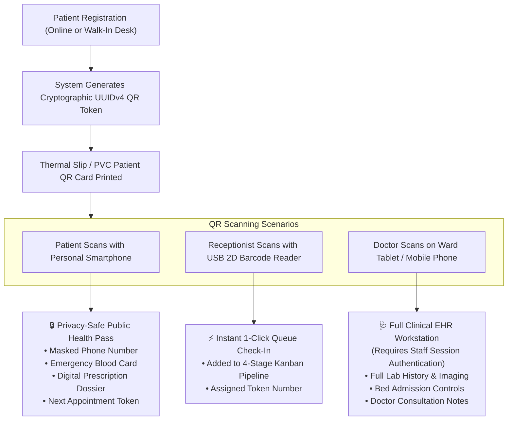

# 📱 Patient QR Lifecycle, 4-Stage Queue & Doctor Consultation Guide

> **Module Documentation:** Digital Patient Identity, Real-Time Queue Pipeline & Clinical Consultation Workflow  
> **Source Files:** `patient_profile_qr.php`, `api/qr.php`, `queue.php`, `book.php`, `patient_book.php`, `online_consult.php`  
> **Target Audience:** Outpatient Department (OPD) Doctors, Head Receptionists, Triage Nurses, IT Integrators

---

## 📋 Table of Contents
1. [Digital Patient Identification Overview](#1-digital-patient-identification-overview)
2. [Unique Lifetime UUID & QR Code Architecture](#2-unique-lifetime-uuid--qr-code-architecture)
3. [Dual-Mode Security View: Public Health Pass vs Clinical Workstation](#3-dual-mode-security-view-public-health-pass-vs-clinical-workstation)
4. [Automatic LAN IP Resolution for Mobile Scanning](#4-automatic-lan-ip-resolution-for-mobile-scanning)
5. [WhatsApp & Telegram Rich Social Preview Cards](#5-whatsapp--telegram-rich-social-preview-cards)
6. [The 4-Stage Hospital Queue Pipeline (Kanban System)](#6-the-4-stage-hospital-queue-pipeline-kanban-system)
7. [Doctor Consultation Modal & Prescription Photo Capture](#7-doctor-consultation-modal--prescription-photo-capture)
8. [Public Patient Self-Booking Portal](#8-public-patient-self-booking-portal)
9. [Remote Online Teleconsultation Workflow](#9-remote-online-teleconsultation-workflow)

---

## 1. Digital Patient Identification Overview

Traditional paper-based patient cards and physical files get lost, torn, or left at home by patients. This results in duplicate patient registrations, fragmented medical records, and repeated diagnostic testing.

The **HMS Patient QR Lifecycle** equips every patient with a **Permanent Lifetime Digital QR Code** issued upon first registration. This QR code acts as their digital health passport across all hospital visits, inpatient admissions, and pharmacy dispensations.



---

## 2. Unique Lifetime UUID & QR Code Architecture

### Generation Mechanics:
When a patient is created in the database, the system generates a **Version 4 Universally Unique Identifier (UUIDv4)** stored in `patients.qr_token`:
```php
function generateUUIDv4() {
    return sprintf('%04x%04x-%04x-%04x-%04x-%04x%04x%04x',
        mt_rand(0, 0xffff), mt_rand(0, 0xffff),
        mt_rand(0, 0xffff),
        mt_rand(0, 0x0fff) | 0x4000,
        mt_rand(0, 0x3fff) | 0x8000,
        mt_rand(0, 0xffff), mt_rand(0, 0xffff), mt_rand(0, 0xffff)
    );
}
```

### Encoded URL Payload:
The QR code encodes a direct, fully qualified URL pointing to the patient profile page:
`http://192.168.1.100/Hospital%20Management%20System/patient_profile_qr.php?token=a1b2c3d4-e5f6-7890-abcd-ef1234567890`

---

## 3. Dual-Mode Security View: Public Health Pass vs Clinical Workstation

To protect patient privacy while providing clinical utility, `patient_profile_qr.php` dynamically inspects the viewer's session:

### Mode A: Public Guest View (Unauthenticated)
Displayed when a patient or family member scans the QR code with any standard smartphone camera app:
- **Masked Phone Number:** Telephone numbers are masked for privacy (e.g. `+91 982•••••10`).
- **Emergency Health Pass:** Clear emergency display of Patient Full Name, Blood Group, Age, Emergency Contact Person, and Primary Hospital Hotline.
- **Active Digital Prescriptions:** View verified digital prescriptions and medication dosages prescribed during their visit.
- **Next Follow-Up Card:** Date and doctor for scheduled follow-ups.
- **Privacy Shield:** Complete confidential clinical notes, financial billing records, and doctor comments are strictly hidden.

### Mode B: Authenticated Staff Workstation (Authenticated Session)
Displayed when an authorized doctor, nurse, or receptionist scans the QR code or opens the profile:
- **Full Clinical Dossier:** Unmasked demographics, complete appointment history, and diagnostic reports.
- **Instant Actions:**
  - **Check-In to Live Queue:** 1-click button to route patient into today's OPD queue.
  - **Quick Bed Admission:** Allocate an inpatient bed in ICU or General Ward.
  - **Upload Medical Files:** Attach lab tests, X-rays, or CT scan DICOM images.
  - **Start Consultation:** Open the active consultation modal.

---

## 4. Automatic LAN IP Resolution for Mobile Scanning

In standard hospital local intranet deployments, web servers often run on `localhost` or `127.0.0.1`. If a QR code contains `http://localhost/...`, a nurse's mobile tablet or patient's phone scanning the QR will fail because `localhost` refers to the mobile device itself!

The HMS includes an intelligent **LAN IP Auto-Resolver** in `patient_profile_qr.php`:
```php
$hostOnly = explode(':', $host)[0];
if (in_array($hostOnly, ['localhost', '127.0.0.1'])) {
    $lanIp = gethostbyname(gethostname());
    if (!empty($lanIp) && $lanIp !== '127.0.0.1' && filter_var($lanIp, FILTER_VALIDATE_IP)) {
        $doctorHost = $lanIp . $portSuffix;
    }
}
```
When QR codes are generated on the server, the system automatically translates `localhost` into the server's real local network IP address (e.g., `192.168.1.50`). Any mobile device connected to the hospital Wi-Fi network can scan and load the record instantly!

---

## 5. WhatsApp & Telegram Rich Social Preview Cards

When hospital receptionists or patients share their digital health pass URL via WhatsApp, SMS, or Telegram, `patient_profile_qr.php` serves complete **Open Graph (OG) Meta Tags**:

```html
<meta property="og:type" content="website" />
<meta property="og:site_name" content="CarePulse Hospital" />
<meta property="og:title" content="🏥 Patient Health Record: Raj Patel (CP-2026-005)" />
<meta property="og:description" content="CarePulse Hospital — Tap to view verified clinical profile, prescriptions, and digital QR health dossier." />
<meta property="og:image" content="https://api.qrserver.com/v1/create-qr-code/?size=500x500&data=..." />
```
Recipients see an elegant, professional hospital preview card with a high-resolution QR thumbnail right inside WhatsApp!

---

## 6. The 4-Stage Hospital Queue Pipeline (Kanban System)

The core OPD engine in `queue.php` organizes patient flow into four distinct, real-time stages:

```
┌──────────────────┐   ┌──────────────────┐   ┌──────────────────┐   ┌──────────────────┐
│ STAGE 1:         │   │ STAGE 2:         │   │ STAGE 3:         │   │ STAGE 4:         │
│ Checked-In       │──>│ Arrived          │──>│ Waiting Lounge   │──>│ In Consultation  │
│ (Desk Check-In)  │   │ (Vitals Triage)  │   │ (Called to OPD)  │   │ (Doctor Cabin)   │
└──────────────────┘   └──────────────────┘   └──────────────────┘   └──────────────────┘
```

### Features of the Queue Pipeline:
- **Interactive Drag-and-Drop / Button Progression:** Move patients across stages with one tap.
- **Slider Mode vs Stack View:** Responsive layout adapting from multi-column desktop displays down to touch-friendly mobile phone swipe cards.
- **Priority Badges:** Color-coded priority tags:
  - 🔴 **Emergency:** Floats immediately to the top of Stage 3.
  - 🟡 **Senior Citizen:** High-priority calling.
  - 🔵 **Normal Appointment.**
- **Department & Doctor Filtering:** Filter the queue by Cardiology, Orthopaedics, Paediatrics, or individual doctor cabins.

---

## 7. Doctor Consultation Modal & Prescription Photo Capture

When the doctor calls the next token from the Waiting Lounge into Stage 4:

### The 4-Step Consultation Modal:
1. **Clinical Diagnosis:**
   - Searchable diagnosis input with autocomplete for common medical conditions (Hypertension, Type 2 Diabetes, Acute Bronchitis, etc.).
2. **Prescription Photo Capture / Upload:**
   - For physicians who prefer handwritten paper prescriptions on official hospital letterheads: Doctor clicks **Capture Prescription** to activate the webcam and photograph the handwritten sheet.
   - The photo is instantly saved as a binary BLOB in MariaDB.
3. **Structured Medications (Digital Rx):**
   - Medicine Name, Dosage (e.g. *500mg*), Frequency (*1-0-1 After Meals*), and Duration (*5 Days*).
4. **Clinical Disposition (Where does the patient go next?):**
   - **Discharge Home:** Patient completes consultation, receives digital prescription, and proceeds to pharmacy.
   - **Send to Diagnostic Lab / Radiology:** Patient routed for blood tests or imaging. When results are uploaded, the patient automatically returns to the doctor's queue!
   - **Admit to Inpatient Bed:** Automatically opens the bed allocation dialog to assign an ICU or Ward bed.

---

## 8. Public Patient Self-Booking Portal

Patients can schedule appointments from home via `patient_book.php`:
- Choose department and consulting physician.
- Browse available time slots pulled dynamically from `doctor_slots.php`.
- Enter personal details and presenting symptoms.
- Receive instant booking reference number and downloadable digital token card.

---

## 9. Remote Online Teleconsultation Workflow

For follow-ups and remote telemedicine, `online_consult.php` provides a dedicated virtual consultation room:
- Encrypted WebRTC video calling between doctor and patient.
- Side-by-side clinical notes and chat messaging.
- Real-time prescription generation during the video call.
- Automated payment and consultation fee tracking (`charges.php`).
